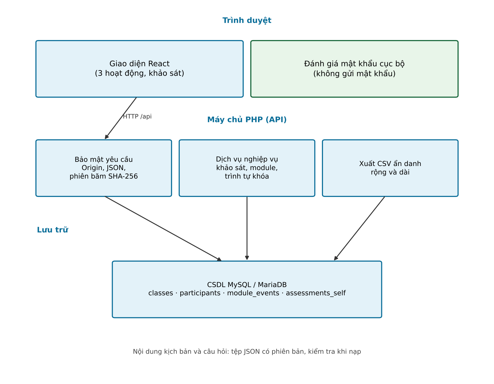
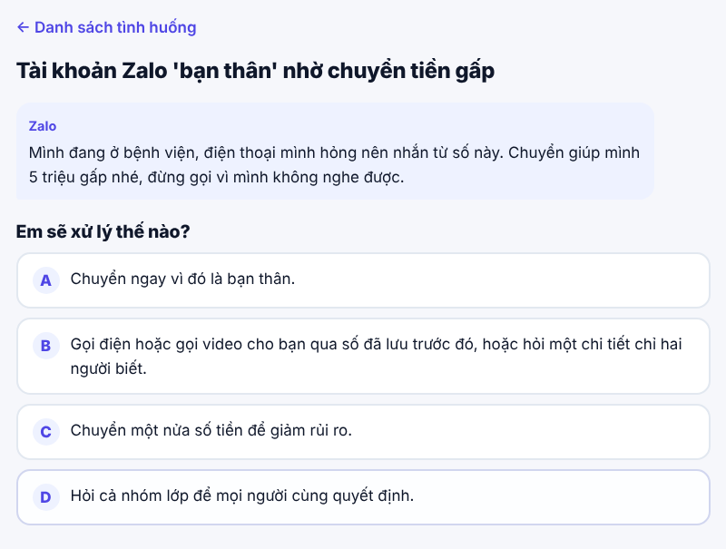
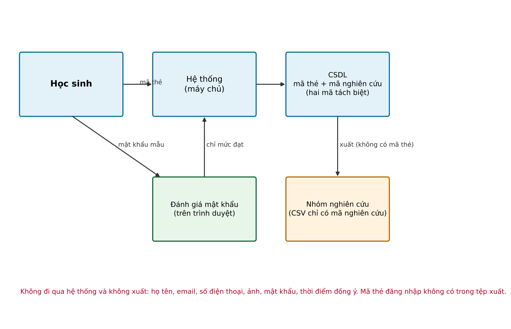

{width=21cm height=29.7cm}

```{=openxml}
<w:p><w:pPr><w:spacing w:before="1500"/></w:pPr></w:p>
```

::: {custom-style="Cover Note"}
**CUỘC THI KHOA HỌC KỸ THUẬT** \
**DÀNH CHO HỌC SINH TRUNG HỌC CƠ SỞ**

NĂM HỌC 2026 – 2027
:::

```{=openxml}
<w:p><w:pPr><w:spacing w:before="1600"/></w:pPr></w:p>
```

::: {custom-style="Cover Note"}
**BÁO CÁO KẾT QUẢ THỰC HIỆN DỰ ÁN DỰ THI**
:::

```{=openxml}
<w:p><w:pPr><w:spacing w:before="700"/></w:pPr></w:p>
```

::: {custom-style="Title"}
AN TOÀN SỐ HỌC ĐƯỜNG
:::

::: {custom-style="Subtitle"}
Xây dựng và đánh giá hệ thống web thực hành nhận diện lừa đảo trực tuyến cho học sinh trung học cơ sở
:::

```{=openxml}
<w:p><w:pPr><w:spacing w:before="1500"/></w:pPr></w:p>
```

::: {custom-style="Cover Note"}
**Lĩnh vực dự thi:** Công nghệ thông tin – An toàn thông tin trong giáo dục

**NĂM 2026**
:::

```{=openxml}
<w:p><w:pPr><w:sectPr><w:pgSz w:w="11906" w:h="16838"/><w:pgMar w:top="1134" w:right="1134" w:bottom="1134" w:left="1701" w:header="709" w:footer="709" w:gutter="0"/><w:titlePg/></w:sectPr></w:pPr></w:p>
```

<!--TOC-->

# TÓM TẮT

**Vấn đề.** Học sinh trung học cơ sở dùng mạng thường xuyên nhưng ít được thực hành nhận diện lừa đảo, và việc học hiếm khi được đo lường. Khảo sát của nhóm (n = 100 mỗi phiếu) cho thấy học sinh đánh giá việc học này rất cần thiết (4,61/5) nhưng mức tự tin chỉ 3,06/5.

**Phương pháp.** Đề tài kết hợp khảo sát thực trạng bằng ba phiếu (học sinh, giáo viên), thiết kế và xây dựng hệ thống web gồm ba hoạt động thực hành, bộ 16 câu đo kiến thức và hành vi ở ba thời điểm (trước, sau và 28 ngày sau khi học), cùng kiểm thử kỹ thuật tự động. Hệ thống không thu họ tên, email hay số điện thoại; mỗi học sinh có hai mã tách biệt, trong đó mã trong dữ liệu nghiên cứu không dùng để đăng nhập.

**Kết quả.** Hệ thống hoàn chỉnh, đạt 321 kiểm tra tích hợp, 14 kiểm thử đơn vị và 23 bước kiểm thử luồng người dùng. Trong khảo sát, 52% học sinh có người thân hoặc bạn bè từng bị lừa qua mạng; 47% giáo viên từng gặp học sinh bị lừa. Dữ liệu đo trước – sau – theo dõi trên hệ thống sẽ được thu thập ở giai đoạn tiếp theo, nên đề tài chưa đưa ra kết luận về hiệu quả học tập; khung phân tích cho bốn giả thuyết đã được xác định trước.

**Từ khóa:** an toàn thông tin; giáo dục an toàn số; học sinh trung học cơ sở; đo lường trước – sau – theo dõi; quyền riêng tư theo thiết kế.

**Lời cam đoan.** Các số liệu khảo sát được tính trực tiếp từ dữ liệu thu thập, không chỉnh sửa; nội dung chưa có dữ liệu được nêu rõ trong báo cáo. Nhóm có dùng công cụ trí tuệ nhân tạo hỗ trợ viết mã và soạn tài liệu, được khai báo ở Phụ lục D.

# CHƯƠNG 1. MỞ ĐẦU

## 1.1. Tính cấp thiết

Học sinh trung học cơ sở dùng điện thoại và mạng xã hội từ sớm, kéo theo các rủi ro lừa đảo: cuộc gọi hoặc tin nhắn mạo danh, đòi đọc mã OTP (mã xác thực dùng một lần), tin trúng thưởng kèm đường dẫn, trang web giả mạo. Khảo sát của nhóm cho thấy 52% trong 100 học sinh có người thân hoặc bạn bè từng bị lừa qua mạng, 47% trong 100 giáo viên từng gặp học sinh bị lừa; học sinh đánh giá việc học nhận diện lừa đảo là rất cần thiết (4,61/5) nhưng mức tự tin chỉ 3,06/5. Giáo viên đánh giá nguy cơ khá cao (3,99/5) và mức tự tin khi hướng dẫn học sinh là 3,39/5. Đây là số liệu do người tham gia tự kê khai, với phạm vi diễn giải nêu ở mục 3.1.3.

Nghiên cứu về giáo dục nhận diện lừa đảo cho trẻ em cho thấy can thiệp có thể cải thiện kết quả trong ngắn hạn nhưng hiệu quả giảm sau khoảng bốn tuần (Lastdrager và cộng sự, 2017). Vì vậy cần công cụ thực hành triển khai được trong trường học, đồng thời đo được sự thay đổi qua nhiều thời điểm.

## 1.2. Mục tiêu nghiên cứu

**Mục tiêu chung:** xây dựng và đánh giá hệ thống web thực hành nhận diện lừa đảo trực tuyến cho học sinh trung học cơ sở, đo được nhận thức và hành vi mà không thu thông tin định danh.

**Mục tiêu cụ thể:** (1) khảo sát thực trạng nhận thức, nhu cầu của học sinh và quan điểm của giáo viên; (2) xây dựng hệ thống ba hoạt động thực hành; (3) xây dựng bộ công cụ đo tách nhận thức và hành vi; (4) thiết kế quy trình đo trước – sau – theo dõi có kiểm soát trình tự ở máy chủ; (5) bảo đảm ẩn danh và quyền riêng tư; (6) xác định khung phân tích để kiểm định giả thuyết khi có dữ liệu đo.

## 1.3. Câu hỏi nghiên cứu và giả thuyết

**Q1.** Điểm kiến thức có khác biệt giữa trước và sau khi học không? **Q2.** Khác biệt còn ý nghĩa sau 28 ngày không? **Q3.** Điểm hành vi tự báo cáo có khác biệt trước – sau không? **Q4.** Thời gian phản hồi và việc dùng gợi ý có liên quan đến độ chính xác khi phân loại tên miền không?

**Giả thuyết:** H1 – điểm kiến thức sau khi học cao hơn trước; H2 – điểm kiến thức ở thời điểm theo dõi cao hơn trước; H3 – điểm hành vi sau khi học cao hơn trước; H4 – học sinh dùng gợi ý đọc tên miền có tỷ lệ phân loại đúng cao hơn. H4 chỉ được diễn giải là tương quan, không phải quan hệ nhân quả.

## 1.4. Đối tượng, phạm vi và phương pháp

**Đối tượng:** học sinh trung học cơ sở (khảo sát khối 6–9) và giáo viên. **Phạm vi:** nhận diện lừa đảo qua điện thoại, tin nhắn; nhận diện tên miền giả; mật khẩu, mã xác thực và quyền riêng tư. Khảo sát thực trạng thu từ 01/11/2026 đến 11/11/2026. Đề tài không kiểm tra hệ thống của bất kỳ tổ chức nào; mọi tên miền trong học liệu đều là tên hư cấu.

**Phương pháp:** (1) nghiên cứu tài liệu; (2) khảo sát bằng phiếu hỏi trực tuyến ẩn danh, phân tích bằng thống kê mô tả; (3) nghiên cứu thiết kế và xây dựng sản phẩm; (4) kiểm thử kỹ thuật tự động; (5) đo lường trước – sau – theo dõi bằng kiểm định phi tham số theo kế hoạch xác định trước.

## 1.5. Ý nghĩa

Về khoa học, đề tài đề xuất thiết kế đo tách nhận thức và hành vi, có kiểm soát trình tự, ghi thời gian phản hồi từng câu, và mô hình dữ liệu tối giản tách mã đăng nhập khỏi mã trong dữ liệu. Về thực tiễn, hệ thống là học liệu tương tác dùng được trong giờ sinh hoạt hoặc ngoại khóa, không cần thiết bị chuyên dụng.

# CHƯƠNG 2. TỔNG QUAN TÀI LIỆU VÀ CƠ SỞ LÝ LUẬN

## 2.1. Khái niệm cốt lõi

**Lừa đảo trực tuyến** (phishing) là hành vi giả mạo chủ thể đáng tin để người nhận cung cấp thông tin hoặc làm theo yêu cầu. **Mã OTP** chỉ dành cho chính chủ tài khoản; người nào xin mã đều có nguy cơ là kẻ lừa đảo. **Tên miền** được đọc từ phải sang trái: đuôi miền ở cuối, phần gốc do đơn vị đăng ký nằm ngay trước đuôi; phần gốc cho biết ai sở hữu địa chỉ, còn tên miền con và đường dẫn thì không. **Nhận thức** là hiểu biết về rủi ro và cách xử lý; **hành vi** là việc có thực hiện biện pháp bảo vệ hay không; đề tài đo riêng hai nội dung này vì nhận thức là điều kiện cần, chưa phải điều kiện đủ để hành vi thay đổi.

**Quyền riêng tư theo thiết kế** là đưa việc bảo vệ dữ liệu vào ngay từ lúc thiết kế. Sweeney (2002) đề xuất mô hình k-anonymity và chỉ ra rằng dữ liệu "đã ẩn danh" vẫn có thể bị tái định danh; vì vậy đề tài áp dụng nguyên tắc tối thiểu hóa thuộc tính, không để dữ liệu nghiên cứu chứa thuộc tính định danh nào.

## 2.2. Nghiên cứu và giải pháp hiện có

Lastdrager và cộng sự (2017) đánh giá đào tạo nhận diện lừa đảo cho học sinh tiểu học; theo phần tóm tắt công bố, mức cải thiện tổng thể khoảng 14% ngay sau đào tạo nhưng không còn ở thời điểm bốn tuần sau đó. Đây là căn cứ để đề tài có khảo sát theo dõi sau 28 ngày. Shadish, Cook và Campbell (2002) phân tích các yếu tố làm sai lệch việc suy ra nguyên nhân trong thiết kế không ngẫu nhiên (trưởng thành tự nhiên, sự kiện bên ngoài, hiệu ứng đo lặp lại); đây là cơ sở để đề tài diễn giải kết quả một cách thận trọng (mục 4.4). NIST (2025) và OWASP (2021) là tài liệu tham khảo cho nội dung về mật khẩu, xác thực và cho việc thiết kế hệ thống (kiểm tra quyền ở phía máy chủ); đề tài không đánh giá hệ thống nào bằng các tiêu chuẩn này.

Theo quan sát của nhóm, tài liệu an toàn thông tin cho học sinh thường ở dạng tờ rơi, bài giảng hoặc video, ít có cơ chế đo trước – sau. Phần tổng quan của đề tài tập trung vào các nghiên cứu quốc tế có thiết kế đo lường rõ ràng; việc đối chiếu với các chương trình giáo dục an toàn thông tin đang triển khai trong nước là hướng mở rộng tiếp theo.

## 2.3. Khoảng trống và điểm cải tiến

**Bảng 1. So sánh cách làm phổ biến và hướng tiếp cận của đề tài**

| Tiêu chí | Cách làm phổ biến (quan sát của nhóm) | Hướng tiếp cận của đề tài |
|---|---|---|
| Cách học | Đọc, xem thụ động | Thực hành tình huống, có giải thích ngay |
| Đo lường | Thường không đo hoặc đo một lần | Ba thời điểm: trước, sau, 28 ngày sau |
| Nhận thức và hành vi | Thường gộp chung | Tách thành hai nhóm câu hỏi |
| Dữ liệu học sinh | Có thể yêu cầu họ tên, email | Không thu danh tính; hai mã tách biệt |
| Mật khẩu | Một số công cụ nhận mật khẩu thật | Mật khẩu mẫu chỉ xử lý trên trình duyệt |

Bảng 1 so sánh cách tiếp cận, không phải kết luận rằng hệ thống tốt hơn giải pháp khác; hiệu quả cần được kiểm chứng bằng dữ liệu đo.

# CHƯƠNG 3. NỘI DUNG VÀ PHƯƠNG PHÁP NGHIÊN CỨU

## 3.1. Khảo sát thực trạng

### 3.1.1. Công cụ

Ba phiếu tạo trên Google Form, ẩn danh (không hỏi họ tên, email, số điện thoại, lớp cụ thể; chỉ hỏi khối lớp): phiếu A (học sinh, trước khi học, 10 câu: khối lớp, thiết bị, thời gian dùng mạng, kinh nghiệm gặp tin đáng ngờ, mức tự tin, nhu cầu học); phiếu B (học sinh, phản hồi sau khi học, 7 câu); phiếu C (giáo viên, 11 câu: nguy cơ, nội dung và hình thức ưu tiên, rào cản, lo ngại quyền riêng tư). Bộ 16 câu đo kiến thức và hành vi nằm trong hệ thống, không đưa vào Google Form để không làm lệch phép đo.

### 3.1.2. Thu thập và xử lý

Dữ liệu thu từ 01/11/2026 đến 11/11/2026; mỗi phiếu có 100 bản hợp lệ (người trả lời đã chọn "đồng ý tham gia"); các phản hồi thử do nhóm tạo không được tính. Phân tích bằng thống kê mô tả: số lượng và tỷ lệ phần trăm cho câu chọn; trung bình và độ lệch chuẩn (SD) cho câu thang 1–5 (1 là thấp nhất, 5 là cao nhất).

### 3.1.3. Phạm vi diễn giải dữ liệu khảo sát

Dữ liệu khảo sát được diễn giải trên ba cơ sở. Thứ nhất, trong quá trình triển khai thu thập, biểu mẫu được rà soát và hoàn thiện cách diễn đạt một số lựa chọn trả lời cho phù hợp với ngữ cảnh học sinh. Các lựa chọn của phiên bản trước có mặt trong dữ liệu được giữ nguyên và đánh dấu †; tỷ lệ của lựa chọn thuộc hai phiên bản được trình bày riêng, không cộng gộp, còn các câu dùng thang 1–5 được tính chung trên toàn bộ 100 bản vì theo ghi nhận của nhóm, nội dung câu hỏi và thang đo được giữ nguyên. Thứ hai, phạm vi áp dụng của kết quả là tập mẫu khảo sát của đề tài (n = 100 mỗi phiếu); đề tài dùng kết quả để mô tả thực trạng và định hướng thiết kế sản phẩm, không dùng để ước lượng tỷ lệ cho một tổng thể rộng hơn. Thứ ba, các chỉ số khảo sát phản ánh mức độ nhận thức và ý kiến tự kê khai của người tham gia ở giai đoạn triển khai hiện tại; phép đo về kiến thức và hành vi được thiết kế riêng, bằng bộ 16 câu trên hệ thống (mục 3.2.3). Để hoàn thiện, đề tài định hướng chuẩn hóa quy trình thử nghiệm trước khi mở rộng, mở rộng quy mô khảo sát, kết hợp các bài kiểm tra tình huống và đo lường trên hệ thống, đồng thời duy trì tách biệt mã định danh nghiên cứu với mã đăng nhập.

## 3.2. Thiết kế và xây dựng hệ thống

### 3.2.1. Yêu cầu và kiến trúc

Từ mục tiêu, khảo sát và tài liệu, nhóm đặt sáu yêu cầu: học bằng tình huống giống thật; giải thích ngay trong hoạt động học (không báo đúng sai trong khảo sát); đo kiến thức và hành vi riêng ở ba thời điểm; kiểm soát trình tự ở máy chủ; không thu thông tin định danh và mật khẩu thử không rời trình duyệt; chạy được trên điện thoại và máy tính. Hệ thống gồm giao diện web (React 19, TypeScript, Tailwind CSS) và máy chủ API viết bằng PHP 8.1 trở lên với cơ sở dữ liệu MySQL hoặc MariaDB (Hình 1). Nội dung kịch bản, câu hỏi nằm trong tệp JSON có phiên bản, được kiểm tra khi nạp (đáp án nằm trong phạm vi, mỗi kịch bản có ít nhất một lựa chọn an toàn, mọi tên miền thuộc danh sách hư cấu).

{width=9.5cm}

*Nguồn: sơ đồ do nhóm tác giả thiết kế, vẽ bằng ngôn ngữ lập trình Python (thư viện Matplotlib).*

### 3.2.2. Ba hoạt động học tập

**Bảng 2. Các hoạt động của hệ thống**

| Hoạt động | Nội dung | Phản hồi cho học sinh |
|---|---|---|
| Sân chơi tình huống | 5 kịch bản (mạo danh, đòi mã OTP, trúng thưởng, nhờ chuyển tiền gấp, trang thanh toán giả); mỗi kịch bản 4 lựa chọn | Đúng/sai, giải thích, dấu hiệu cảnh báo, cho chọn lại |
| Thám tử không gian mạng | 12 địa chỉ (5 chính thống, 7 giả mạo); chế độ đọc tên miền từ phải sang trái | Đúng/sai, giải thích, kiểu đánh lừa |
| Phòng thí nghiệm tài khoản | Thử mật khẩu mẫu; checklist quyền riêng tư 8 bước cho hai nền tảng | Đánh giá ngay trên trình duyệt; câu kiểm tra có giải thích |

Các kiểu đánh lừa trong hoạt động tên miền gồm: thay ký tự (chữ cái thay bằng chữ số hoặc chữ giống), tên chính làm tên miền con, đổi đuôi miền, thêm từ vào tên đúng và tên chính chỉ nằm trong đường dẫn. Hai nút phân loại đổi chỗ theo từng học sinh và từng mục (xác định bằng hàm băm, ổn định khi tải lại trang) để loại thiên lệch vị trí nút. Phần thử mật khẩu ước tính độ mạnh theo độ dài, tập ký tự và trừ điểm các mẫu dễ đoán; thời gian bẻ khóa chỉ để minh họa khái niệm; toàn bộ tính toán chạy trên trình duyệt.

{width=8cm}

*Nguồn: ảnh chụp màn hình sản phẩm với dữ liệu mẫu, do nhóm tác giả thực hiện bằng công cụ chụp tự động; không có người và không có thông tin cá nhân.*

### 3.2.3. Bộ công cụ đo lường

Cùng một bộ 16 câu (phiên bản a-v1; Phụ lục B) dùng ở cả ba giai đoạn để điểm số so sánh được. Mười câu kiến thức có một đáp án đúng, thuộc ba nhóm: cuộc gọi, tin nhắn mạo danh; tên miền và đường dẫn; mật khẩu và xác thực hai lớp. Sáu câu hành vi dùng thang bốn mức (không bao giờ, thỉnh thoảng, thường xuyên, luôn luôn); hai câu được đảo chiều (bấm đường dẫn lạ, chia sẻ mã OTP) để mọi câu cùng hướng, giá trị cao là hành vi an toàn hơn. Hệ thống không báo đúng sai trong khảo sát; đáp án không gửi về trình duyệt trước khi trả lời. Biến số: điểm kiến thức (0–10), điểm hành vi (1–4, sau đảo chiều), thời gian phản hồi (mili giây), việc dùng gợi ý (0/1). Hệ số tin cậy của thang hành vi sẽ tính sau khi thí điểm.

**Bảng 3. Ba giai đoạn đo lường**

| Giai đoạn | Thời điểm | Điều kiện mở (kiểm soát ở máy chủ) |
|---|---|---|
| Khảo sát đầu vào (pre) | Trước khi học | Đã kích hoạt thẻ |
| Khảo sát sau can thiệp (post) | Sau khi xong ba hoạt động | Đã xong khảo sát đầu vào và ba hoạt động |
| Khảo sát theo dõi (delayed) | 28 ngày sau khảo sát sau can thiệp | Đã xong khảo sát sau và đủ 28 ngày |

### 3.2.4. Quyền riêng tư theo thiết kế

\(1) *Tối thiểu hóa dữ liệu:* không thu họ tên, email, số điện thoại, ảnh. (2) *Hai mã tách biệt:* **mã thẻ** (dạng XXXX-XXXX, sinh ngẫu nhiên từ bảng 31 ký tự bỏ ký tự dễ nhầm, khoảng 40 bit) in trên thẻ không ghi tên, là mã đăng nhập duy nhất và không đưa vào dữ liệu nghiên cứu; **mã định danh nghiên cứu** (R cộng chín ký tự) sinh ngẫu nhiên riêng, không suy ra được từ mã thẻ, không đăng nhập được, giữ nguyên khi học sinh được cấp lại thẻ, và là mã duy nhất trong tệp xuất. (3) Cơ sở dữ liệu chỉ lưu giá trị băm SHA-256 của mã phiên. (4) Máy chủ từ chối mọi yêu cầu có trường mật khẩu; không dùng dịch vụ ngoài để kiểm tra mật khẩu. (5) Tham gia tự nguyện, có thể dừng bất cứ lúc nào; thẻ đã dùng không kích hoạt lại được.

{width=9.5cm}

*Nguồn: sơ đồ do nhóm tác giả thiết kế, vẽ bằng ngôn ngữ lập trình Python (thư viện Matplotlib).*

**Ranh giới của tính ẩn danh:** giáo viên phát thẻ trực tiếp nên biết thẻ nào của học sinh nào; dữ liệu ẩn danh với nhóm nghiên cứu và trong tệp xuất, nhưng không ẩn danh với giáo viên phụ trách lớp. Giáo viên thấy mã thẻ, không thấy mã định danh nghiên cứu. Ranh giới này được nêu trong phiếu đồng ý và quản lý bằng sổ phát thẻ giữ riêng.

### 3.2.5. Chức năng theo vai trò

Hệ thống có ba vai trò, kiểm tra quyền ở máy chủ cho mọi thao tác. **Học sinh** kích hoạt thẻ bằng mã trên thẻ hoặc quét mã QR in trên thẻ (mã được điền sẵn, học sinh vẫn phải đọc thông tin và đồng ý), làm khảo sát đầu vào, rồi mở ba hoạt động; xong cả ba thì mở khảo sát sau; sau 28 ngày mở khảo sát theo dõi. **Giáo viên** phát thẻ và theo dõi tiến độ lớp được gán: tạo thẻ (tối đa 20 thẻ mỗi lần), cấp lại thẻ khi học sinh mất (giữ nguyên tiến độ, bắt buộc xác nhận đã đối chiếu sổ phát thẻ, có nhật ký), xem chỉ số tổng hợp và tiến độ từng thẻ nhưng không xem được câu trả lời; in thẻ 85,6 × 54 mm, mười thẻ trên một trang A4, không có họ tên hay ảnh. **Quản trị viên** quản lý tài khoản giáo viên, bộ câu hỏi theo phiên bản (học sinh đã bắt đầu tiếp tục với phiên bản đã ghim), xem số liệu tổng hợp (các ô dưới 5 học sinh tự ẩn) và tải dữ liệu dạng dài hoặc rộng; dữ liệu xuất không chứa họ tên, email, số điện thoại hay mã thẻ.

## 3.3. Thử nghiệm và triển khai

### 3.3.1. Kiểm thử và chạy thử

Nhóm kiểm thử ở bốn mức: kiểm thử tích hợp tự động cho API; kiểm thử đơn vị cho bộ đánh giá mật khẩu; kiểm thử luồng người dùng từ kích hoạt thẻ đến khảo sát theo dõi; kiểm tra giao diện trên trình duyệt ở khổ máy tính và điện thoại; kết quả được tổng hợp ở Bảng 7. Ngày 14/11/2026, nhóm cài và chạy hệ thống trên một máy tính Windows khác theo hướng dẫn từng bước (XAMPP với PHP 8.5.12, Node.js 24.22.2). Qua ảnh chụp màn hình của nhóm, trang đăng nhập, các mục quản trị, việc giáo viên tạo 20 thẻ và xem trước bản in hai trang A4, và việc học sinh kích hoạt thẻ để vào bảng học tập đều hoạt động đúng thiết kế. Lần chạy thử này chưa gồm việc học sinh làm hết khảo sát và ba hoạt động, tải tệp dữ liệu hay in ra giấy; các nội dung đó được kiểm tra bằng kiểm thử tự động.

### 3.3.2. Quy trình triển khai với lớp học

\(1) Nhà trường thống nhất triển khai theo quy định; tạo lớp, cấp tài khoản giáo viên; giáo viên tạo và in thẻ, ghi sổ phát thẻ riêng. (2) Học sinh nhập mã (hoặc quét QR), đọc phiếu đồng ý và tích đồng ý; mỗi thẻ chỉ kích hoạt một lần. (3) Khảo sát đầu vào 16 câu. (4) Ba hoạt động. (5) Khảo sát sau can thiệp. (6) Sau 28 ngày, khảo sát theo dõi.

### 3.3.3. Kế hoạch phân tích dữ liệu đo

Kế hoạch được xác định trước khi thu dữ liệu để hạn chế chọn kiểm định sau khi thấy kết quả: mô tả bằng trung vị, khoảng tứ phân vị và tỷ lệ; phân tích trên các cặp dữ liệu đầy đủ, không thay giá trị thiếu bằng ước lượng; kích thước hiệu ứng r = Z/√N.

**Bảng 4. Giả thuyết và phép kiểm định**

| Giả thuyết | Phép so sánh | Kiểm định (α = 0,05) |
|---|---|---|
| H1 | Điểm kiến thức: đầu vào so với sau can thiệp | Wilcoxon signed-rank |
| H2 | Điểm kiến thức: đầu vào so với theo dõi (báo cáo tỷ lệ bỏ dở) | Wilcoxon; Friedman cho ba giai đoạn |
| H3 | Điểm hành vi sau đảo chiều: đầu vào so với sau can thiệp | Wilcoxon |
| H4 | Độ chính xác theo việc dùng gợi ý | Mann-Whitney hoặc Spearman; diễn giải như tương quan |

### 3.3.4. Đạo đức nghiên cứu

Đề tài cần được nhà trường phê duyệt và có đồng ý bằng văn bản của phụ huynh hoặc người giám hộ trước khi thu dữ liệu từ học sinh; đồng ý điện tử ở đầu phiếu khảo sát chỉ bổ sung, không thay phiếu đồng ý bằng văn bản. Khi công bố kết quả theo lớp, không công bố thống kê của lớp có dưới 5 học sinh; trang số liệu của hệ thống tự ẩn các ô như vậy, còn tệp xuất dữ liệu cần kiểm tra thủ công trước khi công bố.

# CHƯƠNG 4. KẾT QUẢ VÀ THẢO LUẬN

## 4.1. Kết quả khảo sát thực trạng

Bảng 5 (phiếu A: học sinh, trước khi học; B: học sinh, phản hồi sau khi học; C: giáo viên) tách **kết quả đo được** (tính trực tiếp từ 100 bản hợp lệ mỗi phiếu) khỏi **diễn giải của nhóm** (chưa kiểm định). Các chỉ số phản ánh ý kiến tự kê khai của người tham gia.

**Bảng 5. Kết quả chính của ba phiếu khảo sát (n = 100 mỗi phiếu)**

| Phiếu | Chỉ số | Kết quả đo được | Diễn giải của nhóm |
|---|---|---|---|
| A | Tự tin nhận ra tin nhắn, cuộc gọi lừa đảo (1–5) | TB 3,06 (SD 1,19) | Mức tự tin vừa phải |
| A | Mức cần thiết của việc học (1–5) | TB 4,61 (SD 0,58) | Rất cần thiết |
| A | Người thân hoặc bạn bè từng bị lừa qua mạng | 52% "Có" | Rủi ro ở gần học sinh; không phải tỷ lệ học sinh là nạn nhân |
| A | Khối lớp | Lớp 6: 27, lớp 7: 24, lớp 8: 27, lớp 9: 22 | Mẫu trải đều bốn khối |
| B | Mức dễ sử dụng (1–5) | TB 4,27 (SD 0,88) | Đánh giá tích cực, ý kiến tự kê khai; dùng để tham khảo |
| B | Mức rõ của phần giải thích (1–5) | TB 4,25 (SD 0,83) | Đánh giá tích cực, ý kiến tự kê khai; dùng để tham khảo |
| B | Hoạt động hữu ích nhất | 43% "Sân chơi tình huống"; 57% chọn phương án † của biểu mẫu cũ | Không so sánh được ba hoạt động |
| C | Mức nguy cơ lừa đảo của học sinh (1–5) | TB 3,99 (SD 1,02) | Nguy cơ khá cao |
| C | Tự tin khi hướng dẫn học sinh (1–5) | TB 3,39 (SD 1,04) | Chưa hoàn toàn tự tin |
| C | Từng gặp học sinh bị lừa qua mạng | 47% "Có" | Hiện tượng không hiếm |
| C | Rào cản: chưa được tập huấn / thiếu thời gian / thiếu tài liệu | 32% / 40% / 42% | Cần học liệu gọn, dùng trong giờ sinh hoạt |

Mức tự tin (3,06) thấp hơn nhiều so với mức cần thiết (4,61), nhưng đây là hai câu hỏi khác nhau nên không so sánh bằng phép kiểm định; nhóm chỉ xem đó là gợi ý phù hợp với việc ưu tiên thực hành. **Lưu ý về phiếu B:** do 57 trong 100 bản thuộc phiên bản biểu mẫu trước, với các phương án không trùng ba hoạt động hiện có của hệ thống, phiếu B được dùng để tham khảo trải nghiệm chung và **chưa được xem là đánh giá riêng của hệ thống**; phản hồi chuyên biệt về hệ thống sẽ được thu bằng biểu mẫu thống nhất sau khi học sinh sử dụng hệ thống.

## 4.2. Kết quả xây dựng hệ thống và kiểm chứng kỹ thuật

**Bảng 6. Đối chiếu mục tiêu và kết quả**

| Mục tiêu | Kết quả | Minh chứng |
|---|---|---|
| 1. Khảo sát thực trạng | Đã thu 3 phiếu × 100 bản hợp lệ; có hạn chế về biểu mẫu | Mục 4.1; Phụ lục A |
| 2. Hệ thống ba hoạt động | Hoàn thành: 5 tình huống, 12 địa chỉ, checklist 8 bước | Bảng 2; Hình 2 |
| 3. Bộ công cụ đo | Hoàn thành: 16 câu (10 kiến thức, 6 hành vi) | Mục 3.2.3; Phụ lục B |
| 4. Quy trình đo có kiểm soát trình tự | Hoàn thành và được kiểm thử | Bảng 3, Bảng 7 |
| 5. Ẩn danh, quyền riêng tư | Hoàn thành: hai mã tách biệt; tệp xuất không chứa mã thẻ (có kiểm thử tự động) | Mục 3.2.4 |
| 6. Khung phân tích | Đã xác định trước; chưa áp dụng vì chưa có dữ liệu đo | Bảng 4 |

**Bảng 7. Kết quả kiểm chứng kỹ thuật**

| Loại kiểm thử | Phạm vi | Kết quả |
|---|---|---|
| Tích hợp API | Kích hoạt, cấp lại thẻ, xác thực, phân quyền, bộ câu hỏi theo phiên bản, ba hoạt động, khảo sát, khóa trình tự, xuất dữ liệu, tách mã, bảo mật | 321 kiểm tra, đạt toàn bộ |
| Đơn vị | Bộ đánh giá mật khẩu | 14 kiểm thử, đạt toàn bộ |
| Luồng người dùng | Từ kích hoạt thẻ đến khảo sát theo dõi | 23 bước, đạt toàn bộ |
| Giao diện | Biên dịch nghiêm ngặt; bố cục điện thoại và máy tính | Đạt |

Kiểm thử bảo mật xác nhận: yêu cầu ghi từ nguồn không được phép bị từ chối; truy cập khi chưa đăng nhập bị từ chối; đáp án đúng không xuất hiện trong phản hồi khảo sát; mật khẩu thử không xuất hiện trong bất kỳ yêu cầu nào; không mã thẻ nào xuất hiện trong hai tệp dữ liệu xuất. Đây là kiểm chứng kỹ thuật, **không phải kết quả nghiên cứu về hiệu quả học tập**.

## 4.3. Kết quả đo trước – sau – theo dõi

Dữ liệu đo trước – sau – theo dõi do hệ thống ghi nhận **chưa được thu thập** tại thời điểm viết báo cáo; vì vậy đề tài chưa đưa ra kết luận về Q1–Q4 và chưa kiểm định H1–H4. Kết quả sẽ được trình bày theo khung ở Bảng 4 sau khi hoàn tất giai đoạn đo lường.

## 4.4. Thảo luận

**Ưu điểm.** (1) Khép kín từ thực trạng đến sản phẩm. (2) Đo lường có kiểm soát: tách nhận thức và hành vi, khóa trình tự bảo đảm mọi học sinh có dữ liệu đầu vào. (3) Quyền riêng tư từ thiết kế: tệp dữ liệu không cho phép đăng nhập thay học sinh. (4) Dễ triển khai: chạy trên trình duyệt, giáo viên tự tạo và in thẻ. (5) Các thành phần quan trọng đều có kiểm thử tự động.

**Diễn giải khi có dữ liệu.** Nếu H1 và H2 được xác nhận, hoạt động có hiệu quả ngắn hạn và được duy trì; nếu chỉ H1 được xác nhận, phù hợp với sự suy giảm đã ghi nhận ở trẻ em (Lastdrager và cộng sự, 2017); nếu H1 không được xác nhận, cần xem xét hiệu ứng trần và hiệu ứng luyện tập do dùng chung bộ câu hỏi.

**Bảng 8. Phạm vi diễn giải và định hướng hoàn thiện**

| Nội dung | Phạm vi ảnh hưởng | Định hướng hoàn thiện |
|---|---|---|
| Dữ liệu đo trước – sau – theo dõi chưa được thu thập | Chưa đưa ra kết luận về hiệu quả học tập | Thu dữ liệu theo mục 3.3.2; phân tích theo kế hoạch ở mục 3.3.3 |
| Biểu mẫu khảo sát được hoàn thiện diễn đạt trong quá trình thu thập; phiếu B gồm cả phản hồi thuộc phiên bản trước | Một số chỉ số dùng để tham khảo | Giữ nguyên số liệu, đánh dấu †; thu phản hồi chuyên biệt bằng biểu mẫu thống nhất |
| Dữ liệu thuộc tập mẫu khảo sát của đề tài; thiết kế trước – sau không có nhóm đối chứng | Kết quả mô tả tập mẫu; chưa quy kết nguyên nhân | Diễn giải thận trọng; mở rộng quy mô khảo sát; bố trí nhóm đối chứng ở nghiên cứu sau |
| Chỉ số khảo sát là ý kiến tự kê khai; dùng chung một bộ câu cho ba giai đoạn | Có thể chịu ảnh hưởng của mong muốn xã hội và hiệu ứng ghi nhớ | Kết hợp bài kiểm tra tình huống và đo lường trên hệ thống; xây bộ câu song song |
| Nội dung chưa qua thẩm định chuyên gia; độ tin cậy thang hành vi chưa tính | Mức phù hợp của công cụ đo chưa được kiểm định | Thẩm định và thí điểm trước khi thu dữ liệu chính thức |
| Giáo viên biết thẻ nào được phát cho học sinh nào | Dữ liệu ẩn danh với nhóm nghiên cứu, không ẩn danh với giáo viên phụ trách lớp | Sổ phát thẻ giữ riêng; nêu trong phiếu đồng ý; duy trì tách biệt mã nghiên cứu với mã đăng nhập |
| Đăng nhập chưa giới hạn số lần thử; chưa kiểm thử trên máy chủ thực tế; mật khẩu tạm mới ở mức nhắc đổi | Cần hoàn thiện trước khi triển khai diện rộng | Bổ sung giới hạn số lần thử và kiểm thử trên máy chủ thực tế; chuẩn hóa quy trình thử nghiệm |
| Tạo lớp và xem nhật ký còn thực hiện bằng dòng lệnh; tệp xuất chưa tự ẩn nhóm nhỏ; chưa có nhắc khảo sát theo dõi tự động | Cần hỗ trợ kỹ thuật khi triển khai; cần kiểm tra trước khi công bố | Bổ sung màn hình tương ứng; kiểm tra thủ công ngưỡng nhóm nhỏ trước khi công bố |
| Phần tổng quan tập trung vào nghiên cứu quốc tế | Chưa đối chiếu với chương trình trong nước | Mở rộng đối chiếu ở giai đoạn sau |

# CHƯƠNG 5. KẾT LUẬN VÀ KHUYẾN NGHỊ

## 5.1. Kết luận

Đề tài đã khảo sát thực trạng, xây dựng hệ thống web ba hoạt động thực hành về an toàn thông tin cho học sinh trung học cơ sở, kèm mô hình đo kiến thức và hành vi ở ba thời điểm, cơ chế kiểm soát trình tự và công cụ xuất dữ liệu không chứa mã đăng nhập; hệ thống đạt toàn bộ kiểm thử kỹ thuật đã thực hiện. Khảo sát cho thấy học sinh đánh giá việc học nhận diện lừa đảo là rất cần thiết nhưng chưa thật tự tin, và giáo viên cần học liệu hỗ trợ (phạm vi diễn giải nêu ở mục 3.1.3). Hiệu quả của hoạt động học tập (Q1–Q4) sẽ được đánh giá ở giai đoạn nghiên cứu tiếp theo theo khung phân tích đã xác định ở Bảng 4.

## 5.2. Khuyến nghị

**Với nhà trường:** đưa hoạt động vào giờ sinh hoạt hoặc ngoại khóa có giáo viên đầu mối giữ sổ phát thẻ và nhắc khảo sát theo dõi; tập huấn ngắn cho giáo viên (32% giáo viên tham gia khảo sát chọn "chưa được tập huấn" là rào cản); chỉ triển khai khi đã có đồng ý bằng văn bản của phụ huynh.

**Với nhóm nghiên cứu:** chuẩn hóa quy trình thử nghiệm trước khi mở rộng; mở rộng quy mô khảo sát và thu phản hồi học sinh bằng biểu mẫu thống nhất; kết hợp bài kiểm tra tình huống và đo lường trên hệ thống; thẩm định nội dung bởi chuyên gia và thí điểm để tính độ tin cậy; xây bộ câu song song; bổ sung giới hạn số lần đăng nhập, kiểm tra ngưỡng nhóm nhỏ khi xuất dữ liệu, kiểm thử trên máy chủ thực tế; duy trì tách biệt mã định danh nghiên cứu với mã đăng nhập.

**Hướng phát triển:** mở rộng nội dung theo hình thức lừa đảo mới; thiết kế nghiên cứu có nhóm đối chứng ở cấp lớp; theo dõi dài hơn bốn tuần; nhân rộng sang lớp và trường khác với kịch bản điều chỉnh theo địa phương.

# TÀI LIỆU THAM KHẢO

Lastdrager, E., Gallardo, I. C., Hartel, P. H., & Junger, M. (2017). How effective is anti-phishing training for children? *Proceedings of the Thirteenth Symposium on Usable Privacy and Security (SOUPS 2017)*. USENIX Association.

National Institute of Standards and Technology. (2025). *Digital identity guidelines: Authentication and authenticator management* (NIST Special Publication 800-63B-4). U.S. Department of Commerce.

OWASP Foundation. (2021). *OWASP Top 10:2021*. OWASP Foundation.

Shadish, W. R., Cook, T. D., & Campbell, D. T. (2002). *Experimental and quasi-experimental designs for generalized causal inference*. Houghton Mifflin.

Sweeney, L. (2002). k-anonymity: A model for protecting privacy. *International Journal of Uncertainty, Fuzziness and Knowledge-Based Systems, 10*(5), 557–570.

# PHỤ LỤC

## Phụ lục A. Ba phiếu khảo sát thực trạng

**Phiếu A (học sinh, trước khi học; mười câu, câu 0 là xác nhận đồng ý).** (0) Em và phụ huynh đã đọc thông tin nghiên cứu, và phụ huynh đã đồng ý bằng văn bản cho em tham gia chưa? (1) Em đang học khối lớp nào? (2) Em thường dùng thiết bị nào để lên mạng? (chọn nhiều) (3) Mỗi ngày em dùng điện thoại hoặc máy tính khoảng bao lâu để lướt mạng và nhắn tin? (4) Em đã từng gặp loại tin hoặc cuộc gọi nào sau đây? (chọn nhiều) (5) Khi gặp tin nhắn hoặc đường link đáng ngờ, em thường làm gì? (chọn nhiều) (6) Người thân hoặc bạn bè của em đã từng bị lừa qua mạng chưa? (7) Em tự tin đến mức nào khi nhận ra một tin nhắn hoặc cuộc gọi lừa đảo? (8) Theo em, việc học cách nhận diện lừa đảo mạng cần thiết đến mức nào? (9) Em thích học theo cách nào? (chọn nhiều)

**Phiếu B (học sinh, phản hồi sau khi học; bảy câu, câu 0 là xác nhận đồng ý).** (0) Câu xác nhận đồng ý tham gia, như Phiếu A. (1) Hoạt động nào em thấy hữu ích nhất? (2) Các hoạt động dễ sử dụng đến mức nào? (3) Phần giải thích sau mỗi lựa chọn rõ ràng đến mức nào? (4) Điều quan trọng nhất em học được là gì? (5) Em có muốn trao đổi thêm về trải nghiệm của mình không? (6) Em có góp ý nào khác không?

**Phiếu C (giáo viên; mười một câu).** (0) Thầy/cô đã đọc thông tin nghiên cứu và đồng ý tham gia chưa? (1) Thầy/cô đang dạy khối nào? (chọn nhiều) (2) Theo thầy/cô, học sinh gặp nguy cơ lừa đảo qua mạng ở mức nào? (3) Thầy/cô đã từng gặp trường hợp học sinh bị lừa qua mạng chưa? (4) Thầy/cô tự tin đến mức nào khi hướng dẫn học sinh về an toàn số? (5) Nội dung nào cần ưu tiên nhất? (chọn nhiều) (6) Hình thức tổ chức nào phù hợp nhất với lớp? (chọn nhiều) (7) Rào cản lớn nhất khi triển khai? (chọn nhiều) (8) Thầy/cô có sẵn sàng giới thiệu học sinh sử dụng hệ thống này không? (9) Thầy/cô lo ngại đến mức nào về quyền riêng tư dữ liệu của học sinh? (10) Thầy/cô có góp ý nào khác không?

## Phụ lục B. Bộ công cụ đo lường 16 câu (phiên bản a-v1)

Câu kiến thức có ba lựa chọn và một đáp án đúng (không liệt kê đáp án); câu hành vi dùng thang bốn mức: không bao giờ, thỉnh thoảng, thường xuyên, luôn luôn. Nhóm chủ đề: M1 – cuộc gọi, tin nhắn mạo danh; M2 – tên miền và đường dẫn; M3 – mật khẩu, xác thực, quyền riêng tư.

| STT | Loại, nhóm | Nội dung câu hỏi |
|---|---|---|
| 1 | Kiến thức, M1 | Em nhận tin nhắn: "Tài khoản ngân hàng của bạn bị khóa, bấm link để mở lại". Em nên làm gì? |
| 2 | Kiến thức, M1 | Một người gọi tự nhận là shipper và nói cần đọc mã OTP để "xác nhận nhận hàng". Em nên làm gì? |
| 3 | Kiến thức, M1 | Ai trong các trường hợp sau có thể yêu cầu em cung cấp mật khẩu đăng nhập ngân hàng? |
| 4 | Kiến thức, M1 | Khi dùng Wifi công cộng không có mật khẩu, điều gì nên tránh? |
| 5 | Kiến thức, M2 | Địa chỉ uubnd-mophong.io.vn.tra-cuu.test/ có phần gốc (tên do đơn vị đăng ký) là gì? |
| 6 | Kiến thức, M2 | Tên miền "uubnd-m0phong.io.vn" khác "uubnd-mophong.io.vn" ở điểm nào? |
| 7 | Kiến thức, M2 | Trang web có tên chính thức của cơ quan nằm trong đường dẫn (sau dấu /), còn tên miền thật là một tên khác. Trang này có đáng tin không? |
| 8 | Kiến thức, M3 | Trong ba mật khẩu sau, mật khẩu nào khó đoán nhất? |
| 9 | Kiến thức, M3 | Dùng cùng một mật khẩu cho nhiều tài khoản có rủi ro gì? |
| 10 | Kiến thức, M3 | Xác thực hai lớp (hai yếu tố) giúp bảo vệ tài khoản như thế nào? |
| 11 | Hành vi, M3 | Em có bật xác thực hai lớp cho tài khoản mạng xã hội hoặc Zalo không? |
| 12 | Hành vi, M3 | Em có dùng mật khẩu khác nhau cho các tài khoản quan trọng không? |
| 13 | Hành vi (đảo chiều), M1 | Khi nhận tin nhắn có đường link lạ, em có bấm vào xem không? |
| 14 | Hành vi (đảo chiều), M1 | Em có đọc mã OTP cho người khác qua điện thoại không? |
| 15 | Hành vi, M3 | Em có kiểm tra cài đặt quyền riêng tư của tài khoản mạng xã hội không? |
| 16 | Hành vi, M1 | Khi người quen nhờ chuyển tiền qua mạng, em có gọi điện xác minh trước không? |

## Phụ lục C. Số liệu khảo sát chọn lọc

Số liệu tính từ 100 bản hợp lệ mỗi phiếu. Dấu † đánh dấu lựa chọn có trong dữ liệu nhưng không còn trong biểu mẫu hiện hành (biểu mẫu được hoàn thiện diễn đạt trong quá trình thu thập); lựa chọn hiện hành có số 0 là lựa chọn không có người chọn. Câu chọn nhiều có thể cộng lớn hơn 100%; tỷ lệ của lựa chọn cũ và mới không so sánh trực tiếp được.

**Bảng C1. Phiếu B: Hoạt động nào em thấy hữu ích nhất?**

| Lựa chọn | Số người chọn | Tỷ lệ (%) |
|---|---|---|
| Sân chơi tình huống | 43 | 43 |
| Thám tử tên miền; Phòng thí nghiệm tài khoản; Em chưa thử hoạt động nào | 0 | 0 |
| Bài học nhận diện dấu hiệu lừa đảo † | 12 | 12 |
| Câu hỏi kiểm tra kiến thức † | 12 | 12 |
| Trò chơi/đố vui † | 18 | 18 |
| Video hướng dẫn † | 15 | 15 |

Đây là câu hỏi chọn một; tổng các lựa chọn bằng 100 (43 + 12 + 12 + 18 + 15), trong đó 57 bản thuộc các phương án † của phiên bản biểu mẫu trước.

**Bảng C2. Phiếu C: Rào cản lớn nhất khi triển khai?**

| Lựa chọn | Số người chọn | Tỷ lệ (%) |
|---|---|---|
| Thiếu thời gian | 40 | 40 |
| Thiếu tài liệu | 42 | 42 |
| Chưa được tập huấn | 32 | 32 |
| Thiếu thiết bị; Phụ huynh chưa đồng ý; Khác | 0 | 0 |
| Khó kiểm soát mức độ tham gia † | 29 | 29 |
| Lo ngại về quyền riêng tư † | 33 | 33 |
| Thiếu thiết bị hoặc kết nối Internet † | 34 | 34 |

## Phụ lục D. Khai báo sử dụng công nghệ số và trí tuệ nhân tạo

Nhóm sử dụng công cụ lập trình dựa trên mô hình ngôn ngữ lớn (Claude Code, Anthropic) để hỗ trợ viết mã, gỡ lỗi, soạn thảo tài liệu và vẽ sơ đồ; mọi đề xuất đều được nhóm đối chiếu, chạy kiểm thử và chỉnh sửa trước khi đưa vào dự án. Số liệu khảo sát được tính trực tiếp từ dữ liệu thu thập bằng chương trình thống kê, không lấy từ công cụ trí tuệ nhân tạo. Hệ thống An Toàn Số Học Đường không gọi mô hình trí tuệ nhân tạo khi học sinh sử dụng; nội dung các hoạt động là dữ liệu tĩnh do nhóm soạn. Khai báo chi tiết ở phiếu khai báo sử dụng công nghệ số, trí tuệ nhân tạo của hồ sơ dự thi.
