::: {custom-style="Cover Note"}
**TRƯỜNG THCS HOÀNG SA, PHÂN HIỆU LÝ TỰ TRỌNG**
:::

::: {custom-style="Cover Note"}
CUỘC THI KHOA HỌC KỸ THUẬT DÀNH CHO HỌC SINH TRUNG HỌC CƠ SỞ

NĂM HỌC 2026 – 2027

Lĩnh vực: Công nghệ thông tin – An toàn thông tin trong giáo dục
:::

```{=openxml}
<w:p><w:pPr><w:spacing w:before="1000"/></w:pPr></w:p>
```

::: {custom-style="Title"}
AN TOÀN SỐ HỌC ĐƯỜNG
:::

::: {custom-style="Subtitle"}
Xây dựng và đánh giá hệ thống web thực hành nhận diện lừa đảo trực tuyến cho học sinh trung học cơ sở
:::

```{=openxml}
<w:p><w:pPr><w:spacing w:before="1000"/></w:pPr></w:p>
```

::: {custom-style="Cover Note"}
**HỌC SINH THỰC HIỆN**

Trần Cảnh Phúc – Lớp 9/1

Cù Hoàng Linh Trúc – Lớp 9/1

**GIÁO VIÊN HƯỚNG DẪN**

Hoàng Thị Bảo Oanh
:::

```{=openxml}
<w:p><w:pPr><w:spacing w:before="1200"/></w:pPr></w:p>
```

::: {custom-style="Cover Note"}
**NĂM 2026**
:::

<!--TOC-->

# LỜI CAM ĐOAN VÀ LỜI CẢM ƠN

Chúng em xin cam đoan đây là công trình nghiên cứu của nhóm. Các số liệu khảo sát trong báo cáo được tính trực tiếp từ dữ liệu thu thập, không chỉnh sửa; những nội dung chưa có dữ liệu được ghi rõ là chưa có. Mọi tài liệu tham khảo đều được trích dẫn. Nhóm có sử dụng công cụ trí tuệ nhân tạo để hỗ trợ viết mã, gỡ lỗi và soạn thảo tài liệu; việc sử dụng này được khai báo trung thực ở Phụ lục G và trong Phiếu khai báo sử dụng công nghệ số, trí tuệ nhân tạo của hồ sơ dự thi.

Chúng em xin chân thành cảm ơn giáo viên hướng dẫn đã định hướng và góp ý trong suốt quá trình thực hiện đề tài; cảm ơn nhà trường, các thầy cô giáo và các bạn học sinh đã dành thời gian trả lời các phiếu khảo sát.

# TÓM TẮT

**Vấn đề.** Học sinh trung học cơ sở dùng điện thoại và mạng xã hội thường xuyên, nhưng chưa có nhiều cơ hội thực hành nhận diện lừa đảo. Các hình thức hướng dẫn thường ít có cách đo xem học sinh thật sự tiến bộ hay không. Khảo sát của nhóm cho thấy học sinh đánh giá việc học nhận diện lừa đảo là rất cần thiết (trung bình 4,61 trên 5) nhưng mức tự tin còn vừa phải (3,06 trên 5).

**Phương pháp.** Đề tài kết hợp ba việc: (1) khảo sát thực trạng bằng ba phiếu (học sinh, giáo viên) từ 01/11/2026 đến 11/11/2026, mỗi phiếu 100 bản hợp lệ; (2) thiết kế và xây dựng hệ thống web gồm ba hoạt động thực hành (xử lý tình huống, nhận diện tên miền giả, thử mật khẩu và quyền riêng tư), cùng bộ 16 câu đo kiến thức và hành vi ở ba thời điểm (trước, sau và 28 ngày sau khi học); (3) kiểm thử kỹ thuật tự động. Hệ thống không thu họ tên, email hay số điện thoại; học sinh được nhận diện bằng hai mã tách biệt, trong đó mã trong dữ liệu nghiên cứu không dùng để đăng nhập.

**Kết quả.** Hệ thống đã hoàn thành và đạt toàn bộ 321 kiểm tra tích hợp, 14 kiểm thử đơn vị và 23 bước kiểm thử luồng người dùng. Trong khảo sát, 52% học sinh cho biết người thân hoặc bạn bè từng bị lừa qua mạng và 47% giáo viên từng gặp học sinh bị lừa. Học sinh đánh giá hệ thống dễ sử dụng (4,27 trên 5) và phần giải thích rõ ràng (4,25 trên 5); các số liệu này có hạn chế do biểu mẫu khảo sát được sửa trong lúc thu thập. Dữ liệu đo trước–sau–theo dõi trong hệ thống chưa được thu thập nên đề tài chưa kết luận được hiệu quả của hoạt động học tập; khung phân tích cho bốn giả thuyết đã được xác định trước.

**Từ khóa:** an toàn thông tin; giáo dục an toàn số; học sinh trung học cơ sở; hệ thống web tương tác; đo lường trước–sau–theo dõi; quyền riêng tư theo thiết kế.

# DANH MỤC VIẾT TẮT

| Viết tắt | Nghĩa đầy đủ |
|---|---|
| API | Giao diện lập trình ứng dụng (Application Programming Interface) |
| ATTT | An toàn thông tin |
| CSDL | Cơ sở dữ liệu |
| CSRF | Giả mạo yêu cầu liên trang (Cross-Site Request Forgery) |
| CSV | Giá trị phân tách bằng dấu phẩy (Comma-Separated Values), định dạng tệp bảng tính |
| HTTP | Giao thức truyền tải siêu văn bản (HyperText Transfer Protocol) |
| NIST | Viện Tiêu chuẩn và Công nghệ Quốc gia Hoa Kỳ (National Institute of Standards and Technology) |
| OTP | Mã xác thực dùng một lần (One-Time Password) |
| OWASP | Dự án bảo mật ứng dụng web mở (Open Worldwide Application Security Project) |
| PDO | Đối tượng dữ liệu PHP (PHP Data Objects) |
| QR | Mã phản hồi nhanh (Quick Response), mã vạch hai chiều |
| SD | Độ lệch chuẩn (Standard Deviation) |
| SHA-256 | Thuật toán băm an toàn 256 bit (Secure Hash Algorithm 256-bit) |
| SQL | Ngôn ngữ truy vấn dữ liệu có cấu trúc (Structured Query Language) |
| THCS | Trung học cơ sở |
| URL | Địa chỉ tài nguyên trên mạng (Uniform Resource Locator) |

Các thuật ngữ kỹ thuật khác được giải thích bằng ngôn ngữ đơn giản ở Phụ lục F.

# DANH MỤC BẢNG VÀ HÌNH

**Bảng**

- Bảng 1. So sánh cách làm phổ biến và hướng tiếp cận của đề tài
- Bảng 2. Ba phiếu khảo sát thực trạng
- Bảng 3. Ba giai đoạn đo lường
- Bảng 4. Biến số nghiên cứu và cách đo
- Bảng 5. Các hoạt động của hệ thống
- Bảng 6. Kiểu đánh lừa trong hoạt động nhận diện tên miền
- Bảng 7. Giả thuyết, phép kiểm định và điều kiện kết luận
- Bảng 8. Kết quả phiếu A (học sinh, trước khi học)
- Bảng 9. Kết quả phiếu B (học sinh, phản hồi sau khi học)
- Bảng 10. Kết quả phiếu C (giáo viên)
- Bảng 11. Đối chiếu mục tiêu và kết quả đạt được
- Bảng 12. Kết quả kiểm chứng kỹ thuật
- Bảng 13. Khung ghi kết quả đo lường (chưa có dữ liệu)
- Bảng 14. Hạn chế của nghiên cứu và biện pháp khắc phục

**Hình**

- Hình 1. Kiến trúc hệ thống
- Hình 2. Trình tự mở khóa các giai đoạn khảo sát
- Hình 3. Luồng dữ liệu và ranh giới quyền riêng tư
- Hình 4. Bảng học tập của học sinh
- Hình 5. Màn hình khảo sát đầu vào
- Hình 6. Hoạt động Sân chơi tình huống
- Hình 7. Hoạt động Thám tử không gian mạng
- Hình 8. Phòng thí nghiệm tài khoản: kiểm tra mật khẩu mẫu
- Hình 9. Phòng thí nghiệm tài khoản: cài đặt quyền riêng tư
- Hình 10. Trang quản trị: quản lý tài khoản giáo viên
- Hình 11. Trang quản trị: quản lý bộ câu hỏi khảo sát
- Hình 12. Trang quản trị: tải dữ liệu nghiên cứu

Các bảng và hình của phụ lục được đánh số riêng trong từng phụ lục.

# CHƯƠNG 1. MỞ ĐẦU

## 1.1. Tính cấp thiết của đề tài

**Thực trạng.** Học sinh trung học cơ sở dùng điện thoại thông minh và mạng xã hội từ sớm và thường xuyên. Đi kèm là các rủi ro lừa đảo: tin nhắn và cuộc gọi mạo danh, đòi đọc mã OTP, tin nhắn trúng thưởng kèm đường dẫn, và trang web giả mạo. Theo số liệu thống kê được báo Pháp luật TP.HCM (2024) đăng tải, trong tháng 8/2024 cả nước ghi nhận 815 vụ lừa đảo chiếm đoạt tài sản, quá nửa diễn ra trên không gian mạng. Con số này cho thấy quy mô của loại tội phạm này, không cho biết tỷ lệ học sinh là nạn nhân; đề tài không suy diễn từ đó.

**Thực trạng tại địa bàn khảo sát của nhóm.** Qua khảo sát, 52% trong 100 học sinh cho biết người thân hoặc bạn bè từng bị lừa qua mạng; 47% trong 100 giáo viên cho biết đã từng gặp học sinh bị lừa. Học sinh đánh giá việc học nhận diện lừa đảo là rất cần thiết (trung bình 4,61 trên 5) trong khi mức tự tin của các em chỉ ở mức vừa phải (3,06 trên 5). Giáo viên đánh giá nguy cơ khá cao (3,99 trên 5) và mức tự tin khi hướng dẫn học sinh ở mức 3,39 trên 5. Đây là số liệu tự báo cáo, từ một đợt khảo sát có hạn chế được nêu ở mục 3.2.4 và mục 4.1.

**Khoảng trống.** Học sinh ở độ tuổi này thường thành thạo thao tác trên thiết bị nhưng chưa có kiến thức có hệ thống về dấu hiệu lừa đảo. Các nội dung như đọc cấu trúc tên miền, không chia sẻ mã xác thực hay cấu hình quyền riêng tư cần được hướng dẫn trực tiếp và thực hành. Nghiên cứu về giáo dục nhận diện lừa đảo cho trẻ em cho thấy can thiệp có thể cải thiện kết quả trong ngắn hạn, nhưng hiệu quả giảm sau khoảng bốn tuần (Lastdrager và cộng sự, 2017). Vì vậy cần một công cụ thực hành triển khai được trong nhà trường, đồng thời đo được sự thay đổi qua nhiều thời điểm, không chỉ ngay sau khi học.

**Câu hỏi trung tâm của đề tài:** làm thế nào xây dựng một công cụ thực hành cho học sinh trung học cơ sở, đo được sự thay đổi nhận thức và hành vi ở ba thời điểm, mà không thu thập thông tin định danh học sinh?

## 1.2. Mục tiêu nghiên cứu

**Mục tiêu chung.** Xây dựng và đánh giá một hệ thống web thực hành nhận diện lừa đảo trực tuyến cho học sinh trung học cơ sở, có khả năng đo lường nhận thức và hành vi và bảo vệ quyền riêng tư của học sinh.

**Mục tiêu cụ thể.**

1. Khảo sát thực trạng nhận thức và nhu cầu học tập của học sinh, và quan điểm của giáo viên.
2. Thiết kế và xây dựng hệ thống web gồm ba hoạt động thực hành về an toàn thông tin.
3. Xây dựng bộ công cụ đo tách riêng nhận thức (câu có đáp án) và hành vi (tự báo cáo).
4. Thiết kế quy trình đo trước–sau–theo dõi, có kiểm soát trình tự mở khóa ở phía máy chủ.
5. Bảo đảm ẩn danh dữ liệu và quyền riêng tư của học sinh trong toàn bộ vòng đời nghiên cứu.
6. Xác định khung phân tích để kiểm định các giả thuyết khi có dữ liệu đo.

## 1.3. Câu hỏi nghiên cứu và giả thuyết

**Câu hỏi nghiên cứu**

- **Q1.** Điểm kiến thức an toàn thông tin của học sinh có khác biệt giữa trước và sau khi học không?
- **Q2.** Khác biệt này còn ý nghĩa ở thời điểm theo dõi sau 28 ngày không?
- **Q3.** Điểm hành vi tự báo cáo có khác biệt giữa trước và sau khi học không?
- **Q4.** Thời gian phản hồi và việc dùng gợi ý có liên quan đến độ chính xác khi phân loại tên miền không?

**Giả thuyết**

- **H1.** Điểm kiến thức sau khi học cao hơn trước khi học.
- **H2.** Điểm kiến thức ở thời điểm theo dõi cao hơn trước khi học.
- **H3.** Điểm hành vi sau khi học cao hơn trước khi học.
- **H4.** Học sinh dùng gợi ý đọc tên miền có tỷ lệ phân loại đúng cao hơn học sinh không dùng.

H1 đến H3 là giả thuyết có hướng, dựa trên mục đích của hoạt động học tập. H4 là mối liên hệ quan sát được, không phải kết quả của phân bổ ngẫu nhiên, nên chỉ được diễn giải như tương quan.

## 1.4. Đối tượng và phạm vi nghiên cứu

**Đối tượng.** Học sinh trung học cơ sở. Việc thử nghiệm đo lường dự kiến thực hiện trên một đến hai lớp học do nhà trường lựa chọn, quy mô 40 đến 100 học sinh. Tham gia là tự nguyện và có sự đồng ý của phụ huynh hoặc người giám hộ. Khảo sát thực trạng gồm học sinh các khối 6 đến 9 và giáo viên (mục 3.2).

**Phạm vi không gian.** Các cơ sở giáo dục tham gia khảo sát và một cơ sở dự kiến thử nghiệm đo lường [Cần bổ sung: số trường và cách chọn mẫu của đợt khảo sát]. Học sinh dùng thiết bị cá nhân hoặc thiết bị của nhà trường.

**Phạm vi thời gian.** Khảo sát thực trạng từ 01/11/2026 đến 11/11/2026. Quy trình đo lường kéo dài khoảng sáu tuần, trong đó có 28 ngày giữa khảo sát sau khi học và khảo sát theo dõi.

**Phạm vi nội dung.** Nhận diện lừa đảo qua điện thoại và tin nhắn; nhận diện tên miền giả mạo; quản lý mật khẩu, mã xác thực và quyền riêng tư trên ứng dụng nhắn tin và mạng xã hội.

**Giới hạn phạm vi.** Đề tài không kiểm tra hệ thống của bất kỳ cơ quan, tổ chức hay doanh nghiệp nào; mọi tên miền trong nội dung đều là tên hư cấu; đề tài không đánh giá tài khoản thật của học sinh.

## 1.5. Phương pháp nghiên cứu

1. **Nghiên cứu tài liệu:** tìm hiểu các nghiên cứu về giáo dục nhận diện lừa đảo, thiết kế đo lường và các chuẩn bảo mật liên quan (Chương 2).
2. **Khảo sát bằng phiếu hỏi:** ba phiếu thu trực tuyến, ẩn danh, gồm câu chọn một, chọn nhiều và thang đánh giá 1 đến 5; phân tích bằng thống kê mô tả (mục 3.2).
3. **Nghiên cứu thiết kế và xây dựng sản phẩm:** thiết kế hệ thống theo yêu cầu rút ra từ khảo sát và tài liệu, xây dựng, kiểm thử, rồi cải tiến (mục 3.3).
4. **Kiểm thử kỹ thuật:** kiểm thử tự động ở mức tích hợp và đơn vị, kiểm thử luồng người dùng và kiểm tra giao diện trên máy tính, điện thoại (mục 3.4).
5. **Đo lường trước–sau–theo dõi:** đo kiến thức và hành vi ở ba thời điểm bằng bộ 16 câu, phân tích bằng kiểm định phi tham số theo kế hoạch xác định trước (mục 3.4.5).

## 1.6. Ý nghĩa khoa học và thực tiễn

**Ý nghĩa khoa học.** Đề tài đề xuất một thiết kế đo lường tách biến nhận thức và hành vi, có kiểm soát trình tự và ghi thời gian phản hồi ở từng câu. Bộ mã hóa dữ liệu và định dạng xuất hai kiểu được mô tả đầy đủ, có thể dùng lại cho nghiên cứu khác. Đề tài cũng minh họa cách thiết kế một hệ thống nghiên cứu với dữ liệu tối giản, tách mã đăng nhập khỏi mã trong dữ liệu.

**Ý nghĩa thực tiễn.** Hệ thống là học liệu tương tác dùng được trong giờ sinh hoạt hoặc ngoại khóa mà không cần thiết bị chuyên dụng. Nội dung kịch bản bám sát các hình thức lừa đảo phổ biến và có thể điều chỉnh cho trường khác. Nhà trường có thể dùng cùng quy trình đo để đánh giá chương trình của mình.

## 1.7. Bố cục báo cáo

Báo cáo gồm năm chương. Chương 1 nêu lý do, mục tiêu, phạm vi và phương pháp. Chương 2 trình bày cơ sở lý luận và các nghiên cứu liên quan. Chương 3 trình bày khảo sát thực trạng, quy trình thiết kế sản phẩm và thử nghiệm. Chương 4 trình bày kết quả và thảo luận. Chương 5 nêu kết luận và khuyến nghị. Phần cuối là tài liệu tham khảo và các phụ lục minh chứng.

# CHƯƠNG 2. TỔNG QUAN TÀI LIỆU VÀ CƠ SỞ LÝ LUẬN

## 2.1. Các khái niệm cốt lõi

**An toàn thông tin** là việc bảo vệ tính bí mật, tính toàn vẹn và tính sẵn sàng của thông tin và hệ thống. Đề tài thu hẹp khái niệm vào hành vi cá nhân khi dùng thiết bị số: nhận diện lừa đảo, bảo vệ mã xác thực, quản lý mật khẩu và cấu hình quyền riêng tư.

**Lừa đảo trực tuyến** (phishing) là hành vi giả mạo một chủ thể đáng tin để người nhận cung cấp thông tin hoặc làm theo một yêu cầu. Đề tài đưa vào hệ thống bốn dạng: cuộc gọi hoặc tin nhắn mạo danh cơ quan, ngân hàng; yêu cầu đọc mã OTP; tin nhắn trúng thưởng kèm đường dẫn; trang web giả mạo qua tên miền hoặc đường dẫn.

**Mã OTP** (mã xác thực dùng một lần) là mã ngắn gửi về điện thoại để xác nhận một thao tác, ví dụ đăng nhập hoặc chuyển tiền. Mã OTP chỉ dành cho chính chủ tài khoản; người nào xin mã đều có nguy cơ là kẻ lừa đảo.

**Cấu trúc tên miền.** Tên miền được đọc từ phải sang trái theo thứ tự phân cấp: đuôi miền ở cuối, phần gốc là tên do đơn vị đăng ký ngay trước đuôi, các phần còn lại là tên miền con. Phần gốc cho biết ai sở hữu địa chỉ; tên miền con và đường dẫn không cho biết nguồn của trang. Đây là cơ sở kỹ thuật của hoạt động nhận diện tên miền.

**Nhận thức và hành vi.** Nhận thức là hiểu biết về rủi ro và cách xử lý; hành vi là việc có thực hiện biện pháp bảo vệ hay không. Đề tài xem nhận thức là điều kiện cần, chưa phải điều kiện đủ, để hành vi thay đổi, nên đo riêng hai nội dung này. Hành vi trong đề tài được đo bằng tự báo cáo về các thói quen cụ thể như bật xác thực hai lớp, bấm đường dẫn lạ, đọc mã xác thực cho người khác.

**Can thiệp và đo lường trước–sau–theo dõi.** Trong báo cáo, *can thiệp* là việc cho học sinh thực hiện ba hoạt động học tập của hệ thống. Đo trước can thiệp, ngay sau can thiệp và sau một khoảng thời gian là cách phổ biến để đánh giá hiệu quả và mức độ duy trì kết quả.

**Quyền riêng tư theo thiết kế** (privacy by design) là nguyên tắc đưa việc bảo vệ dữ liệu vào ngay từ lúc thiết kế, không bổ sung sau. Các điểm áp dụng được trình bày ở mục 3.3.5.

**Ẩn danh và k-anonymity.** Một tập dữ liệu đạt k-anonymity khi mỗi bản ghi không thể phân biệt với ít nhất k − 1 bản ghi khác theo các thuộc tính có thể suy ra danh tính. Sweeney (2002) đề xuất mô hình này và chỉ ra rằng dữ liệu "đã ẩn danh" vẫn có thể bị tái định danh nếu không kèm chính sách kiểm soát. Đề tài áp dụng nguyên tắc tối thiểu hóa thuộc tính thay vì áp dụng hình thức k-anonymity, vì dữ liệu nghiên cứu không chứa thuộc tính định danh nào.

## 2.2. Các nghiên cứu và giải pháp hiện có

**Giáo dục nhận diện lừa đảo cho trẻ em.** Lastdrager và cộng sự (2017) đánh giá việc đào tạo nhận diện lừa đảo trên học sinh tiểu học. Theo phần tóm tắt công bố, nhóm tác giả ghi nhận mức cải thiện tổng thể khoảng 14% sau đào tạo, nhưng kết quả này không còn ở thời điểm bốn tuần sau đó. Các tác giả kết luận đào tạo có hiệu quả ngắn hạn, và trường học là nơi thuận lợi để đào tạo vì học sinh đến lớp đều đặn. Kết luận này là căn cứ để đề tài thiết kế khảo sát theo dõi sau 28 ngày.

**Thiết kế nghiên cứu không ngẫu nhiên.** Shadish, Cook và Campbell (2002) phân tích các yếu tố làm sai lệch việc suy ra nguyên nhân trong thiết kế không ngẫu nhiên, trong đó có sự trưởng thành tự nhiên, các sự kiện bên ngoài và hiệu ứng của chính việc đo lặp lại. Các yếu tố này là giới hạn trực tiếp của đề tài và được nêu ở mục 4.5.

**Tiêu chuẩn xác thực và rủi ro ứng dụng web.** NIST (2025) ban hành SP 800-63B-4 về xác thực và quản lý bộ xác thực, thay thế phiên bản 2017; tài liệu nêu các yêu cầu về mật khẩu và xác thực nhiều yếu tố. OWASP (2021) xếp kiểm soát truy cập bị lỗi ở vị trí đầu trong Top 10 rủi ro bảo mật ứng dụng web. Đề tài tham khảo các nguyên tắc này khi thiết kế nội dung về mật khẩu và khi xây dựng hệ thống (từ chối mặc định các yêu cầu ghi, kiểm tra quyền ở phía máy chủ). Đề tài không đánh giá hệ thống nào bằng các tiêu chuẩn này.

**Cách hướng dẫn phổ biến.** Theo quan sát của nhóm, tài liệu hướng dẫn an toàn thông tin cho học sinh thường ở dạng tờ rơi, bài giảng hoặc video. Các dạng này ít có cơ chế đo trước và sau khi học, và hiếm khi tách đánh giá nhận thức khỏi đánh giá hành vi. Nhóm chưa tổng hợp đầy đủ các chương trình đã triển khai ở Việt Nam; đây là hạn chế của tổng quan tài liệu (mục 4.5). [Cần bổ sung nguồn: các chương trình giáo dục an toàn thông tin cho học sinh đã triển khai ở Việt Nam]

## 2.3. Khoảng trống và điểm cải tiến của đề tài

**Bảng 1. So sánh cách làm phổ biến và hướng tiếp cận của đề tài**

| Tiêu chí | Cách làm phổ biến (theo quan sát của nhóm) | Hướng tiếp cận của đề tài |
|---|---|---|
| Cách học | Đọc hoặc xem, học sinh tiếp nhận thụ động | Thực hành tình huống; học sinh chọn cách xử lý và nhận giải thích ngay |
| Đo lường | Thường không đo hoặc chỉ đo một lần | Đo ở ba thời điểm: trước, sau và 28 ngày sau khi học |
| Nhận thức và hành vi | Thường gộp chung | Tách thành hai nhóm câu hỏi với cách tính riêng |
| Kiểm soát trình tự | Không có | Máy chủ chỉ mở hoạt động và khảo sát khi đủ điều kiện |
| Dữ liệu học sinh | Có thể yêu cầu họ tên, email | Không thu họ tên, email, số điện thoại; hai mã tách biệt |
| Mật khẩu | Một số công cụ trực tuyến nhận mật khẩu thật | Mật khẩu mẫu được kiểm tra ngay trên trình duyệt, không gửi lên máy chủ |
| Học liệu | Gắn chặt với mã nguồn | Nội dung tách thành tệp có phiên bản, được kiểm tra tự động trước khi dùng |

Bảng 1 là so sánh về cách tiếp cận, không phải kết luận rằng hệ thống tốt hơn các giải pháp khác; hiệu quả thực tế cần được kiểm chứng bằng dữ liệu đo (mục 4.4).

# CHƯƠNG 3. NỘI DUNG VÀ PHƯƠNG PHÁP NGHIÊN CỨU

## 3.1. Quy trình nghiên cứu

Nghiên cứu được thực hiện theo sáu bước:

1. **Khảo sát thực trạng** (01/11/2026 đến 11/11/2026): thu ba phiếu để tìm hiểu nhận thức, nhu cầu của học sinh và quan điểm của giáo viên (mục 3.2).
2. **Thiết kế giải pháp:** từ yêu cầu rút ra từ khảo sát và tài liệu, thiết kế ba hoạt động, bộ đo lường và cơ chế bảo vệ quyền riêng tư (mục 3.3).
3. **Xây dựng sản phẩm:** lập trình hệ thống, soạn nội dung và bộ câu hỏi (mục 3.3). [Cần bổ sung: thời gian thực hiện]
4. **Kiểm thử kỹ thuật và thử nghiệm triển khai:** kiểm thử tự động, chạy thử trên máy tính khác (mục 3.4).
5. **Đo lường trước–sau–theo dõi với học sinh:** theo quy trình ở mục 3.4.3. [Cần bổ sung: thời gian thực hiện]
6. **Phân tích dữ liệu và báo cáo:** theo kế hoạch xác định trước (mục 3.4.5).

## 3.2. Khảo sát thực trạng

### 3.2.1. Mục đích

Tìm hiểu mức tự tin, kinh nghiệm gặp tin đáng ngờ và nhu cầu học tập của học sinh; điều kiện và mối quan tâm của giáo viên khi triển khai; và thu phản hồi của học sinh sau khi học để cải tiến hệ thống.

### 3.2.2. Công cụ

Ba phiếu được tạo trên Google Form (Bảng 2). Nội dung đầy đủ ở Phụ lục A. Các phiếu không hỏi họ tên, email, số điện thoại hay lớp cụ thể (chỉ hỏi khối lớp), và không gắn với mã thẻ trong hệ thống. Bộ 16 câu đo kiến thức và hành vi nằm trong hệ thống, không đưa vào Google Form để không làm lệch phép đo trước–sau.

**Bảng 2. Ba phiếu khảo sát thực trạng**

| Phiếu | Đối tượng | Thời điểm theo thiết kế | Số câu | Nội dung chính |
|---|---|---|---|---|
| A. Phiếu nền | Học sinh | Trước khi học | 10 | Khối lớp, thiết bị, thời gian dùng mạng, kinh nghiệm gặp tin đáng ngờ, mức tự tin, nhu cầu học |
| B. Phiếu phản hồi | Học sinh | Sau khi học | 7 | Hoạt động hữu ích nhất, mức dễ dùng, mức rõ của giải thích, ý kiến mở |
| C. Phiếu giáo viên | Giáo viên | Một lần | 11 | Nguy cơ học sinh gặp phải, nội dung và hình thức ưu tiên, rào cản, lo ngại quyền riêng tư |

### 3.2.3. Thu thập và xử lý dữ liệu

Dữ liệu được thu từ 01/11/2026 đến 11/11/2026. Mỗi phiếu có 100 bản hợp lệ (người trả lời đã chọn "đồng ý tham gia" ở câu đầu). Các phản hồi thử do nhóm tạo khi kiểm tra biểu mẫu không được tính. Dữ liệu thô được lưu trong tài khoản của nhóm, không đưa vào mã nguồn và không đưa vào báo cáo.

Phân tích bằng thống kê mô tả: số lượng và tỷ lệ phần trăm cho câu chọn; trung bình và độ lệch chuẩn (SD) cho câu thang 1 đến 5, với 1 là mức thấp nhất và 5 là mức cao nhất. Bảng số liệu chi tiết ở Phụ lục C.

### 3.2.4. Hạn chế của khảo sát

- **Biểu mẫu được sửa trong lúc thu thập.** Một số lựa chọn trả lời được đổi giữa chừng. Lựa chọn có trong dữ liệu nhưng không còn trong biểu mẫu hiện tại được giữ nguyên và đánh dấu †. Tỷ lệ của lựa chọn cũ và lựa chọn mới không cộng lại thành 100% và không so sánh trực tiếp được. Các câu thang 1 đến 5 được tính chung trên toàn bộ 100 bản, với giả định nội dung các câu này không đổi. [Cần bổ sung: thời điểm sửa biểu mẫu và danh sách các câu đã sửa]
- **Cách chọn mẫu chưa được mô tả đầy đủ.** [Cần bổ sung: phiếu được phát đến những lớp và trường nào, bằng cách nào]. Kết quả không khái quát hóa được cho toàn bộ học sinh hay giáo viên.
- **Tự báo cáo.** Mọi chỉ số đều do người trả lời tự đánh giá, có thể lệch theo mong muốn xã hội.

## 3.3. Thiết kế và xây dựng hệ thống

### 3.3.1. Yêu cầu thiết kế

Từ mục tiêu đề tài, kết quả khảo sát và các nghiên cứu ở Chương 2, nhóm đặt ra sáu yêu cầu:

1. Học bằng thực hành tình huống giống thật, không chỉ đọc.
2. Có giải thích ngay sau mỗi lựa chọn trong hoạt động học; không phản hồi đúng sai trong khảo sát để không ảnh hưởng phép đo.
3. Đo kiến thức và hành vi riêng, ở ba thời điểm, bằng cùng một bộ câu hỏi.
4. Trình tự được kiểm soát ở máy chủ: học sinh phải có dữ liệu đầu vào trước khi học.
5. Không thu thông tin định danh; mật khẩu thử không rời trình duyệt.
6. Chạy được trên điện thoại và máy tính, không cần cài phần mềm.

### 3.3.2. Kiến trúc hệ thống

Hệ thống gồm giao diện web (React 19, TypeScript, Tailwind CSS) và máy chủ API viết bằng PHP 8.1 trở lên với cơ sở dữ liệu MySQL hoặc MariaDB (Hình 1). Giao diện và máy chủ trao đổi qua HTTP trên đường dẫn `/api`. Nội dung kịch bản, câu hỏi và checklist lưu trong tệp JSON có phiên bản, tách khỏi mã nguồn. Khi nạp, mỗi tệp được kiểm tra: đáp án nằm trong phạm vi, mỗi kịch bản có ít nhất một lựa chọn an toàn, mọi tên miền thuộc danh sách được phép.

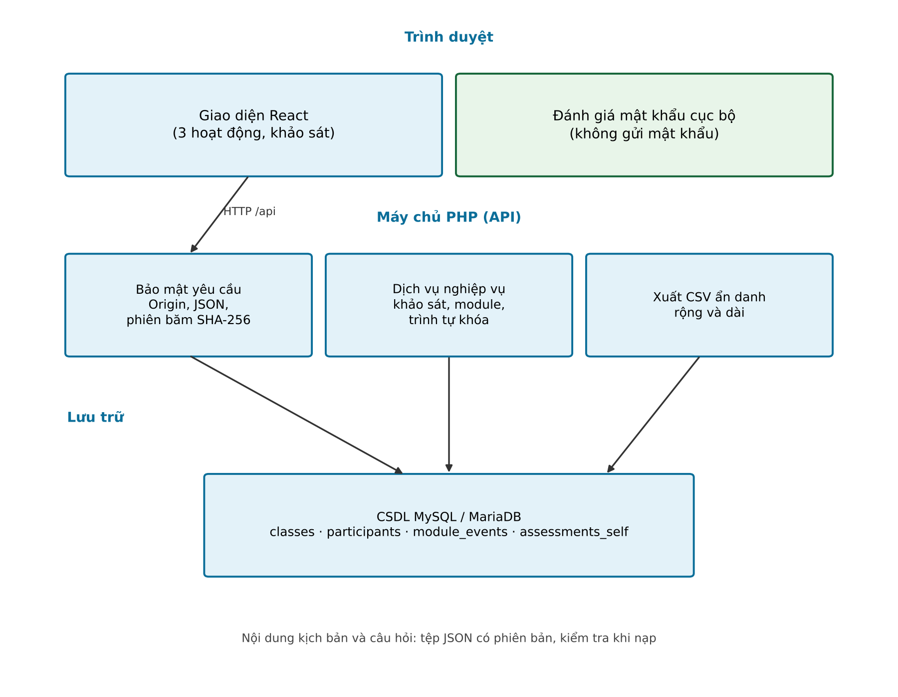{width=85%}

Hệ thống kế thừa cách tách giao diện và máy chủ từ một dự án web tiền thân của nhóm. Khi kế thừa, nhóm bỏ hai thiết kế có rủi ro đã được phân tích: đăng nhập dựa trên thông tin máy chủ không xác minh, và lưu mật khẩu trong mã phía trình duyệt.

### 3.3.3. Ba hoạt động học tập

**Bảng 5. Các hoạt động của hệ thống**

| Hoạt động | Nội dung | Hệ thống ghi nhận | Phản hồi cho học sinh |
|---|---|---|---|
| Sân chơi tình huống | 5 kịch bản, mỗi kịch bản 4 lựa chọn | Mọi lần thử; điểm lấy từ lần đầu | Đúng hoặc sai, giải thích, dấu hiệu cảnh báo, cho chọn lại |
| Thám tử không gian mạng | 12 địa chỉ (5 chính thống, 7 giả mạo) | Mỗi địa chỉ một lần; có dùng gợi ý hay không | Đúng hoặc sai, giải thích, kiểu đánh lừa |
| Phòng thí nghiệm tài khoản | Thử mật khẩu mẫu và checklist 8 bước cho hai nền tảng | Mức mật khẩu cao nhất đạt được; kết quả từng bước | Đánh giá ngay trên trình duyệt; câu kiểm tra có giải thích |

*Hoạt động 1. Sân chơi tình huống.* Năm kịch bản mô phỏng: cuộc gọi tự xưng công an yêu cầu chuyển tiền vào tài khoản "an toàn"; yêu cầu đọc mã OTP với lý do xác minh; tin nhắn trúng thưởng có đường dẫn; tài khoản bạn bè nhờ chuyển tiền gấp; trang thanh toán dịch vụ công giả mạo. Cách xử lý an toàn luôn là chuyển sang kênh đã biết từ trước, không tiếp tục trên kênh do đối phương mở.

*Hoạt động 2. Thám tử không gian mạng.* Học sinh phân loại 12 địa chỉ là chính thống hoặc giả mạo (Bảng 6), mỗi địa chỉ một lần. Khi chưa chắc, học sinh mở chế độ đọc từ phải sang trái: các phần của tên miền được xếp ngược và phần gốc được tô nổi bật. Hai nút phân loại đổi chỗ theo từng học sinh và từng mục (xác định bằng hàm băm, ổn định khi tải lại trang) để loại bỏ thiên lệch vị trí nút mà không đổi đáp án.

**Bảng 6. Kiểu đánh lừa trong hoạt động nhận diện tên miền**

| Kiểu | Mô tả | Cách nhận diện |
|---|---|---|
| Thay ký tự | Một chữ cái bị thay bằng chữ số hoặc chữ cái gần giống | So từng ký tự của phần gốc với tên chính thức |
| Tên chính làm tên miền con | Tên đúng đứng giữa địa chỉ, phần gốc là tên khác | Đọc từ phải sang trái để tìm phần gốc |
| Đổi đuôi | Đuôi miền bị thay đổi | Đuôi không quyết định tính chính thống |
| Thêm từ | Thêm một từ như "đăng nhập" vào tên đúng | Phần gốc đã đổi |
| Tên chính trong đường dẫn | Tên đúng chỉ nằm sau dấu gạch chéo | Đường dẫn không quyết định nguồn trang |

Mọi tên miền trong nội dung là tên hư cấu, dùng đuôi `.test`, `.example` hoặc `.io.vn` kèm dấu hiệu hư cấu trong tên gốc. Lớp kiểm tra nội dung từ chối tên miền thật khi nạp nên không thể đưa địa chỉ thật vào học liệu do sơ suất khi soạn.

*Hoạt động 3. Phòng thí nghiệm tài khoản.* Gồm hai phần. Phần *thử mật khẩu*: học sinh nhập mật khẩu mẫu; hệ thống ước tính độ mạnh theo độ dài và tập ký tự, trừ điểm với các mẫu dễ đoán (chuỗi liên tiếp, ký tự lặp, dãy phím, năm sinh, mật khẩu thông dụng). Thời gian bẻ khóa được ước lượng theo hai giả định tốc độ đoán, chỉ để minh họa khái niệm, không phải số đo thực tế. Toàn bộ tính toán chạy trên trình duyệt. Phần *checklist quyền riêng tư*: tám bước cho hai nền tảng nhắn tin và mạng xã hội; mỗi bước có hướng dẫn, lý do, câu kiểm tra và ô xác nhận đã thực hành trên điện thoại.

### 3.3.4. Bộ công cụ đo lường

Cùng một bộ 16 câu được dùng ở cả ba giai đoạn để các điểm số so sánh được (Bảng 3). Bộ câu hỏi có phiên bản (a-v1); danh sách câu ở Phụ lục B.

**Bảng 3. Ba giai đoạn đo lường**

| Giai đoạn | Mã | Thời điểm | Điều kiện mở | Nội dung |
|---|---|---|---|---|
| Khảo sát đầu vào | pre | Trước khi học | Đã kích hoạt thẻ | 16 câu: 10 kiến thức, 6 hành vi |
| Khảo sát sau can thiệp | post | Sau khi xong ba hoạt động | Đã xong khảo sát đầu vào và ba hoạt động | Cùng bộ 16 câu |
| Khảo sát theo dõi | delayed | 28 ngày sau khảo sát sau can thiệp | Đã xong khảo sát sau can thiệp và đủ 28 ngày | Cùng bộ 16 câu |

Máy chủ kiểm soát trình tự này (Hình 2): trả lỗi 403 nếu học sinh vào hoạt động khi chưa xong khảo sát đầu vào, và từ chối khảo sát sau hoặc theo dõi khi chưa đủ điều kiện. Nhờ vậy mọi học sinh có dữ liệu đầu vào trước khi học.

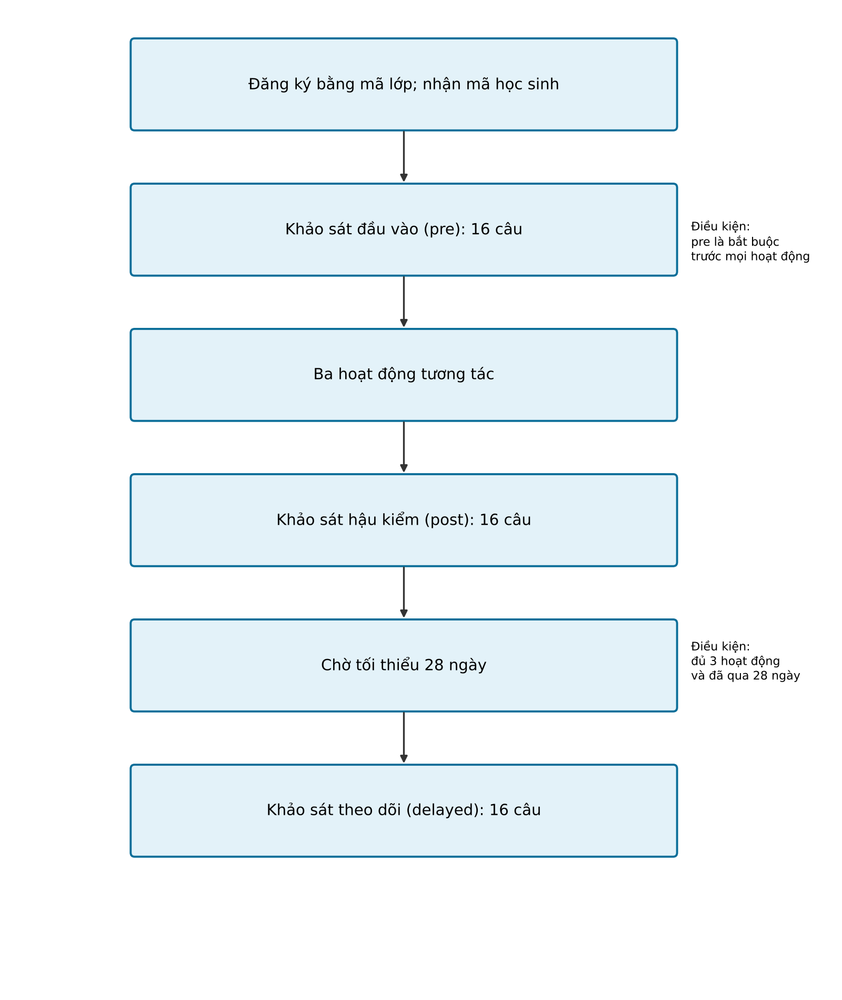{width=80%}

*Mười câu kiến thức* có một đáp án đúng, thuộc ba nhóm: cuộc gọi và tin nhắn mạo danh; tên miền và đường dẫn; mật khẩu và xác thực hai lớp. Đáp án không được gửi về trình duyệt trước khi học sinh trả lời. *Sáu câu hành vi* dùng thang bốn mức: không bao giờ, thỉnh thoảng, thường xuyên, luôn luôn. Hai câu được đảo chiều (bấm đường dẫn lạ, chia sẻ mã OTP); điểm hành vi được tính sau khi đảo để mọi câu cùng hướng, giá trị cao là hành vi an toàn hơn. Trong khảo sát, chọn một đáp án là câu trả lời được gửi và hệ thống chuyển sang câu sau; hệ thống không báo đúng sai.

**Bảng 4. Biến số nghiên cứu và cách đo**

| Biến | Loại | Cách đo | Đơn vị |
|---|---|---|---|
| Điểm kiến thức | Rời rạc | Số câu kiến thức đúng | 0–10 |
| Tỷ lệ kiến thức | Liên tục | Điểm kiến thức ÷ 10 × 100 | % |
| Điểm hành vi | Thứ bậc | Trung bình mức trả lời sau đảo chiều (điểm = 5 − mức với câu đảo) | 1–4 |
| Thời gian phản hồi | Liên tục | Từ khi hiện câu đến khi học sinh chọn | mili giây |
| Hoàn thành hoạt động | Nhị phân | Đạt điều kiện của từng hoạt động | 0 hoặc 1 |
| Sử dụng gợi ý | Nhị phân | Có mở chế độ đọc từ phải sang trái trước khi phân loại | 0 hoặc 1 |

Câu kiến thức ghi đúng hoặc sai; câu hành vi ghi mức trả lời. Hai loại được tách ở cấp cấu trúc dữ liệu để không lẫn khi phân tích. Hệ số tin cậy nội bộ của thang hành vi và độ khó từng câu sẽ được tính sau khi thí điểm, vì hiện chưa có dữ liệu đo.

### 3.3.5. Quyền riêng tư theo thiết kế

Thiết kế áp dụng sáu nguyên tắc, mỗi nguyên tắc tương ứng một điểm kiểm soát trong mã nguồn.

1. **Tối thiểu hóa dữ liệu.** Không thu họ tên, email, số điện thoại, ảnh. Thời điểm đồng ý và phiên bản phiếu đồng ý được lưu để kiểm soát phiên bản nhưng không xuất ra tệp nghiên cứu.
2. **Hai mã tách biệt.** Mỗi học sinh có hai mã độc lập. *Mã thẻ* (dạng XXXX-XXXX) do hệ thống cấp ngẫu nhiên từ bảng 31 ký tự, loại các ký tự dễ nhầm (0, O, 1, I, L), không gian mã khoảng 40 bit, in trên thẻ không ghi tên; đây là mã đăng nhập duy nhất của học sinh nên là thông tin xác thực và không được đưa vào dữ liệu nghiên cứu. *Mã định danh nghiên cứu* (dạng R cộng chín ký tự) sinh ngẫu nhiên riêng khi phát thẻ, không suy ra được từ mã thẻ, không dùng để đăng nhập, và là mã duy nhất xuất hiện trong tệp dữ liệu. Mã này giữ nguyên khi học sinh được cấp lại thẻ nên dữ liệu các giai đoạn vẫn nối được. Nhờ vậy người có tệp dữ liệu không thể đăng nhập thay học sinh.
3. **Băm phiên đăng nhập.** Cơ sở dữ liệu chỉ lưu giá trị băm SHA-256 của mã phiên; đăng nhập lại làm vô hiệu mã phiên cũ.
4. **Mật khẩu không rời trình duyệt.** Máy chủ từ chối mọi yêu cầu có trường mật khẩu và chỉ nhận mức đánh giá tổng hợp.
5. **Không dùng dịch vụ ngoài để kiểm tra mật khẩu.** Ngay cả tiền tố băm gửi đến dịch vụ ngoài cũng gắn với mật khẩu của học sinh.
6. **Tự nguyện và rút lui.** Phiếu đồng ý nêu quyền dừng bất cứ lúc nào. Yêu cầu kích hoạt bị từ chối nếu phiên bản phiếu không khớp, và một thẻ đã dùng không kích hoạt lại được.

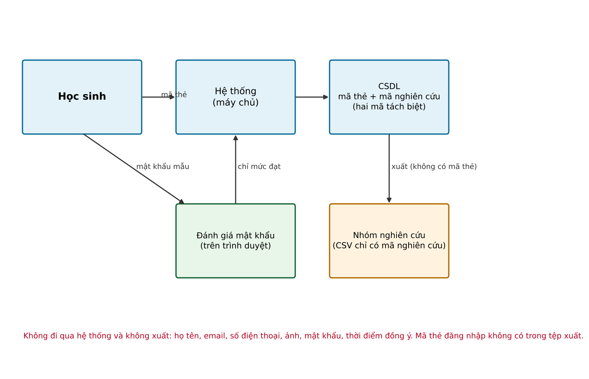{width=85%}

**Ranh giới của tính ẩn danh.** Giáo viên phát thẻ trực tiếp nên biết thẻ nào của học sinh nào; vì vậy dữ liệu ẩn danh đối với nhóm nghiên cứu và đối với tệp xuất, nhưng không ẩn danh đối với giáo viên phụ trách lớp. Giáo viên thấy mã thẻ nhưng không thấy mã định danh nghiên cứu trên giao diện, nên không đối chiếu được tệp dữ liệu với học sinh. Ranh giới này được nêu trong phiếu đồng ý và quản lý bằng sổ phát thẻ giữ riêng.

### 3.3.6. Chức năng theo vai trò

Hệ thống có ba vai trò với quyền hạn khác nhau, được kiểm tra ở máy chủ cho mọi thao tác. Các hình dưới đây chụp từ bản chạy thử với dữ liệu mẫu rất nhỏ; phần thông tin về nhóm thực hiện và nhà trường đã được cắt bỏ.

**Vai trò học sinh.** Học sinh kích hoạt thẻ bằng cách nhập mã trên thẻ hoặc quét mã QR in trên thẻ (mã được điền sẵn, học sinh vẫn phải đọc thông tin và đồng ý). Các lần sau đăng nhập bằng cùng mã thẻ. Sau khi đăng nhập, học sinh làm khảo sát đầu vào; xong khảo sát mới mở ba hoạt động, làm theo thứ tự tùy chọn. Xong cả ba hoạt động thì mở khảo sát sau can thiệp; 28 ngày sau mở khảo sát theo dõi. Bảng học tập (Hình 4) cho học sinh thấy tiến độ, hành trình sáu chặng, thông báo và kết quả của mình.

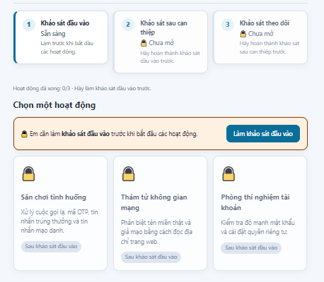{width=70%}

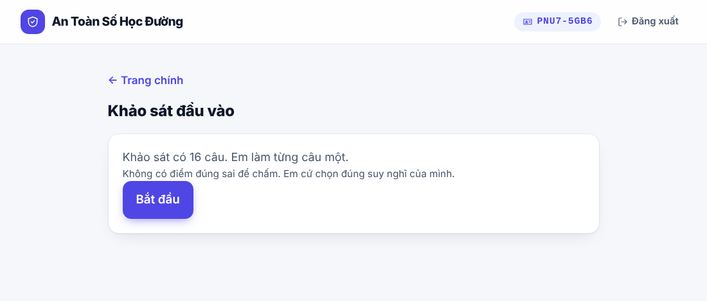{width=70%}

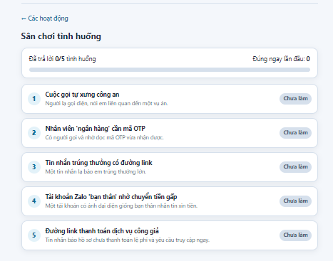{width=70%}

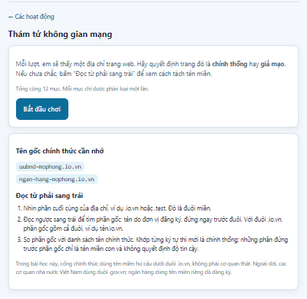{width=70%}

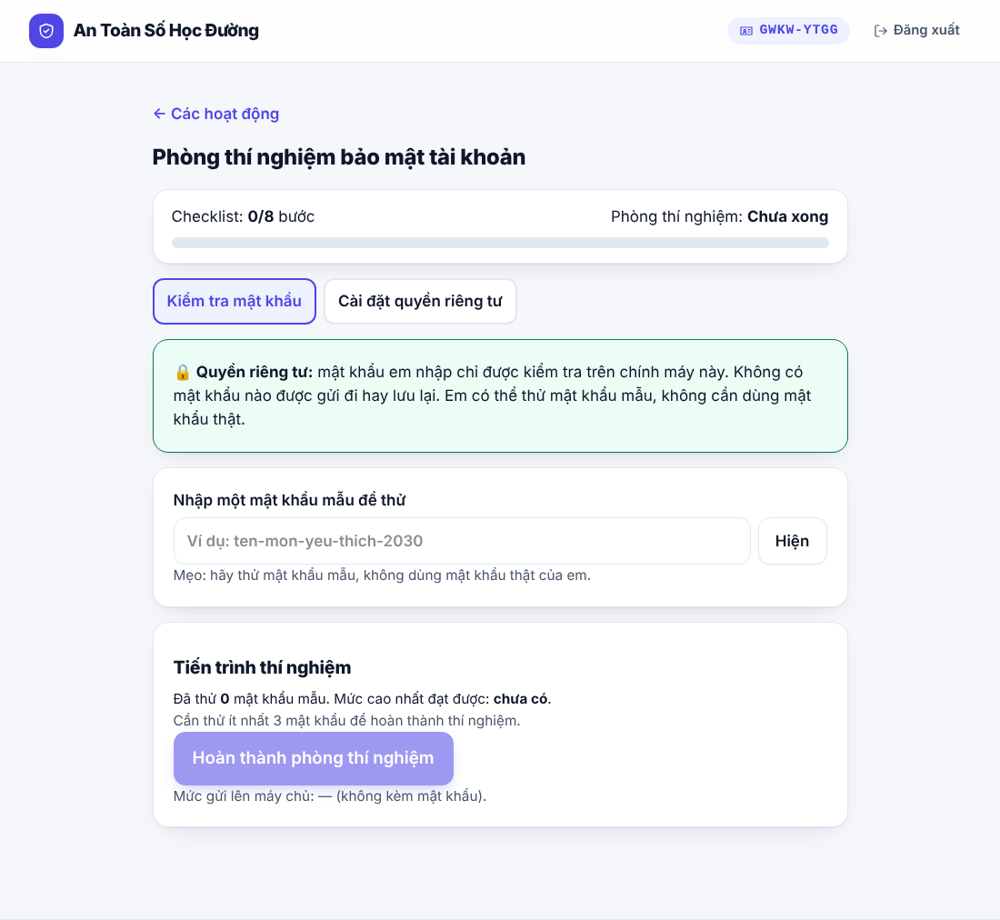{width=70%}

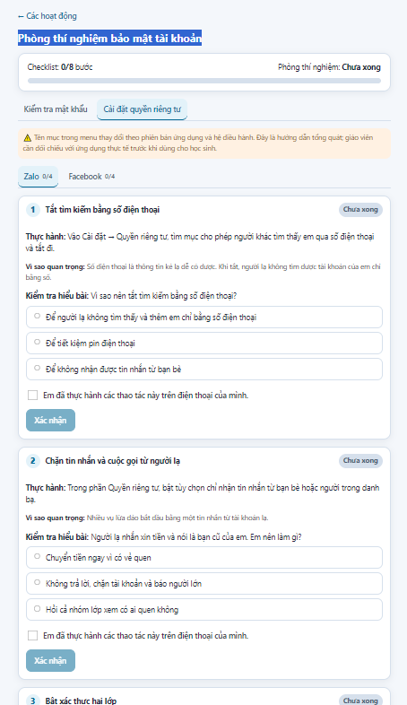{width=70%}

**Vai trò giáo viên.** Giáo viên phát thẻ và theo dõi tiến độ lớp được gán. Trang lớp hiển thị chỉ số tổng hợp (số thẻ đã cấp, tỷ lệ kích hoạt, số học sinh xong từng khảo sát) và danh sách học sinh theo mã thẻ kèm tiến độ từng hoạt động; giáo viên không xem được câu trả lời. Giáo viên tạo thẻ mới (tối đa 20 thẻ mỗi lần, có giới hạn tổng số thẻ mỗi lớp) và cấp lại thẻ cho học sinh làm mất thẻ; thao tác cấp lại giữ nguyên tiến độ, bắt buộc xác nhận đã đối chiếu mã cũ với sổ phát thẻ và được ghi vào nhật ký. Hệ thống hỗ trợ in thẻ theo kích thước chuẩn 85,6 × 54 mm, mười thẻ trên một trang A4, in giấy hoặc lưu PDF qua hộp thoại in của trình duyệt. Mỗi thẻ gồm tên đề tài, lớp, mã kích hoạt và mã QR; thẻ không có họ tên hay ảnh học sinh.

**Vai trò quản trị viên.** Quản trị viên vận hành hệ thống, không gắn với lớp nào và không xem được tiến độ chi tiết của học sinh. Giao diện chia chức năng thành nhóm: tổng quan, quản lý đào tạo, thống kê, và in ấn kèm xuất dữ liệu.

*Quản lý tài khoản giáo viên:* tạo tài khoản, gắn lớp, cấp lại mật khẩu, khóa hoặc mở khóa. Hệ thống không cho khóa chính tài khoản đang đăng nhập hoặc quản trị viên cuối cùng còn hoạt động.

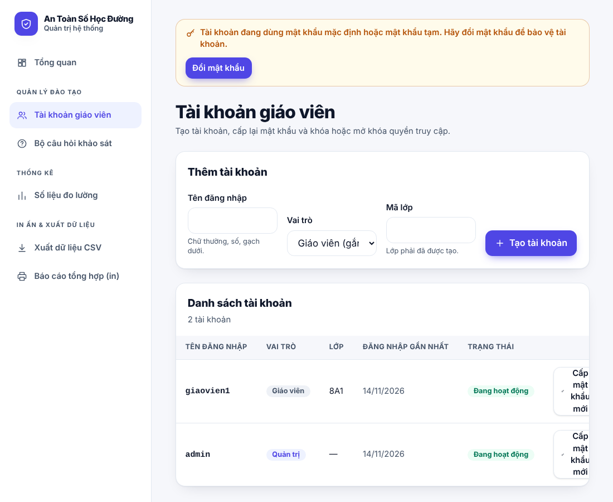{width=60%}

*Quản lý bộ câu hỏi:* xem, thêm, sửa, xóa câu hỏi. Mỗi thay đổi tạo một phiên bản mới, phiên bản cũ giữ nguyên; học sinh đã bắt đầu khảo sát tiếp tục với phiên bản đã ghim lúc bắt đầu, nên dữ liệu các phiên bản khác nhau vẫn xác định rõ.

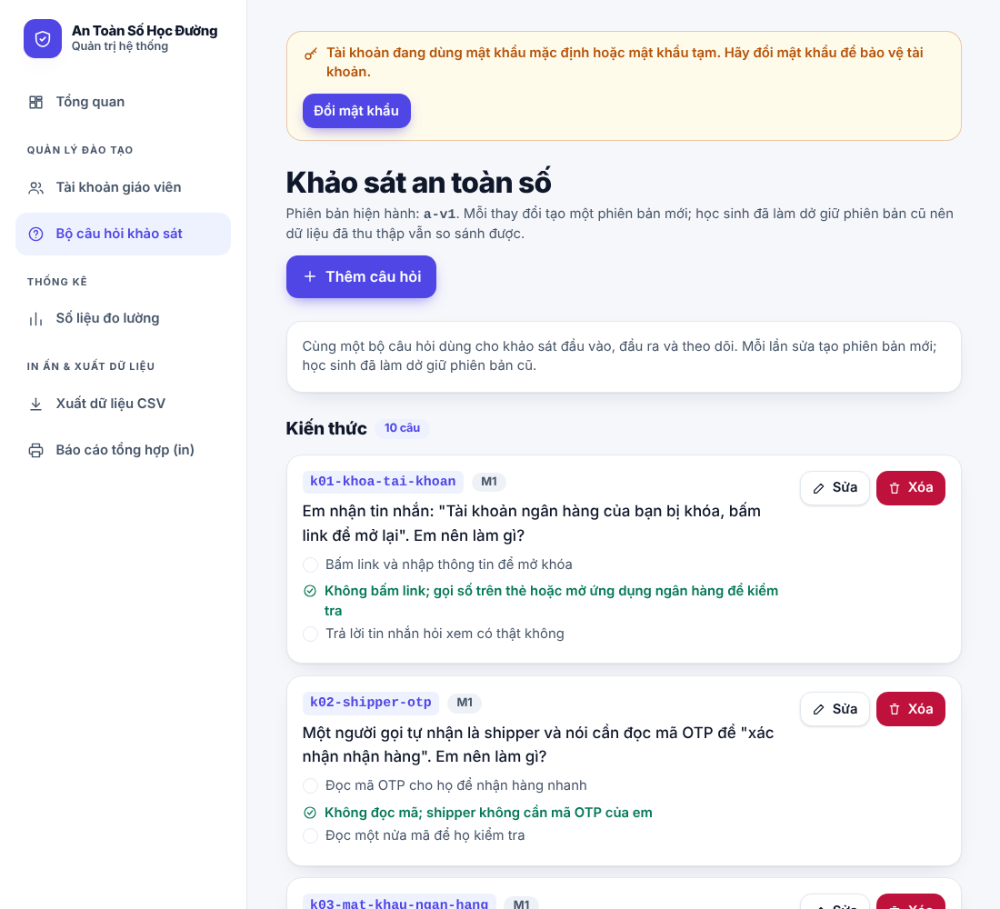{width=60%}

*Theo dõi và xuất dữ liệu:* trang tổng quan hiển thị chỉ số chính và biểu đồ (số học sinh theo thời gian, tiến trình theo chặng, tỷ lệ kích hoạt, điểm theo giai đoạn, tiến độ theo lớp, tỷ lệ đúng theo nhóm chủ đề). Các bảng số liệu chi tiết tự ẩn ô có dưới năm học sinh. Quản trị viên in báo cáo tổng hợp hoặc lưu PDF, và tải dữ liệu dạng dài (mỗi dòng một câu trả lời) hoặc dạng rộng (mỗi dòng một học sinh). Dữ liệu xuất không chứa họ tên, email, số điện thoại hay mã thẻ đăng nhập; học sinh nhận diện bằng mã định danh nghiên cứu.

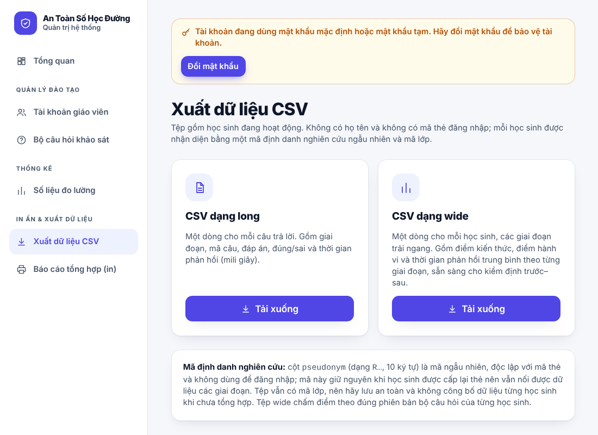{width=70%}

Hệ thống không thực hiện kiểm định thống kê; các kiểm định làm riêng theo kế hoạch ở mục 3.4.5, trên dữ liệu xuất từ hệ thống.

## 3.4. Thử nghiệm và triển khai thực tế

### 3.4.1. Kiểm thử kỹ thuật

Nhóm kiểm thử ở bốn mức: kiểm thử tích hợp tự động cho API (kích hoạt thẻ, xác thực, phân quyền, ba hoạt động, khảo sát, khóa trình tự, xuất dữ liệu, tách mã); kiểm thử đơn vị cho bộ đánh giá mật khẩu; kiểm thử luồng người dùng từ kích hoạt thẻ đến khảo sát theo dõi qua máy chủ trung gian; và kiểm tra giao diện trên trình duyệt ở khổ máy tính và điện thoại. Kết quả ở mục 4.3.

### 3.4.2. Chạy thử trên một máy tính khác

Ngày 14/11/2026, nhóm cài và chạy hệ thống trên một máy tính Windows khác theo hướng dẫn từng bước của dự án (XAMPP với PHP 8.5.12, Node.js 24.22.2, npm 11.19.1). Qua ảnh chụp màn hình của nhóm, trang chủ, đăng nhập giáo viên và quản trị, các mục của trang quản trị, việc giáo viên tạo 20 thẻ và xem trước bản in hai trang A4, và việc học sinh kích hoạt thẻ để vào bảng học tập (ba hoạt động bị khóa đến khi làm khảo sát đầu vào) đều hoạt động đúng thiết kế. Lần chạy thử này chưa gồm việc học sinh làm hết khảo sát và ba hoạt động, tải tệp dữ liệu hay in ra giấy; các nội dung đó đã được kiểm tra bằng kiểm thử tự động (mục 4.3).

### 3.4.3. Quy trình triển khai với lớp học

Giáo viên hướng dẫn trình tự, không tiếp cận dữ liệu của học sinh. Quy trình gồm sáu bước:

1. **Chuẩn bị.** Nhà trường thống nhất triển khai theo quy định. Nhóm tạo lớp, cấp tài khoản giáo viên; giáo viên tạo và in thẻ (mỗi thẻ một mã ngẫu nhiên, không ghi tên) và ghi sổ phát thẻ riêng.
2. **Kích hoạt thẻ.** Học sinh nhập mã (hoặc quét QR), đọc phiếu đồng ý và tích đồng ý. Mỗi thẻ chỉ kích hoạt một lần.
3. **Khảo sát đầu vào.** Học sinh làm 16 câu, không có phản hồi đúng sai.
4. **Học tập.** Học sinh làm ba hoạt động theo thứ tự tùy chọn.
5. **Khảo sát sau can thiệp.** Học sinh làm lại 16 câu sau khi xong ba hoạt động.
6. **Khảo sát theo dõi.** Sau 28 ngày, học sinh làm lại 16 câu.

Học sinh làm mất thẻ đã kích hoạt được giáo viên cấp thẻ mới với tiến độ giữ nguyên, sau khi đối chiếu sổ phát thẻ; mỗi lần cấp lại được ghi nhật ký (người thực hiện, mã cũ, mã mới, thời điểm).

### 3.4.4. Thử nghiệm với học sinh

Nhóm đã thu phản hồi của 100 học sinh bằng phiếu B (mục 4.1). Các thông tin sau về buổi thử nghiệm chưa được ghi lại trong tài liệu của nhóm và cần bổ sung trước khi nộp: [Cần bổ sung: số lớp và số học sinh dùng hệ thống, thời gian và số buổi, cách tổ chức, thiết bị sử dụng]. Dữ liệu do chính hệ thống ghi nhận (khảo sát ba giai đoạn, nhật ký hoạt động) chưa được thu thập tại thời điểm viết báo cáo, nên báo cáo không trình bày kết quả đo trước–sau–theo dõi (mục 4.4).

### 3.4.5. Kế hoạch phân tích dữ liệu đo

Kế hoạch được xác định trước khi thu dữ liệu để hạn chế việc chọn kiểm định sau khi đã thấy kết quả.

- **Mô tả:** trung vị, khoảng tứ phân vị và tỷ lệ cho từng giai đoạn; số học sinh bỏ dở ở từng giai đoạn báo cáo riêng.
- **So sánh trước–sau:** kiểm định Wilcoxon signed-rank cho điểm kiến thức (H1) và điểm hành vi đã điều chỉnh (H3), mức ý nghĩa α = 0,05. Đây là kiểm định phi tham số, phù hợp mẫu nhỏ và dữ liệu không giả định phân phối chuẩn.
- **So sánh ba giai đoạn:** kiểm định Friedman cho điểm kiến thức khi có đủ dữ liệu; cặp trước–theo dõi kiểm định bằng Wilcoxon (H2).
- **Kích thước hiệu ứng:** r = Z / √N cho kiểm định Wilcoxon, kèm khoảng tin cậy khi có thể.
- **Liên hệ:** hệ số tương quan Spearman giữa thời gian phản hồi, cờ dùng gợi ý và độ chính xác (H4); chỉ diễn giải là tương quan.
- **Dữ liệu thiếu:** không thay bằng giá trị ước lượng; phân tích trên các cặp dữ liệu đầy đủ và báo cáo số cặp.

**Bảng 7. Giả thuyết, phép kiểm định và điều kiện kết luận**

| Giả thuyết | Phép so sánh | Tiêu chí | Điều kiện để kết luận |
|---|---|---|---|
| H1 | Điểm kiến thức: đầu vào so với sau can thiệp | Wilcoxon, p < 0,05 | Có đủ cặp dữ liệu hai giai đoạn |
| H2 | Điểm kiến thức: đầu vào so với theo dõi | Wilcoxon, p < 0,05 | Báo cáo tỷ lệ bỏ dở ở giai đoạn theo dõi |
| H3 | Điểm hành vi: đầu vào so với sau can thiệp | Wilcoxon sau điều chỉnh đảo chiều | Báo cáo độ tin cậy của thang hành vi |
| H4 | Độ chính xác theo việc dùng gợi ý | Mann-Whitney hoặc Spearman | Diễn giải như tương quan |

### 3.4.6. Đạo đức nghiên cứu và ẩn danh khi công bố

Đề tài cần được nhà trường phê duyệt và có đồng ý bằng văn bản của phụ huynh hoặc người giám hộ trước khi thu dữ liệu từ học sinh; đồng ý điện tử ở đầu phiếu khảo sát chỉ bổ sung, không thay phiếu đồng ý bằng văn bản. Dữ liệu được lưu an toàn, chỉ dùng cho mục đích nghiên cứu và xóa theo quy định khi kết thúc. Khi công bố kết quả theo lớp, không công bố thống kê của lớp có dưới 5 học sinh để tránh lộ danh tính; trang số liệu của hệ thống tự ẩn các ô như vậy, còn tệp xuất dữ liệu thì cần kiểm tra thủ công trước khi công bố.

# CHƯƠNG 4. KẾT QUẢ VÀ THẢO LUẬN

## 4.1. Kết quả khảo sát thực trạng

Các bảng dưới đây tách **kết quả đo được** (số liệu tính trực tiếp từ 100 bản hợp lệ mỗi phiếu) khỏi **diễn giải của nhóm** (suy luận, chưa kiểm định). Mọi chỉ số là tự báo cáo. Bảng chi tiết từng câu ở Phụ lục C.

**Bảng 8. Kết quả phiếu A (học sinh, trước khi học; n = 100)**

| Chỉ số | Kết quả đo được | Diễn giải của nhóm |
|---|---|---|
| Tự tin khi nhận ra tin nhắn hoặc cuộc gọi lừa đảo (thang 1–5) | Trung bình 3,06 (SD 1,19) | Mức tự tin vừa phải |
| Mức cần thiết của việc học nhận diện lừa đảo (thang 1–5) | Trung bình 4,61 (SD 0,58) | Học sinh đánh giá việc học là rất cần thiết |
| Người thân hoặc bạn bè từng bị lừa qua mạng | 52% chọn "Có" | Rủi ro ở gần học sinh; không phải tỷ lệ học sinh là nạn nhân |
| Khối lớp của người trả lời | Lớp 6: 27, lớp 7: 24, lớp 8: 27, lớp 9: 22 | Mẫu trải đều bốn khối |

Mức tự tin (3,06) thấp hơn nhiều so với mức cần thiết (4,61). Đây là hai câu hỏi khác nhau nên không so sánh bằng phép kiểm định; nhóm chỉ xem đó là gợi ý rằng học sinh thấy cần học nhưng chưa tự tin, phù hợp với việc ưu tiên thực hành.

**Bảng 9. Kết quả phiếu B (học sinh, phản hồi sau khi học; n = 100)**

| Chỉ số | Kết quả đo được | Diễn giải của nhóm |
|---|---|---|
| Mức dễ sử dụng các hoạt động (thang 1–5) | Trung bình 4,27 (SD 0,88) | Đánh giá tích cực, tự báo cáo |
| Mức rõ ràng của phần giải thích (thang 1–5) | Trung bình 4,25 (SD 0,83) | Đánh giá tích cực, tự báo cáo |
| Hoạt động hữu ích nhất | 43% chọn "Sân chơi tình huống"; 57% chọn các phương án † của phiên bản biểu mẫu cũ | Chỉ 43 phiếu dùng danh sách hoạt động hiện tại; không so sánh được ba hoạt động |
| Muốn trao đổi thêm | 20% chọn "Có" | Một phần học sinh có thêm ý kiến muốn chia sẻ |

*Lưu ý quan trọng về phiếu B.* Ở câu "hoạt động hữu ích nhất", 57 trong 100 bản chọn các phương án không có trong biểu mẫu hiện tại (như "Video hướng dẫn", "Trò chơi/đố vui") và không thuộc ba hoạt động của hệ thống. Vì vậy phiếu B **chưa thể xem là đánh giá riêng của hệ thống**, và điểm dễ sử dụng, điểm rõ ràng chỉ nên dùng làm tham khảo. Để đánh giá hệ thống, nhóm sẽ thu lại phản hồi bằng một biểu mẫu cố định, sau khi học sinh thật sự dùng hệ thống (mục 5.2).

**Bảng 10. Kết quả phiếu C (giáo viên; n = 100)**

| Chỉ số | Kết quả đo được | Diễn giải của nhóm |
|---|---|---|
| Mức nguy cơ lừa đảo mạng của học sinh (thang 1–5) | Trung bình 3,99 (SD 1,02) | Giáo viên đánh giá nguy cơ khá cao |
| Tự tin khi hướng dẫn học sinh về an toàn số (thang 1–5) | Trung bình 3,39 (SD 1,04) | Giáo viên chưa hoàn toàn tự tin |
| Đã từng gặp học sinh bị lừa qua mạng | 47% chọn "Có" | Hiện tượng không hiếm theo trải nghiệm của giáo viên tham gia |
| Rào cản "Chưa được tập huấn" | 32% chọn | Cần học liệu hỗ trợ giáo viên |
| Rào cản "Thiếu thời gian" / "Thiếu tài liệu" | 40% / 42% chọn | Cần tài liệu gọn, dùng được trong giờ sinh hoạt |

Ở phiếu C và phiếu A, nhiều câu chọn nhiều có cả lựa chọn cũ (†) và lựa chọn mới nên tỷ lệ từng lựa chọn không cộng lại thành 100% và chỉ mang tính mô tả (Phụ lục C).

## 4.2. Kết quả xây dựng hệ thống

**Bảng 11. Đối chiếu mục tiêu và kết quả đạt được**

| Mục tiêu | Kết quả | Minh chứng |
|---|---|---|
| 1. Khảo sát thực trạng | Đã thu 100 phiếu học sinh trước khi học, 100 phiếu phản hồi và 100 phiếu giáo viên; có hạn chế về biểu mẫu | Mục 4.1; Phụ lục A, C |
| 2. Xây dựng hệ thống ba hoạt động | Hoàn thành: 5 tình huống, 12 địa chỉ, checklist 8 bước cho hai nền tảng | Mục 3.3.3; Hình 4–9 |
| 3. Bộ công cụ đo tách nhận thức và hành vi | Hoàn thành: 16 câu (10 kiến thức, 6 hành vi) | Mục 3.3.4; Phụ lục B |
| 4. Quy trình đo có kiểm soát trình tự | Hoàn thành và được kiểm thử | Bảng 3; Hình 2; Bảng 12 |
| 5. Ẩn danh và quyền riêng tư | Hoàn thành: hai mã tách biệt; tệp xuất không chứa mã thẻ (có kiểm thử tự động) | Mục 3.3.5; Bảng 12 |
| 6. Khung phân tích | Đã xác định trước, chưa áp dụng vì chưa có dữ liệu đo | Mục 3.4.5; Bảng 7, 13 |

## 4.3. Kết quả kiểm chứng kỹ thuật

**Bảng 12. Kết quả kiểm chứng kỹ thuật**

| Loại kiểm thử | Phạm vi | Kết quả |
|---|---|---|
| Tích hợp API | Kích hoạt thẻ, cấp lại thẻ (có xác nhận đối chiếu sổ, nhật ký), xác thực, tài khoản giáo viên và quản trị, đổi mật khẩu, bộ câu hỏi theo phiên bản, ba hoạt động, khảo sát, khóa trình tự, xuất dữ liệu, tách mã định danh nghiên cứu khỏi mã đăng nhập, thống kê theo thời gian, bảo mật | 321 kiểm tra, đạt toàn bộ |
| Đơn vị | Bộ đánh giá mật khẩu | 14 kiểm thử, đạt toàn bộ |
| Biên dịch và đóng gói giao diện | Kiểm tra kiểu nghiêm ngặt, đóng gói | Đạt |
| Luồng người dùng qua máy chủ trung gian | Từ kích hoạt thẻ đến khảo sát theo dõi | 23 bước, đạt toàn bộ |
| Trình duyệt | Luồng học sinh, khóa hoạt động, bố cục điện thoại và máy tính (không tràn ngang ở khổ 390 và 768 px) | Đạt |

Kiểm thử bảo mật xác nhận: yêu cầu ghi từ nguồn không được phép bị từ chối; yêu cầu sai định dạng JSON bị từ chối; truy cập khi chưa đăng nhập bị từ chối; đáp án đúng không xuất hiện trong phản hồi khảo sát; mật khẩu thử không xuất hiện trong bất kỳ yêu cầu nào; không mã thẻ nào của học sinh xuất hiện trong hai tệp dữ liệu xuất. Đây là kiểm chứng kỹ thuật, **không phải kết quả nghiên cứu về hiệu quả học tập**. Các kiểm thử được chạy lần cuối trong quá trình phát triển và cần chạy lại trước khi nộp.

## 4.4. Kết quả đo lường trước–sau–theo dõi

Dữ liệu đo do hệ thống ghi nhận (khảo sát đầu vào, sau can thiệp, theo dõi) **chưa được thu thập** tại thời điểm viết báo cáo, nên đề tài chưa trả lời được các câu hỏi Q1 đến Q4 và chưa kiểm định H1 đến H4. Bảng 13 là khung ghi kết quả khi có dữ liệu; các ô để trống và không điền giá trị giả định.

**Bảng 13. Khung ghi kết quả đo lường (chưa có dữ liệu)**

| Chỉ số | Đầu vào (pre) | Sau can thiệp (post) | Theo dõi (delayed) | Kiểm định | p | r |
|---|---|---|---|---|---|---|
| Điểm kiến thức, trung vị [IQR] | | | | Wilcoxon / Friedman | | |
| Điểm hành vi đã điều chỉnh, trung vị [IQR] | | | | Wilcoxon | | |
| Thời gian phản hồi trung bình (ms) | | | | Mô tả | — | — |
| Số học sinh có đầy đủ dữ liệu | | | | — | — | — |

## 4.5. Thảo luận

### 4.5.1. Ưu điểm

- **Khép kín từ thực trạng đến sản phẩm.** Hệ thống được thiết kế từ nhu cầu nêu trong khảo sát (cần thực hành, cần giải thích ngay) và từ các nghiên cứu về hiệu quả ngắn hạn của đào tạo nhận diện lừa đảo.
- **Thiết kế đo lường có kiểm soát.** Tách nhận thức và hành vi cho phép phát hiện trường hợp nhận thức thay đổi mà hành vi chưa đổi, và ngược lại. Khóa trình tự bảo đảm mọi học sinh có dữ liệu đầu vào.
- **Quyền riêng tư được thiết kế từ đầu.** Không thu thông tin định danh; mật khẩu thử không rời trình duyệt; tệp dữ liệu không cho phép đăng nhập thay học sinh. Cái giá là kiến trúc phức tạp hơn, đổi lại giảm rủi ro lớn nhất liên quan đến dữ liệu nhạy cảm.
- **Dễ triển khai.** Chạy trên trình duyệt, giáo viên tự tạo và in thẻ, không cần tài khoản cá nhân của học sinh; đã chạy thử được trên một máy tính khác theo hướng dẫn.
- **Kiểm chứng kỹ thuật đầy đủ.** Các thành phần quan trọng đều có kiểm thử tự động.

### 4.5.2. Diễn giải giả thuyết khi có dữ liệu

- Nếu H1 và H2 được xác nhận, hoạt động học tập có hiệu quả ngắn hạn và được duy trì trong khoảng theo dõi.
- Nếu H1 được xác nhận nhưng H2 không, kết quả phù hợp với sự suy giảm sau can thiệp từng được ghi nhận ở trẻ em (Lastdrager và cộng sự, 2017).
- Nếu H1 không được xác nhận, cần xem xét hiệu ứng trần (học sinh đã biết trước nội dung) và hiệu ứng luyện tập do dùng chung bộ câu hỏi.
- Nếu H3 không được xác nhận, cần xem xét giới hạn của tự báo cáo, vì học sinh có thể trả lời theo mong muốn xã hội.

### 4.5.3. Hạn chế

**Bảng 14. Hạn chế của nghiên cứu và biện pháp khắc phục**

| Mã | Hạn chế | Tác động | Biện pháp |
|---|---|---|---|
| G1 | Chưa có dữ liệu đo trước–sau–theo dõi từ hệ thống | Chưa kết luận được hiệu quả | Thu dữ liệu theo quy trình 3.4.3; phân tích theo mục 3.4.5 |
| G2 | Biểu mẫu khảo sát bị sửa trong lúc thu thập | Tỷ lệ lựa chọn cũ và mới không so sánh được; giả định các câu thang 1–5 không đổi | Giữ nguyên số liệu và đánh dấu †; báo cáo riêng; xác nhận thời điểm sửa; khi khảo sát lại dùng một biểu mẫu cố định |
| G3 | Phiếu B không phản ánh riêng ba hoạt động của hệ thống (57/100 chọn phương án cũ) | Không xem là đánh giá của hệ thống | Thu lại phản hồi bằng biểu mẫu cố định sau khi học sinh dùng hệ thống |
| G4 | Cách chọn mẫu và phạm vi khảo sát chưa được mô tả đầy đủ | Không khái quát hóa được | Bổ sung mô tả; báo cáo kích thước mẫu |
| G5 | Mọi chỉ số đều tự báo cáo | Sai lệch do mong muốn xã hội | Ghi nhận là hạn chế; cân nhắc đo khách quan ở nghiên cứu sau |
| G6 | Cùng một bộ câu hỏi cho ba giai đoạn | Điểm có thể tăng do ghi nhớ | Xây dựng bộ câu song song cho sau can thiệp và theo dõi |
| G7 | Nội dung chưa được chuyên gia thẩm định; độ tin cậy thang hành vi chưa tính | Có thể không đo đúng khái niệm; điểm hành vi có thể không ổn định | Thẩm định trước khi thu dữ liệu chính thức; thí điểm để tính hệ số tin cậy |
| G8 | Không có nhóm đối chứng ngẫu nhiên; quy mô mẫu nhỏ | Không quy hoàn toàn thay đổi cho hoạt động học tập; độ mạnh thống kê hạn chế | Diễn giải thận trọng; báo cáo kích thước hiệu ứng và khoảng tin cậy; không khái quát hóa |
| G9 | Giáo viên biết danh tính gắn với mã thẻ; cấp lại thẻ phụ thuộc sổ phát thẻ | Ẩn danh không đầy đủ với giáo viên; mất sổ thì không tìm lại được mã | Sổ phát thẻ giữ riêng; nêu trong phiếu đồng ý; bắt buộc xác nhận đối chiếu sổ khi cấp lại, có nhật ký |
| G10 | Đăng nhập bằng mã chưa giới hạn số lần thử; chưa kiểm thử trên máy chủ thực tế; mật khẩu tạm chỉ được nhắc đổi | Rủi ro bảo mật khi triển khai rộng | Bổ sung giới hạn theo địa chỉ mạng và kiểm thử trên máy chủ thực tế trước khi triển khai rộng |
| G11 | Tạo lớp và xem nhật ký thao tác vẫn dùng dòng lệnh hoặc truy vấn; chưa tự nhắc khảo sát theo dõi; tệp xuất không tự ẩn nhóm nhỏ | Cần kỹ năng kỹ thuật; tỷ lệ quay lại có thể thấp; nguy cơ suy luận danh tính | Bổ sung màn hình tương ứng; giáo viên lên lịch nhắc; kiểm tra thủ công trước khi công bố |
| G12 | Tên mục menu của ứng dụng mạng xã hội thay đổi theo phiên bản | Hướng dẫn có thể lỗi thời | Đối chiếu với ứng dụng thực tế trước khi dùng |

Tổng quan tài liệu còn thiếu thông tin về các chương trình giáo dục an toàn thông tin đã triển khai tại Việt Nam, và chưa có đánh giá về mức độ phổ biến của từng hình thức lừa đảo đối với học sinh; hai điểm này cần được bổ sung khi có điều kiện tra cứu đầy đủ.

# CHƯƠNG 5. KẾT LUẬN VÀ KHUYẾN NGHỊ

## 5.1. Kết luận

Đề tài đã khảo sát thực trạng, thiết kế và xây dựng một hệ thống web gồm ba hoạt động thực hành về an toàn thông tin cho học sinh trung học cơ sở, kèm mô hình đo kiến thức và hành vi ở ba thời điểm, cơ chế kiểm soát trình tự và công cụ xuất dữ liệu không chứa mã đăng nhập. Hệ thống đạt toàn bộ các kiểm thử kỹ thuật đã thực hiện.

**Đóng góp chính của đề tài:**

1. Bằng chứng khảo sát ban đầu (có nêu rõ hạn chế) cho thấy học sinh đánh giá việc học nhận diện lừa đảo là rất cần thiết nhưng chưa thật tự tin, và giáo viên cần học liệu hỗ trợ.
2. Một hệ thống có thể tái sử dụng, trong đó nội dung tách khỏi mã nguồn và được kiểm tra tự động trước khi dùng.
3. Một thiết kế đo lường tách nhận thức và hành vi, ghi thời gian phản hồi từng câu, có bộ mã hóa dữ liệu đầy đủ.
4. Một mô hình quyền riêng tư cho nghiên cứu có học sinh: không thu thông tin định danh, mật khẩu không rời thiết bị, mã đăng nhập tách khỏi mã trong dữ liệu.

**Điều đề tài chưa làm được.** Đề tài chưa khẳng định hiệu quả của hoạt động học tập, vì chưa có dữ liệu đo trước–sau–theo dõi; các câu hỏi Q1 đến Q4 còn để ngỏ. Mọi kết luận về hiệu quả phải chờ dữ liệu và phân tích theo kế hoạch ở mục 3.4.5.

## 5.2. Khuyến nghị

**Đối với nhà trường.**

- Đưa hoạt động vào giờ sinh hoạt hoặc ngoại khóa, có giáo viên hướng dẫn, mỗi lớp một giáo viên làm đầu mối giữ sổ phát thẻ và nhắc khảo sát theo dõi.
- Tổ chức tập huấn ngắn cho giáo viên (32% giáo viên tham gia khảo sát chọn "chưa được tập huấn" là rào cản).
- Chỉ triển khai khi đã có đồng ý bằng văn bản của phụ huynh.

**Đối với nhóm nghiên cứu (việc cần làm trước khi thu dữ liệu chính thức).**

- Bổ sung thông tin còn thiếu về khảo sát: thời điểm sửa biểu mẫu, cách chọn mẫu, số lớp và trường tham gia.
- Thu lại phản hồi của học sinh bằng một biểu mẫu cố định sau khi các em dùng hệ thống.
- Thẩm định nội dung bởi chuyên gia; thí điểm để tính độ tin cậy của thang hành vi và độ khó từng câu.
- Xây dựng bộ câu song song để giảm hiệu ứng luyện tập ở khảo sát sau và theo dõi.
- Bổ sung giới hạn số lần đăng nhập, kiểm tra ngưỡng nhóm nhỏ khi xuất dữ liệu, và kiểm thử trên máy chủ thực tế.

**Hướng phát triển và ứng dụng rộng rãi.**

1. Mở rộng nội dung sang các nền tảng và hình thức lừa đảo mới khi có số liệu về mức độ phổ biến.
2. Thiết kế nghiên cứu có nhóm đối chứng ở cấp lớp để tăng khả năng suy luận nguyên nhân.
3. Theo dõi dài hơn bốn tuần để đánh giá mức duy trì kết quả.
4. Nhân rộng sang các lớp và trường khác: dùng lại hệ thống và quy trình đo (phần hướng dẫn chạy và sử dụng theo vai trò đi kèm dự án), điều chỉnh kịch bản cho phù hợp địa phương.

# TÀI LIỆU THAM KHẢO

Lastdrager, E., Gallardo, I. C., Hartel, P. H., & Junger, M. (2017). How effective is anti-phishing training for children? In *Proceedings of the Thirteenth Symposium on Usable Privacy and Security (SOUPS 2017)*. USENIX Association. https://www.usenix.org/conference/soups2017/technical-sessions/presentation/lastdrager

National Institute of Standards and Technology. (2025). *Digital identity guidelines: Authentication and authenticator management* (NIST Special Publication 800-63B-4). U.S. Department of Commerce. https://csrc.nist.gov/pubs/sp/800/63/B/4/final

OWASP Foundation. (2021). *OWASP Top 10:2021*. https://owasp.org/Top10/2021/

Pháp luật TP.HCM. (2024). *Tháng 8, cả nước có 815 vụ lừa đảo chiếm đoạt tài sản, đa phần là trên không gian mạng*. https://plo.vn/thang-8-ca-nuoc-co-815-vu-lua-dao-chiem-doat-tai-san-da-phan-la-tren-khong-gian-mang-post808991.html

Shadish, W. R., Cook, T. D., & Campbell, D. T. (2002). *Experimental and quasi-experimental designs for generalized causal inference*. Houghton Mifflin.

Sweeney, L. (2002). k-anonymity: A model for protecting privacy. *International Journal of Uncertainty, Fuzziness and Knowledge-Based Systems, 10*(5), 557–570.

# PHỤ LỤC A. BỘ BA PHIẾU KHẢO SÁT THỰC TRẠNG

Nội dung dưới đây là phiên bản biểu mẫu hiện hành. Trong lúc thu thập, một số lựa chọn đã được sửa (mục 3.2.4); các lựa chọn cũ có trong dữ liệu được liệt kê ở Phụ lục C với dấu †. Tên gọi hoạt động trong phiếu B là "Thám tử tên miền", tương ứng hoạt động "Thám tử không gian mạng" của hệ thống.

**Phiếu A. Học sinh: Phiếu nền (trước can thiệp)**

**Tiêu đề:** Phiếu khảo sát nền: An Toàn Số Học Đường

**Mô tả:** Phiếu này dùng để tìm hiểu thói quen dùng điện thoại và kinh nghiệm gặp tin nhắn đáng ngờ của em. Không có câu trả lời đúng hay sai. Không ghi họ tên. Thời gian làm khoảng 5 phút.

**Phần 0. Đồng ý tham gia** (trang 1)

| # | Câu hỏi | Kiểu | Bắt buộc |
|||||
| 0 | Em và phụ huynh đã đọc thông tin nghiên cứu, và phụ huynh đã đồng ý bằng văn bản cho em tham gia chưa? | Trắc nghiệm: "Rồi, em và phụ huynh đã đồng ý" (tiếp tục) / "Chưa" (kết thúc) | Có |

**Phần 1. Thông tin chung** (trang 2)

| # | Câu hỏi | Kiểu | Lựa chọn |
|||||
| 1 | Em đang học khối lớp nào? | Trắc nghiệm | Lớp 6, Lớp 7, Lớp 8, Lớp 9 |
| 2 | Em thường dùng thiết bị nào để lên mạng? (chọn nhiều) | Hộp kiểm | Điện thoại thông minh, Máy tính bảng, Máy tính xách tay/để bàn |
| 3 | Mỗi ngày em dùng điện thoại hoặc máy tính khoảng bao lâu để lướt mạng và nhắn tin? | Trắc nghiệm | Dưới 1 giờ, Từ 1 đến 3 giờ, Trên 3 giờ |

**Phần 2. Kinh nghiệm gặp tin đáng ngờ**

| # | Câu hỏi | Kiểu | Lựa chọn |
|||||
| 4 | Em đã từng gặp loại tin hoặc cuộc gọi nào sau đây? (chọn nhiều) | Hộp kiểm | Tin nhắn báo trúng thưởng hoặc nhận quà; Cuộc gọi tự xưng nhân viên ngân hàng hoặc cơ quan; Đường link đòi đăng nhập hoặc cập nhật thông tin; Người lạ hỏi mã OTP hoặc mã xác thực; Lời mời việc làm hoặc đầu tư nhanh; Em chưa gặp loại nào |
| 5 | Khi gặp tin nhắn hoặc đường link đáng ngờ, em thường làm gì? (chọn nhiều) | Hộp kiểm | Bấm vào xem thử; Hỏi người lớn hoặc bạn bè; Không trả lời và xóa tin; Kiểm tra lại bằng số điện thoại hoặc ứng dụng chính thức; Báo cáo cho nền tảng; Em chưa biết nên làm gì |
| 6 | Người thân hoặc bạn bè của em đã từng bị lừa qua mạng chưa? | Trắc nghiệm | Có, Không, Em không biết |
| 7 | Em tự tin đến mức nào khi nhận ra một tin nhắn hoặc cuộc gọi lừa đảo? | Thang 1–5 | 1: Rất không tự tin; 5: Rất tự tin |

**Phần 3. Nhu cầu học tập**

| # | Câu hỏi | Kiểu | Lựa chọn |
|||||
| 8 | Theo em, việc học cách nhận diện lừa đảo mạng cần thiết đến mức nào? | Thang 1–5 | 1: Không cần thiết; 5: Rất cần thiết |
| 9 | Em thích học theo cách nào? (chọn nhiều) | Hộp kiểm | Tình huống có nhiều lựa chọn; Trò chơi hoặc đố vui; Video ngắn; Bài đọc có hướng dẫn; Thực hành trực tiếp trên thiết bị |


**Phiếu B. Học sinh: Phiếu phản hồi (sau can thiệp)**

**Tiêu đề:** Phiếu phản hồi sau khi học: An Toàn Số Học Đường

**Mô tả:** Em vừa hoàn thành các hoạt động. Phiếu này lấy ý kiến để cải thiện bài học. Không có câu trả lời đúng hay sai. Không ghi họ tên.

**Phần 0. Đồng ý** (trang 1): cùng câu 0 như Phiếu A.

**Phần 1. Phản hồi** (trang 2)

| # | Câu hỏi | Kiểu | Lựa chọn |
|||||
| 1 | Hoạt động nào em thấy hữu ích nhất? | Trắc nghiệm | Sân chơi tình huống; Thám tử tên miền; Phòng thí nghiệm tài khoản; Em chưa thử hoạt động nào |
| 2 | Các hoạt động dễ sử dụng đến mức nào? | Thang 1–5 | 1: Rất khó; 5: Rất dễ |
| 3 | Phần giải thích sau mỗi lựa chọn rõ ràng đến mức nào? | Thang 1–5 | 1: Không rõ; 5: Rất rõ |
| 4 | Điều quan trọng nhất em học được là gì? | Đoạn văn (không bắt buộc) | — |
| 5 | Em có muốn trao đổi thêm về trải nghiệm của mình không? | Trắc nghiệm | Có: em sẽ liên hệ trực tiếp với người hướng dẫn, không ghi thông tin trong phiếu này; Không |
| 6 | Em có góp ý nào khác không? | Đoạn văn (không bắt buộc) | — |


**Phiếu C. Giáo viên hướng dẫn**

**Tiêu đề:** Phiếu khảo sát giáo viên: An Toàn Số Học Đường

**Mô tả:** Phiếu này lấy ý kiến của thầy/cô về nhu cầu và điều kiện triển khai. Không ghi tên học sinh. Thời gian làm khoảng 5 phút.

**Phần 0. Đồng ý** (trang 1)

| # | Câu hỏi | Kiểu | Bắt buộc |
|||||
| 0 | Thầy/cô đã đọc thông tin nghiên cứu và đồng ý tham gia chưa? | Trắc nghiệm: "Đồng ý" (tiếp tục) / "Chưa" (kết thúc) | Có |

**Phần 1. Thông tin và thực tế lớp học** (trang 2)

| # | Câu hỏi | Kiểu | Lựa chọn |
|||||
| 1 | Thầy/cô đang dạy khối nào? (chọn nhiều) | Hộp kiểm | Khối 6, Khối 7, Khối 8, Khối 9 |
| 2 | Theo thầy/cô, học sinh gặp nguy cơ lừa đảo qua mạng ở mức nào? | Thang 1–5 | 1: Hầu như không; 5: Rất thường xuyên |
| 3 | Thầy/cô đã từng gặp trường hợp học sinh bị lừa qua mạng chưa? | Trắc nghiệm | Có, Không, Không chắc |
| 4 | Thầy/cô tự tin đến mức nào khi hướng dẫn học sinh về an toàn số? | Thang 1–5 | 1: Rất không tự tin; 5: Rất tự tin |

**Phần 2. Nội dung và hình thức** (trang 3)

| # | Câu hỏi | Kiểu | Lựa chọn |
|||||
| 5 | Nội dung nào cần ưu tiên nhất? (chọn nhiều) | Hộp kiểm | Nhận diện lừa đảo qua tin nhắn và cuộc gọi; Kiểm tra tên miền và đường link; Quản lý mật khẩu và mã xác thực; Quyền riêng tư trên mạng xã hội; Cách xử lý khi đã bị lừa |
| 6 | Hình thức tổ chức nào phù hợp nhất với lớp? (chọn nhiều) | Hộp kiểm | Tiết sinh hoạt; Hoạt động ngoại khóa; Học sinh tự làm trên thiết bị; Lồng ghép vào môn học |
| 7 | Rào cản lớn nhất khi triển khai? (chọn nhiều) | Hộp kiểm | Thiếu thời gian; Thiếu thiết bị; Thiếu tài liệu; Chưa được tập huấn; Phụ huynh chưa đồng ý; Khác |
| 8 | Thầy/cô có sẵn sàng giới thiệu học sinh sử dụng hệ thống này không? | Trắc nghiệm | Chắc chắn có, Có thể, Không |
| 9 | Thầy/cô lo ngại đến mức nào về quyền riêng tư dữ liệu của học sinh? | Trắc nghiệm | Rất lo ngại, Lo ngại ở mức trung bình, Không lo ngại lắm, Không lo ngại |
| 10 | Thầy/cô có góp ý nào khác không? | Đoạn văn (không bắt buộc) | — |


# PHỤ LỤC B. BỘ CÔNG CỤ ĐO LƯỜNG 16 CÂU

Bộ câu hỏi phiên bản a-v1, dùng chung cho ba giai đoạn. Câu kiến thức có ba lựa chọn và một đáp án đúng; câu hành vi dùng thang bốn mức: **không bao giờ, thỉnh thoảng, thường xuyên, luôn luôn**. Đáp án đúng không được liệt kê trong báo cáo; xem bộ mã hóa dữ liệu của dự án (tệp `docs/CODEBOOK_NGHIEN_CUU.md`). Nhóm chủ đề: M1 – cuộc gọi, tin nhắn mạo danh; M2 – tên miền và đường dẫn; M3 – mật khẩu, xác thực và quyền riêng tư.

| STT | Mã câu | Loại | Nhóm | Nội dung câu hỏi | Ghi chú |
|---|---|---|---|---|---|
| 1 | k01-khoa-tai-khoan | Kiến thức | M1 | Em nhận tin nhắn: "Tài khoản ngân hàng của bạn bị khóa, bấm link để mở lại". Em nên làm gì? |  |
| 2 | k02-shipper-otp | Kiến thức | M1 | Một người gọi tự nhận là shipper và nói cần đọc mã OTP để "xác nhận nhận hàng". Em nên làm gì? |  |
| 3 | k03-mat-khau-ngan-hang | Kiến thức | M1 | Ai trong các trường hợp sau có thể yêu cầu em cung cấp mật khẩu đăng nhập ngân hàng? |  |
| 4 | k04-wifi-cong-cong | Kiến thức | M1 | Khi dùng Wifi công cộng không có mật khẩu, điều gì nên tránh? |  |
| 5 | k05-ten-mien-cuoi | Kiến thức | M2 | Địa chỉ https://uubnd-mophong.io.vn.tra-cuu.test/ có phần gốc (tên do đơn vị đăng ký) là gì? |  |
| 6 | k06-thay-ky-tu | Kiến thức | M2 | Tên miền "uubnd-m0phong.io.vn" khác "uubnd-mophong.io.vn" ở điểm nào? |  |
| 7 | k07-ten-chinh-tren-duong-dan | Kiến thức | M2 | Trang web có tên chính thức của cơ quan nằm trong đường dẫn (sau dấu /), còn tên miền thật là một tên khác. Trang này có đáng tin không? |  |
| 8 | k08-mat-khau-manh | Kiến thức | M3 | Trong ba mật khẩu sau, mật khẩu nào khó đoán nhất? |  |
| 9 | k09-dung-chung-mat-khau | Kiến thức | M3 | Dùng cùng một mật khẩu cho nhiều tài khoản có rủi ro gì? |  |
| 10 | k10-xac-thuc-hai-lop | Kiến thức | M3 | Xác thực hai lớp (hai yếu tố) giúp bảo vệ tài khoản như thế nào? |  |
| 11 | b01-xac-thuc-hai-lop | Hành vi | M3 | Em có bật xác thực hai lớp cho tài khoản mạng xã hội hoặc Zalo không? |  |
| 12 | b02-mat-khau-rieng | Hành vi | M3 | Em có dùng mật khẩu khác nhau cho các tài khoản quan trọng không? |  |
| 13 | b03-bam-link-la | Hành vi | M1 | Khi nhận tin nhắn có đường link lạ, em có bấm vào xem không? | Đảo chiều |
| 14 | b04-chia-se-otp | Hành vi | M1 | Em có đọc mã OTP cho người khác qua điện thoại không? | Đảo chiều |
| 15 | b05-quyen-rieng-tu | Hành vi | M3 | Em có kiểm tra cài đặt quyền riêng tư của tài khoản mạng xã hội không? |  |
| 16 | b06-xac-minh-nguoi-quen | Hành vi | M1 | Khi người quen nhờ chuyển tiền qua mạng, em có gọi điện xác minh trước không? |  |

# PHỤ LỤC C. SỐ LIỆU THỐNG KÊ CHI TIẾT CỦA BA PHIẾU KHẢO SÁT

Số liệu tính từ 100 bản hợp lệ mỗi phiếu. Với câu chọn: *Số người chọn* và *Tỷ lệ* tính trên 100 bản; câu chọn nhiều có thể cộng lại lớn hơn 100%. Dấu † đánh dấu lựa chọn có trong dữ liệu nhưng không còn trong biểu mẫu hiện hành (biểu mẫu đã được sửa trong lúc thu thập). Lựa chọn của biểu mẫu hiện hành có số 0 là lựa chọn không có người chọn trong dữ liệu. Tỷ lệ của lựa chọn cũ và mới không cộng lại thành 100% và không so sánh trực tiếp được.

**Phiếu A (học sinh, trước khi học)**


- Tổng số dòng phản hồi: 100
- Phiếu hợp lệ (đã đồng ý tham gia): 100

*Em đang học khối lớp nào?*

| Lựa chọn | Số em chọn | Tỷ lệ (%) |
|---|---|---|
| Lớp 6 | 27 | 27,0 |
| Lớp 7 | 24 | 24,0 |
| Lớp 8 | 27 | 27,0 |
| Lớp 9 | 22 | 22,0 |

*Em thường dùng thiết bị nào để lên mạng? (chọn nhiều)*

| Lựa chọn | Số em chọn | Tỷ lệ (%) |
|---|---|---|
| Điện thoại thông minh | 56 | 56,0 |
| Máy tính bảng | 55 | 55,0 |
| Máy tính xách tay hoặc để bàn | 0 | 0,0 |
| Máy tính xách tay † | 50 | 50,0 |
| Máy tính để bàn † | 49 | 49,0 |

*Mỗi ngày em dùng điện thoại hoặc máy tính khoảng bao lâu để lướt mạng và nhắn tin?*

| Lựa chọn | Số em chọn | Tỷ lệ (%) |
|---|---|---|
| Dưới 1 giờ | 18 | 18,0 |
| Từ 1 đến 3 giờ | 47 | 47,0 |
| Trên 3 giờ | 0 | 0,0 |
| Trên 5 giờ † | 8 | 8,0 |
| Từ 3 đến 5 giờ † | 27 | 27,0 |

*Em đã từng gặp loại tin hoặc cuộc gọi nào sau đây? (chọn nhiều)*

| Lựa chọn | Số em chọn | Tỷ lệ (%) |
|---|---|---|
| Tin nhắn báo trúng thưởng hoặc nhận quà | 32 | 32,0 |
| Cuộc gọi tự xưng nhân viên ngân hàng hoặc cơ quan | 0 | 0,0 |
| Đường link đòi đăng nhập hoặc cập nhật thông tin | 38 | 38,0 |
| Người lạ hỏi mã OTP hoặc mã xác thực | 0 | 0,0 |
| Lời mời việc làm hoặc đầu tư nhanh | 0 | 0,0 |
| Em chưa gặp loại nào | 0 | 0,0 |
| Cuộc gọi giả danh nhân viên ngân hàng/shipper † | 32 | 32,0 |
| Em chưa từng gặp các tình huống trên † | 37 | 37,0 |
| Thông báo tài khoản mạng xã hội bị khóa † | 32 | 32,0 |
| Tin nhắn mượn tiền từ tài khoản bạn bè † | 32 | 32,0 |

*Khi gặp tin nhắn hoặc đường link đáng ngờ, em thường làm gì? (chọn nhiều)*

| Lựa chọn | Số em chọn | Tỷ lệ (%) |
|---|---|---|
| Bấm vào xem thử | 0 | 0,0 |
| Hỏi người lớn hoặc bạn bè | 0 | 0,0 |
| Không trả lời và xóa tin | 36 | 36,0 |
| Kiểm tra lại bằng số điện thoại hoặc ứng dụng chính thức | 32 | 32,0 |
| Báo cáo cho nền tảng | 0 | 0,0 |
| Em chưa biết nên làm gì | 44 | 44,0 |
| Chặn và báo cáo tài khoản † | 29 | 29,0 |
| Hỏi ý kiến cha mẹ hoặc thầy cô † | 35 | 35,0 |
| Nhấn vào đường link để xem † | 28 | 28,0 |

*Người thân hoặc bạn bè của em đã từng bị lừa qua mạng chưa?*

| Lựa chọn | Số em chọn | Tỷ lệ (%) |
|---|---|---|
| Có | 52 | 52,0 |
| Không | 27 | 27,0 |
| Em không biết | 0 | 0,0 |
| Không biết † | 21 | 21,0 |

*Em tự tin đến mức nào khi nhận ra một tin nhắn hoặc cuộc gọi lừa đảo?*

- Số trả lời: 100; trung bình 3,06; độ lệch chuẩn 1,19

*Theo em, việc học cách nhận diện lừa đảo mạng cần thiết đến mức nào?*

- Số trả lời: 100; trung bình 4,61; độ lệch chuẩn 0,58

*Em thích học theo cách nào? (chọn nhiều)*

| Lựa chọn | Số em chọn | Tỷ lệ (%) |
|---|---|---|
| Tình huống có nhiều lựa chọn | 49 | 49,0 |
| Trò chơi hoặc đố vui | 35 | 35,0 |
| Video ngắn | 39 | 39,0 |
| Bài đọc có hướng dẫn | 0 | 0,0 |
| Thực hành trực tiếp trên thiết bị | 0 | 0,0 |
| Hình ảnh/infographic † | 41 | 41,0 |
| Hướng dẫn từng bước † | 44 | 44,0 |
| Thảo luận nhóm † | 44 | 44,0 |


**Phiếu B (học sinh, phản hồi sau khi học)**


- Tổng số dòng phản hồi: 100
- Phiếu hợp lệ (đã đồng ý tham gia): 100

*Hoạt động nào em thấy hữu ích nhất?*

| Lựa chọn | Số em chọn | Tỷ lệ (%) |
|---|---|---|
| Sân chơi tình huống | 43 | 43,0 |
| Thám tử tên miền | 0 | 0,0 |
| Phòng thí nghiệm tài khoản | 0 | 0,0 |
| Em chưa thử hoạt động nào | 0 | 0,0 |
| Bài học nhận diện dấu hiệu lừa đảo † | 12 | 12,0 |
| Câu hỏi kiểm tra kiến thức † | 12 | 12,0 |
| Trò chơi/đố vui † | 18 | 18,0 |
| Video hướng dẫn † | 15 | 15,0 |

*Các hoạt động dễ sử dụng đến mức nào?*

- Số trả lời: 100; trung bình 4,27; độ lệch chuẩn 0,88

*Phần giải thích sau mỗi lựa chọn rõ ràng đến mức nào?*

- Số trả lời: 100; trung bình 4,25; độ lệch chuẩn 0,83

*Em có muốn trao đổi thêm về trải nghiệm của mình không?*

| Lựa chọn | Số em chọn | Tỷ lệ (%) |
|---|---|---|
| Có: em sẽ liên hệ trực tiếp với người hướng dẫn, không ghi thông tin trong phiếu này | 20 | 20,0 |
| Không | 80 | 80,0 |


**Phiếu C (giáo viên)**


- Tổng số dòng phản hồi: 100
- Phiếu hợp lệ (đã đồng ý tham gia): 100

*Thầy/cô đang dạy khối nào? (chọn nhiều)*

| Lựa chọn | Số người chọn | Tỷ lệ (%) |
|---|---|---|
| Khối 6 | 55 | 55,0 |
| Khối 7 | 50 | 50,0 |
| Khối 8 | 60 | 60,0 |
| Khối 9 | 46 | 46,0 |

*Theo thầy/cô, học sinh gặp nguy cơ lừa đảo qua mạng ở mức nào?*

- Số trả lời: 100; trung bình 3,99; độ lệch chuẩn 1,02

*Thầy/cô đã từng gặp trường hợp học sinh bị lừa qua mạng chưa?*

| Lựa chọn | Số người chọn | Tỷ lệ (%) |
|---|---|---|
| Có | 47 | 47,0 |
| Không | 0 | 0,0 |
| Không chắc | 16 | 16,0 |
| Chưa † | 37 | 37,0 |

*Thầy/cô tự tin đến mức nào khi hướng dẫn học sinh về an toàn số?*

- Số trả lời: 100; trung bình 3,39; độ lệch chuẩn 1,04

*Nội dung nào cần ưu tiên nhất? (chọn nhiều)*

| Lựa chọn | Số người chọn | Tỷ lệ (%) |
|---|---|---|
| Nhận diện lừa đảo qua tin nhắn và cuộc gọi | 0 | 0,0 |
| Kiểm tra tên miền và đường link | 38 | 38,0 |
| Quản lý mật khẩu và mã xác thực | 39 | 39,0 |
| Quyền riêng tư trên mạng xã hội | 0 | 0,0 |
| Cách xử lý khi đã bị lừa | 0 | 0,0 |
| Bảo vệ thông tin cá nhân † | 32 | 32,0 |
| Nhận diện deepfake và nội dung giả † | 28 | 28,0 |
| Nhận diện tin nhắn/cuộc gọi giả mạo † | 29 | 29,0 |
| Ứng xử và báo cáo khi gặp lừa đảo † | 37 | 37,0 |

*Hình thức tổ chức nào phù hợp nhất với lớp? (chọn nhiều)*

| Lựa chọn | Số người chọn | Tỷ lệ (%) |
|---|---|---|
| Tiết sinh hoạt | 39 | 39,0 |
| Hoạt động ngoại khóa | 29 | 29,0 |
| Học sinh tự làm trên thiết bị | 35 | 35,0 |
| Lồng ghép vào môn học | 0 | 0,0 |
| Trò chơi hoặc cuộc thi † | 30 | 30,0 |
| Tích hợp trong môn Tin học † | 29 | 29,0 |
| Video ngắn † | 34 | 34,0 |

*Rào cản lớn nhất khi triển khai? (chọn nhiều)*

| Lựa chọn | Số người chọn | Tỷ lệ (%) |
|---|---|---|
| Thiếu thời gian | 40 | 40,0 |
| Thiếu thiết bị | 0 | 0,0 |
| Thiếu tài liệu | 42 | 42,0 |
| Chưa được tập huấn | 32 | 32,0 |
| Phụ huynh chưa đồng ý | 0 | 0,0 |
| Khác | 0 | 0,0 |
| Khó kiểm soát mức độ tham gia † | 29 | 29,0 |
| Lo ngại về quyền riêng tư † | 33 | 33,0 |
| Thiếu thiết bị hoặc kết nối Internet † | 34 | 34,0 |

*Thầy/cô có sẵn sàng giới thiệu hệ thống cho học sinh sử dụng không?*

| Lựa chọn | Số người chọn | Tỷ lệ (%) |
|---|---|---|
| Chắc chắn có | 0 | 0,0 |
| Có thể | 40 | 40,0 |
| Không | 0 | 0,0 |
| Chưa sẵn sàng † | 5 | 5,0 |
| Có † | 55 | 55,0 |

*Thầy/cô lo ngại đến mức nào về quyền riêng tư dữ liệu của học sinh?*

| Lựa chọn | Số người chọn | Tỷ lệ (%) |
|---|---|---|
| Rất lo ngại | 0 | 0,0 |
| Lo ngại ở mức trung bình | 53 | 53,0 |
| Không lo ngại lắm | 0 | 0,0 |
| Không lo ngại | 8 | 8,0 |
| Lo ngại ở mức cao † | 19 | 19,0 |
| Lo ngại ở mức thấp † | 20 | 20,0 |


# PHỤ LỤC D. HÌNH ẢNH GIAO DIỆN TRÊN ĐIỆN THOẠI

Các hình chụp từ bản chạy thử với dữ liệu mẫu; thông tin về nhóm thực hiện và nhà trường đã được cắt bỏ.

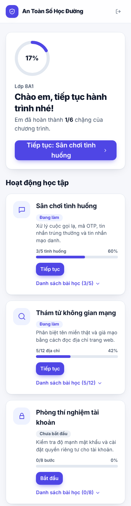{width=40%}

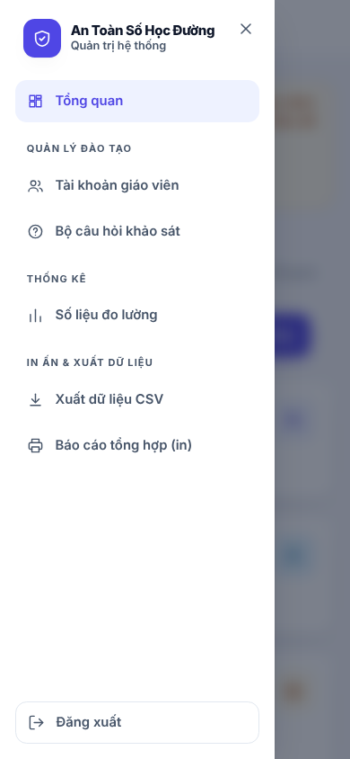{width=40%}

# PHỤ LỤC E. CẤU TRÚC DỮ LIỆU VÀ ĐỊNH DẠNG XUẤT

**Bảng E1. Cấu trúc các bảng dữ liệu chính**

| Bảng | Trường chính | Mục đích |
|---|---|---|
| classes | Mã lớp, tên lớp, tên cơ sở, thời điểm tạo | Danh sách lớp tham gia |
| participants | Mã thẻ, mã định danh nghiên cứu, mã lớp, trạng thái thẻ (đã phát hoặc đã kích hoạt), băm mã phiên, phiên bản phiếu, thời điểm kích hoạt, số lần cấp lại thẻ | Định danh học sinh (hai mã tách biệt) và kiểm soát phiên |
| teachers | Tên đăng nhập, băm mật khẩu, vai trò (giáo viên hoặc quản trị), lớp được gán, cờ đổi mật khẩu tạm, băm mã phiên | Tài khoản giáo viên và quản trị viên |
| module_events | Mã học sinh, hoạt động, mã mục, số lần thử, lựa chọn, đúng hoặc sai, thời gian phản hồi, cờ gợi ý, phiên bản nội dung | Nhật ký ba hoạt động |
| assessments_self | Mã học sinh, giai đoạn, mã câu, đáp án hoặc mức, đúng hoặc sai, thời gian phản hồi, phiên bản | Kết quả khảo sát ba giai đoạn |
| audit_log | Thời điểm, loại người thực hiện, mã người thực hiện, thao tác, mã cũ, mã mới, việc đã xác nhận đối chiếu sổ | Truy vết trách nhiệm khi cấp lại thẻ; không đưa vào tệp xuất |
| survey_versions | Mã phiên bản, tiêu đề, lời dẫn, thang đo hành vi, cờ hiện hành, thời điểm tạo | Lịch sử phiên bản bộ câu hỏi (bất biến sau khi tạo) |
| survey_items | Mã phiên bản, mã câu, thứ tự, nội dung câu hỏi | Nội dung từng câu của mỗi phiên bản |

Ràng buộc duy nhất theo bộ ba (học sinh, giai đoạn, mã câu) trong bảng `assessments_self` bảo đảm mỗi câu chỉ được trả lời một lần trong một giai đoạn. Cột `is_safe` trong `module_events` mang nghĩa phân loại đúng hoặc đạt yêu cầu.

**Định dạng xuất dữ liệu.** *Dạng dài*: mỗi dòng là một lần trả lời, gồm mã định danh nghiên cứu, mã lớp, giai đoạn, mã câu, loại câu, đúng hoặc sai, chỉ số lựa chọn, mức hành vi, thời gian phản hồi, phiên bản nội dung và thời điểm trả lời. *Dạng rộng*: mỗi dòng là một học sinh, gồm mã định danh nghiên cứu, mã lớp, số câu kiến thức đúng, tỷ lệ phần trăm, điểm hành vi đã điều chỉnh, thời gian phản hồi trung bình theo giai đoạn và số hoạt động đã hoàn thành. Cả hai mã hóa UTF-8 kèm BOM để mở được bằng phần mềm bảng tính, và không chứa họ tên, email, số điện thoại, mã thẻ đăng nhập, thời điểm đồng ý hay nội dung mật khẩu. Mô tả từng cột ở bộ mã hóa dữ liệu `docs/CODEBOOK_NGHIEN_CUU.md`.

# PHỤ LỤC F. GIẢI THÍCH THUẬT NGỮ

| Thuật ngữ | Giải thích đơn giản |
|---|---|
| Lừa đảo trực tuyến (phishing) | Giả làm người hoặc tổ chức đáng tin để lấy thông tin hoặc tiền |
| Mã OTP | Mã dùng một lần gửi về điện thoại để xác nhận thao tác; không đọc cho bất kỳ ai |
| Tên miền | Phần chữ của địa chỉ trang web, ví dụ phần nằm ngay trước đuôi miền |
| Can thiệp | Việc cho học sinh làm ba hoạt động học tập của hệ thống |
| Khảo sát đầu vào, sau can thiệp, theo dõi | Ba lần đo: trước khi học, ngay sau khi học và 28 ngày sau |
| Mã thẻ | Mã in trên thẻ để học sinh đăng nhập; phải giữ kín |
| Mã định danh nghiên cứu | Mã ngẫu nhiên khác, chỉ có trong dữ liệu nghiên cứu, không đăng nhập được |
| Sổ phát thẻ | Sổ riêng của giáo viên ghi thẻ nào phát cho học sinh nào; không nằm trong hệ thống |
| Ẩn danh | Không thể biết dữ liệu này là của học sinh nào |
| Thống kê mô tả | Cách tóm tắt dữ liệu bằng số lượng, tỷ lệ, trung bình |
| Độ lệch chuẩn (SD) | Số cho biết các câu trả lời trải rộng quanh mức trung bình đến đâu |
| Kiểm định phi tham số | Phép kiểm tra thống kê không đòi hỏi dữ liệu phải có dạng phân phối đặc biệt |
| Tự báo cáo | Người trả lời tự đánh giá về bản thân, nên có thể không hoàn toàn chính xác |

# PHỤ LỤC G. KHAI BÁO SỬ DỤNG CÔNG NGHỆ SỐ VÀ TRÍ TUỆ NHÂN TẠO

Nhóm sử dụng **Claude Code** (Anthropic), một công cụ lập trình dựa trên mô hình ngôn ngữ lớn, trong quá trình phát triển: gợi ý cấu trúc và viết mã, gỡ lỗi kiểm thử, gợi ý nội dung câu hỏi khảo sát, soạn thảo và rà soát tài liệu, báo cáo. Mọi đề xuất đều được nhóm đối chiếu, chạy kiểm thử và chỉnh sửa trước khi đưa vào dự án; các số liệu khảo sát trong báo cáo được tính trực tiếp từ dữ liệu thu thập bằng chương trình thống kê, không lấy từ đề xuất của công cụ AI.

**Hệ thống An Toàn Số Học Đường không gọi mô hình trí tuệ nhân tạo khi học sinh sử dụng.** Nội dung các hoạt động là dữ liệu tĩnh do nhóm soạn.

Khai báo chi tiết (mức độ sử dụng, tóm tắt các câu lệnh) ở Phiếu khai báo sử dụng công nghệ số, trí tuệ nhân tạo (Phụ lục 7 của hồ sơ dự thi).
