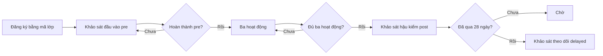
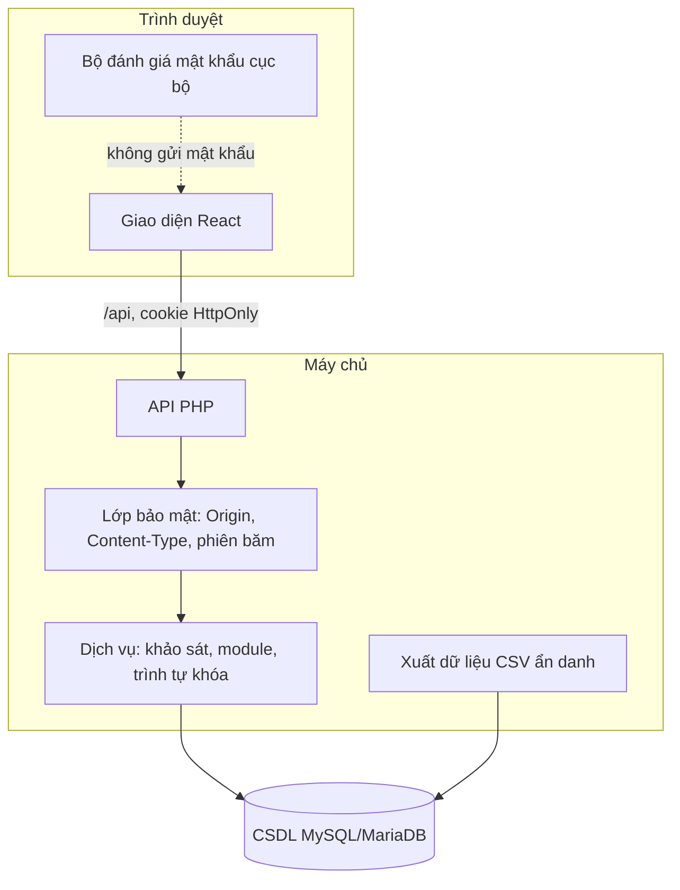
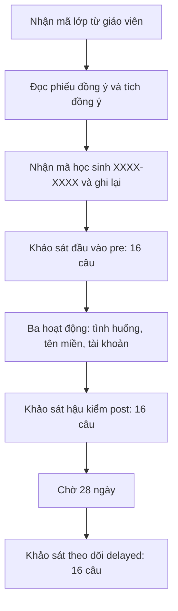
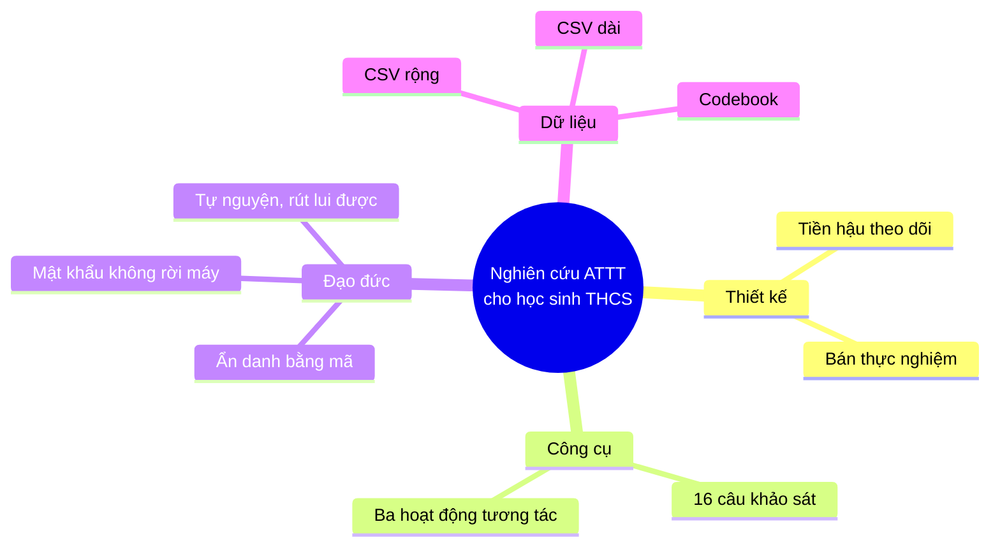
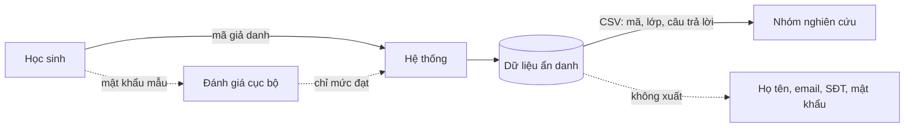

# An Toàn Số Học Đường: Hệ thống web tương tác nâng cao nhận thức và hành vi an toàn thông tin cho học sinh trung học cơ sở

**Hồ sơ dự thi Khoa học kỹ thuật cấp học dành cho học sinh trung học cơ sở**

**Phiên bản:** 2.0 (bản thảo)

> **Lưu ý về tính toàn vẹn của kết quả.** Tại thời điểm soạn thảo, nghiên cứu **chưa thu thập dữ liệu thực nghiệm**. Các nội dung về kết quả trong báo cáo là **giả thuyết và kết quả dự kiến**, không phải phát hiện. Ký hiệu [Thiết kế] chỉ quyết định phương pháp; [Thực nghiệm] chỉ nội dung đã kiểm chứng bằng chạy mã hoặc kiểm thử; [Cần bổ sung nguồn] chỉ chỗ cần tra cứu thêm.

---

## MỤC LỤC

| Mục | Nội dung | Trang |
|---|---|---|
| | Danh mục viết tắt | [__] |
| | Danh mục bảng biểu và hình vẽ | [__] |
| | Mở đầu | [__] |
| 1 | Lý do chọn đề tài | [__] |
| 2 | Mục tiêu nghiên cứu | [__] |
| 3 | Câu hỏi nghiên cứu và giả thuyết | [__] |
| 4 | Đối tượng và phạm vi nghiên cứu | [__] |
| 5 | Ý nghĩa khoa học và thực tiễn | [__] |
| | Chương 1. Tổng quan tài liệu và cơ sở lý thuyết | [__] |
| 1.1 | Các khái niệm cơ bản | [__] |
| 1.2 | Cơ sở lý thuyết cho nghiên cứu hành vi và giáo dục trực tuyến | [__] |
| 1.3 | Tổng quan các giải pháp và nghiên cứu tương tự | [__] |
| | Chương 2. Phương pháp nghiên cứu | [__] |
| 2.1 | Thiết kế nghiên cứu: mô hình tiền–hậu–theo dõi | [__] |
| 2.2 | Công cụ đo lường | [__] |
| 2.3 | Hệ thống web tương tác | [__] |
| 2.4 | Quy trình thực hiện | [__] |
| 2.5 | Quyền riêng tư theo thiết kế và đạo đức nghiên cứu | [__] |
| 2.6 | Phương pháp phân tích dữ liệu | [__] |
| | Chương 3. Kết quả và thảo luận | [__] |
| 3.1 | Sản phẩm phần mềm | [__] |
| 3.2 | Cấu trúc dữ liệu, codebook và định dạng xuất | [__] |
| 3.3 | Kết quả dự kiến và đánh giá khả năng đáp ứng mục tiêu | [__] |
| 3.4 | Thảo luận | [__] |
| 3.5 | Giới hạn của nghiên cứu | [__] |
| | Kết luận và khuyến nghị | [__] |
| | Tài liệu tham khảo | [__] |
| | Phụ lục | [__] |

*Ghi chú: số trang được điền sau khi xuất bản thảo sang định dạng văn bản (Word hoặc PDF). Markdown không tự đánh số trang.*

---

## DANH MỤC VIẾT TẮT

| Viết tắt | Nghĩa đầy đủ |
|---|---|
| ATTT | An toàn thông tin |
| API | Giao diện lập trình ứng dụng (Application Programming Interface) |
| CSDL | Cơ sở dữ liệu |
| CSRF | Giả mạo yêu cầu liên trang (Cross-Site Request Forgery) |
| CSV | Giá trị phân tách bằng dấu phẩy (Comma-Separated Values) |
| HTTP | Giao thức truyền tải siêu văn bản (HyperText Transfer Protocol) |
| k-anonymity | Ẩn danh k (mỗi bản ghi không phân biệt được với ít nhất k−1 bản ghi khác) |
| OTP | Mật khẩu dùng một lần (One-Time Password) |
| OWASP | Dự án bảo mật ứng dụng web mở (Open Web Application Security Project) |
| PDO | Đối tượng dữ liệu PHP (PHP Data Objects) |
| THCS | Trung học cơ sở |
| URL | Địa chỉ tài nguyên trên mạng (Uniform Resource Locator) |
| NIST | Viện Tiêu chuẩn và Công nghệ Hoa Kỳ (National Institute of Standards and Technology) |
| SQL | Ngôn ngữ truy vấn dữ liệu có cấu trúc (Structured Query Language) |

---

## DANH MỤC BẢNG BIỂU VÀ HÌNH VẼ

### Bảng

| Số hiệu | Tên bảng | Trang |
|---|---|---|
| Bảng 1 | Ba giai đoạn đo lường | [__] |
| Bảng 2 | Biến số nghiên cứu và cách đo | [__] |
| Bảng 3 | Các hoạt động của hệ thống | [__] |
| Bảng 4 | Kiểu đánh lừa trong hoạt động thám tử tên miền | [__] |
| Bảng 5 | Cấu trúc các bảng dữ liệu chính | [__] |
| Bảng 6 | Kết quả kiểm thử hệ thống | [__] |
| Bảng 7 | Giả thuyết và tiêu chí đánh giá dự kiến | [__] |
| Bảng 8 | Giới hạn của nghiên cứu và biện pháp khắc phục | [__] |

### Hình

| Số hiệu | Tên hình | Trang |
|---|---|---|
| Hình 1 | Trình tự mở khóa các giai đoạn khảo sát | [__] |
| Hình 2 | Kiến trúc hệ thống | [__] |
| Hình 3 | Quy trình tham gia của học sinh | [__] |
| Hình 4 | Sơ đồ tổng hợp các thành phần nghiên cứu | [__] |
| Hình 5 | Luồng dữ liệu và quyền riêng tư | [__] |

---

## MỞ ĐẦU

### 1. Lý do chọn đề tài

Học sinh trung học cơ sở đang sử dụng điện thoại thông minh và mạng xã hội từ sớm và thường xuyên. Đi kèm với việc sử dụng đó là các rủi ro về an toàn thông tin: lừa đảo qua tin nhắn và cuộc gọi, mạo danh người quen, đánh cắp mã xác thực và tài khoản, và các trang web giả mạo [Cần bổ sung nguồn: số liệu thống kê hiện hành về lừa đảo trực tuyến liên quan đến thanh thiếu niên tại Việt Nam].

Học sinh ở độ tuổi này thường có kỹ năng sử dụng thiết bị tốt, nhưng hiểu biết về rủi ro và thói quen bảo vệ tài khoản còn hạn chế. Các nội dung như nhận diện tên miền giả mạo, quản lý mã xác thực một lần và cài đặt quyền riêng tư đòi hỏi kiến thức cụ thể mà không phải lúc nào học sinh cũng được hướng dẫn có hệ thống [Cần bổ sung nguồn].

Nghiên cứu về giáo dục an toàn thông tin cho trẻ em cho thấy can thiệp có thể cải thiện kết quả nhận diện lừa đảo trong ngắn hạn, nhưng hiệu quả có thể giảm theo thời gian [Lastdrager et al., 2017]. Điều này đặt ra nhu cầu về các chương trình có đo lường ở nhiều thời điểm, thay vì chỉ kiểm tra ngay sau khi học.

Từ đó, đề tài lựa chọn hướng nghiên cứu thiết kế và đánh giá một hệ thống web tương tác, cho phép học sinh thực hành trực tiếp và cho phép đo lường có cấu trúc trước, sau và theo dõi sau một khoảng thời gian.

### 2. Mục tiêu nghiên cứu

1. Thiết kế và xây dựng một hệ thống web tương tác gồm ba hoạt động về an toàn thông tin cho học sinh trung học cơ sở.
2. Xây dựng bộ công cụ đo lường tách riêng nhận thức (kiến thức có đáp án) và hành vi (tự báo cáo).
3. Đánh giá mức thay đổi về nhận thức an toàn thông tin của học sinh sau can thiệp và sau khoảng thời gian theo dõi.
4. Đánh giá mức thay đổi về hành vi an toàn thông tin tự báo cáo của học sinh.
5. Bảo đảm quyền riêng tư của học sinh trong toàn bộ quá trình nghiên cứu, không thu thập thông tin định danh cá nhân.

### 3. Câu hỏi nghiên cứu và giả thuyết

**Câu hỏi nghiên cứu:**

- **Q1.** Điểm nhận thức an toàn thông tin của học sinh có tăng sau can thiệp so với trước can thiệp không?
- **Q2.** Mức tăng này có còn ở thời điểm theo dõi sau khoảng bốn tuần không?
- **Q3.** Điểm hành vi tự báo cáo có thay đổi sau can thiệp không?
- **Q4.** Thời gian phản hồi và việc sử dụng gợi ý có liên quan đến độ chính xác trong các hoạt động không?

**Giả thuyết khoa học:**

- **H1.** Điểm kiến thức ở giai đoạn sau can thiệp cao hơn giai đoạn trước can thiệp.
- **H2.** Điểm kiến thức ở giai đoạn theo dõi vẫn cao hơn giai đoạn trước can thiệp.
- **H3.** Điểm hành vi ở giai đoạn sau can thiệp cao hơn giai đoạn trước can thiệp.
- **H4.** Ở hoạt động thám tử tên miền, học sinh sử dụng gợi ý "đọc từ phải sang trái" có tỷ lệ phân loại đúng cao hơn học sinh không sử dụng.

Các giả thuyết H1 đến H3 được đặt theo chiều tăng dựa trên thiết kế can thiệp. H4 chỉ là mối liên hệ quan sát được, vì việc dùng gợi ý không được phân bổ ngẫu nhiên.

### 4. Đối tượng và phạm vi nghiên cứu

**Đối tượng.** Học sinh trung học cơ sở tham gia trong các lớp do nhà trường lựa chọn, với quy mô dự kiến 40 đến 100 học sinh, thuộc một đến hai lớp [Thiết kế].

**Phạm vi không gian.** Nghiên cứu được triển khai trong phạm vi một cơ sở giáo dục, trên thiết bị cá nhân của học sinh hoặc thiết bị do nhà trường cung cấp.

**Phạm vi thời gian.** Từ đo lường trước can thiệp đến đo lường theo dõi là khoảng sáu tuần, gồm can thiệp và khoảng bốn tuần theo dõi [Thiết kế; thời gian thực tế cần xác nhận khi triển khai].

**Phạm vi nội dung.** Ba nhóm nội dung: nhận diện tình huống lừa đảo qua điện thoại và tin nhắn; nhận diện tên miền giả mạo; quản lý tài khoản, mật khẩu và quyền riêng tư trên ứng dụng nhắn tin và mạng xã hội phổ biến.

**Giới hạn phạm vi.** Nghiên cứu không kiểm tra hệ thống của bất kỳ cơ quan hay tổ chức nào, không sử dụng tên miền thật trong nội dung, và không đánh giá hành vi thực tế trên tài khoản của học sinh.

### 5. Ý nghĩa khoa học và thực tiễn

**Ý nghĩa khoa học.**
- Đề tài đề xuất một thiết kế đo lường tách biến nhận thức và hành vi, có kiểm soát trình tự và ghi nhận thời gian phản hồi.
- Đề tài cung cấp bộ mã hóa dữ liệu (codebook) và cấu trúc xuất dữ liệu có thể tái sử dụng cho các nghiên cứu sau.
- Đề tài minh họa cách thiết kế một hệ thống nghiên cứu với dữ liệu tối giản, không chứa thông tin định danh.

**Ý nghĩa thực tiễn.**
- Hệ thống cung cấp học liệu tương tác, có thể dùng trong giờ sinh hoạt hoặc hoạt động ngoại khóa.
- Các kịch bản và checklist được xây dựng từ các hình thức lừa đảo và thao tác bảo mật phổ biến, nên có thể điều chỉnh cho các trường khác.
- Quy trình đo lường có thể giúp nhà trường đánh giá hiệu quả của chương trình giáo dục an toàn thông tin mà không cần đầu tư công cụ phức tạp.

---

## CHƯƠNG 1. TỔNG QUAN TÀI LIỆU VÀ CƠ SỞ LÝ THUYẾT

### 1.1. Các khái niệm cơ bản

**An toàn thông tin.** Việc bảo vệ tính bí mật, tính toàn vẹn và tính sẵn sàng của thông tin và hệ thống thông tin. Trong phạm vi đề tài, khái niệm được thu hẹp vào các hành vi cá nhân khi sử dụng thiết bị số: nhận diện lừa đảo, bảo vệ mã xác thực, quản lý mật khẩu và cài đặt quyền riêng tư [Cần bổ sung nguồn: định nghĩa chuẩn về an toàn thông tin].

**Lừa đảo trực tuyến (phishing).** Hành vi giả mạo một chủ thể đáng tin cậy để dẫn dắt nạn nhân cung cấp thông tin hoặc thực hiện một hành động. Đề tài xem xét bốn biến thể: cuộc gọi và tin nhắn giả mạo cơ quan hoặc ngân hàng, yêu cầu đọc mã xác thực, tin nhắn trúng thưởng có đường dẫn, và trang web giả mạo đường dẫn hoặc tên miền [Cần bổ sung nguồn về phân loại lừa đảo].

**Tên miền và cấu trúc địa chỉ web.** Địa chỉ web được đọc từ phải sang trái: đuôi miền (ví dụ `.test`, `.example`) ở cuối, phần gốc là tên do đơn vị đăng ký ngay trước đuôi, và các phần đứng trước là tên miền con. Phần gốc quyết định nguồn của trang; tên miền con và đường dẫn không quyết định nguồn [Cần bổ sung nguồn về cấu trúc hệ thống tên miền].

**Hành vi số.** Các hành vi có thể quan sát được khi sử dụng thiết bị và dịch vụ số. Đề tài đo hành vi bằng tự báo cáo, với các câu hỏi về thói quen như bật xác thực hai lớp, bấm đường dẫn lạ và đọc mã xác thực cho người khác.

**Nhận thức và hành vi.** Nhận thức là hiểu biết về rủi ro và cách xử lý; hành vi là thực hiện hoặc không thực hiện các biện pháp bảo vệ. Đề tài coi nhận thức là điều kiện cần cho thay đổi hành vi, nhưng không đủ để bảo đảm thay đổi hành vi [Cần bổ sung nguồn: lý thuyết nhận thức–hành vi trong giáo dục sức khỏe].

**Quyền riêng tư theo thiết kế (privacy by design).** Nguyên tắc đưa các yêu cầu bảo vệ dữ liệu vào ngay từ giai đoạn thiết kế, bao gồm tối thiểu hóa dữ liệu, định danh giả và kiểm soát truy cập [Cần bổ sung nguồn].

**Ẩn danh k (k-anonymity).** Một bản phát hành dữ liệu đạt chuẩn k-anonymity khi mỗi bản ghi không thể phân biệt với ít nhất k−1 bản ghi khác trong cùng bản phát hành. Mô hình này do Sweeney (2002) đề xuất, và được đề tài dùng làm cơ sở tham chiếu cho việc giảm nguy cơ suy luận danh tính [Sweeney, 2002].

### 1.2. Cơ sở lý thuyết cho nghiên cứu hành vi và giáo dục trực tuyến

**Đo lường tiền–hậu–theo dõi.** Thiết kế đo lường trước can thiệp, sau can thiệp và theo dõi sau một khoảng thời gian là cách phổ biến để đánh giá hiệu quả can thiệp và mức độ duy trì kết quả [Shadish et al., 2002]. Với thiết kế không có nhóm đối chứng ngẫu nhiên, các tác giả nhấn mạnh cần kiểm soát các đe dọa đối với suy luận nhân quả như trưởng thành tự nhiên, lịch sử và thay đổi do đo lường lặp lại [Shadish et al., 2002].

**Giáo dục an toàn thông tin trực tuyến cho trẻ em.** Nghiên cứu của Lastdrager và cộng sự (2017) đánh giá đào tạo nhận diện lừa đảo trên học sinh tiểu học ở Hà Lan. Theo tóm tắt công bố, nhóm tác giả ghi nhận mức cải thiện tổng thể khoảng 14% sau đào tạo, nhưng kết quả không duy trì ở thời điểm bốn tuần sau. Các tác giả kết luận rằng đào tạo có hiệu quả ngắn hạn, và việc giáo dục trẻ em ở trường có thuận lợi vì học sinh đến trường đều đặn [Lastdrager et al., 2017]. *[Cần xác minh lại số liệu cụ thể với toàn văn bài báo trước khi nộp.]*

**Thiết kế học tập tương tác.** Học tập qua tình huống và phản hồi tức thì là một hướng tiếp cận được sử dụng rộng rãi trong giáo dục kỹ năng số. Đề tài áp dụng nguyên tắc cung cấp giải thích đi kèm mỗi lựa chọn, cho phép học sinh chọn lại khi sai [Cần bổ sung nguồn: nghiên cứu về phản hồi tức thì trong học tập tương tác].

**Lưu ý phương pháp.** Mẫu nhỏ và thiết kế không ngẫu nhiên hạn chế khả năng khái quát hóa kết quả. Đề tài vì vậy được xem là nghiên cứu thăm dò, và các kết luận được diễn giải thận trọng.

### 1.3. Tổng quan các giải pháp và nghiên cứu tương tự

**Tiêu chuẩn kỹ thuật về xác thực.** Hướng dẫn kỹ thuật của NIST về xác thực và quản lý bộ xác thực được cập nhật năm 2025 trong SP 800-63B-4. Phiên bản này thay thế SP 800-63B năm 2017 [National Institute of Standards and Technology, 2025]. Đề tài tham chiếu các nguyên tắc về độ dài mật khẩu, xác thực đa yếu tố và tránh dùng mật khẩu có thể đoán được. Đề tài không dùng dữ liệu của hướng dẫn này để đánh giá hệ thống của bất kỳ tổ chức nào.

**Rủi ro ứng dụng web.** Tổ chức OWASP công bố danh sách mười rủi ro bảo mật ứng dụng web hàng đầu. Phiên bản 2021 xếp kiểm soát truy cập bị lỗi (Broken Access Control) ở vị trí đầu tiên [OWASP Foundation, 2021]. Đề tài áp dụng nguyên tắc từ chối mặc định cho các API ghi và kiểm tra quyền ở phía máy chủ, không tin cậy kiểm tra phía trình duyệt.

**Các giải pháp giáo dục hiện có.** Các tài liệu hướng dẫn an toàn thông tin phổ biến thường là tờ rơi, bài giảng hoặc video. Các giải pháp này ít khi có cơ chế đo lường trước và sau can thiệp, và hiếm khi tách đánh giá nhận thức khỏi đánh giá hành vi. Đây là khoảng trống mà đề tài hướng tới [Cần bổ sung nguồn: tổng quan các chương trình giáo dục an toàn thông tin ở Việt Nam].

**Đề tài tiền thân.** Phần kiến trúc của hệ thống kế thừa từ một dự án web có cấu trúc frontend và backend tách biệt. Trong quá trình kế thừa, các thành phần có rủi ro thiết kế (đăng nhập bằng thông tin không xác minh, lưu mật khẩu trong mã nguồn phía trình duyệt) đã bị loại bỏ, và phần đánh giá các rủi ro này được ghi nhận như bài học thiết kế [Thực nghiệm: đối chiếu mã nguồn tiền thân].

---

## CHƯƠNG 2. PHƯƠNG PHÁP NGHIÊN CỨU

### 2.1. Thiết kế nghiên cứu: mô hình tiền–hậu–theo dõi

Nghiên cứu sử dụng thiết kế bán thực nghiệm một nhóm hoặc hai lớp, không ngẫu nhiên hóa [Thiết kế]. Ba giai đoạn đo lường được mô tả trong Bảng 1.

**Bảng 1. Ba giai đoạn đo lường**

| Giai đoạn | Mã | Thời điểm | Điều kiện mở | Nội dung |
|---|---|---|---|---|
| Tiền kiểm | `pre` | Trước can thiệp | Đã đăng ký | 16 câu: 10 kiến thức, 6 hành vi |
| Hậu kiểm | `post` | Sau khi hoàn thành ba hoạt động | Đã hoàn thành pre và cả ba hoạt động | Cùng bộ 16 câu |
| Theo dõi | `delayed` | Sau 28 ngày kể từ hậu kiểm | Đã hoàn thành post và đã qua 28 ngày | Cùng bộ 16 câu |

Cùng một bộ câu hỏi được dùng cho cả ba giai đoạn để bảo đảm so sánh được. Đây là một hạn chế đã biết, vì có thể xảy ra hiệu ứng luyện tập; đề tài đề xuất bộ câu song song cho các nghiên cứu tiếp theo.

Trình tự mở khóa được hệ thống bảo đảm ở cả giao diện và máy chủ. Học sinh không thể vào các hoạt động học tập khi chưa hoàn thành khảo sát đầu vào. Khảo sát hậu kiểm chỉ mở khi đã hoàn thành đủ ba hoạt động. Khảo sát theo dõi chỉ mở sau khoảng thời gian đã cấu hình (mặc định 28 ngày).

**Hình 1. Trình tự mở khóa các giai đoạn khảo sát**



### 2.2. Công cụ đo lường

**Bộ câu hỏi.** Bộ câu hỏi gồm 16 câu, được lưu thành tệp có phiên bản (`a-v1`).

- **Mười câu kiến thức** có một đáp án đúng. Các câu bao phủ ba nhóm nội dung: cuộc gọi và tin nhắn giả mạo, nhận diện tên miền và đường dẫn, quản lý mật khẩu và xác thực hai lớp. Đáp án đúng không được hiển thị cho học sinh trong khảo sát.
- **Sáu câu hành vi** dùng thang bốn mức: không bao giờ, thỉnh thoảng, thường xuyên, luôn luôn. Ba câu được đánh dấu đảo chiều (bấm đường dẫn lạ, đọc mã xác thực cho người khác, và một câu về thói quen bảo vệ tài khoản) để điểm hành vi nhất quán theo chiều tích cực.

**Biến số.**

**Bảng 2. Biến số nghiên cứu và cách đo**

| Biến | Loại | Cách đo | Đơn vị |
|---|---|---|---|
| Điểm kiến thức | Định lượng rời rạc | Số câu kiến thức đúng | 0–10 |
| Tỷ lệ kiến thức | Định lượng liên tục | Điểm kiến thức ÷ 10 × 100 | % |
| Điểm hành vi | Thứ bậc | Trung bình các câu hành vi, đã điều chỉnh đảo chiều (điểm = 5 − mức) | 1–4 |
| Thời gian phản hồi | Định lượng liên tục | Từ lúc hiển thị câu đến khi học sinh chọn | mili giây |
| Hoàn thành hoạt động | Nhị phân | Đạt đủ điều kiện của từng hoạt động | 0 hoặc 1 |
| Sử dụng gợi ý | Nhị phân | Có mở "đọc từ phải sang trái" trước khi phân loại | 0 hoặc 1 |

**Đo nhận thức và hành vi.** Câu kiến thức ghi nhận đúng hoặc sai. Câu hành vi ghi nhận mức trả lời, không có đúng hay sai. Hai loại được tách ở cấp dữ liệu để không lẫn lẫn nhau khi phân tích.

**Độ tin cậy của công cụ.** Hệ số tin cậy nội bộ của thang hành vi và độ khó của từng câu kiến thức chưa được tính, vì chưa có dữ liệu. Đây là việc cần làm sau thí điểm [Thiết kế].

### 2.3. Hệ thống web tương tác

Hệ thống gồm giao diện web (React 19, TypeScript, Vite) và máy chủ API (PHP 8.1 trở lên, PDO MySQL). Nội dung kịch bản được lưu trong tệp JSON có phiên bản, tách khỏi mã nguồn.

**Hình 2. Kiến trúc hệ thống**



**Bảng 3. Các hoạt động của hệ thống**

| Hoạt động | Số lượng nội dung | Cơ chế ghi nhận | Cơ chế phản hồi |
|---|---|---|---|
| Sân chơi tình huống | 5 kịch bản, mỗi kịch bản 4 lựa chọn | Mọi lần thử, điểm lấy lần đầu | Đúng hoặc sai, giải thích, dấu hiệu cảnh báo, cho chọn lại |
| Thám tử không gian mạng | 12 địa chỉ web (5 chính thống, 7 giả mạo) | Mỗi địa chỉ một lần, cờ dùng gợi ý | Đúng hoặc sai, giải thích, thủ thuật đánh lừa |
| Phòng thí nghiệm tài khoản | Trình đánh giá mật khẩu và checklist 8 bước cho hai nền tảng | Mức cao nhất của phòng thí nghiệm, kết quả từng bước | Đánh giá cục bộ; câu kiểm tra có giải thích |

**Hoạt động 1: Sân chơi tình huống.** Năm kịch bản mô phỏng cuộc gọi tự xưng công an yêu cầu chuyển tiền, yêu cầu đọc mã xác thực một lần, tin nhắn trúng thưởng có đường dẫn, tài khoản bạn bè nhờ chuyển tiền gấp, và trang thanh toán dịch vụ công giả mạo. Học sinh chọn một trong các cách xử lý. Mỗi lựa chọn có phản hồi đúng hoặc sai, giải thích, và danh sách dấu hiệu cần để ý.

**Hoạt động 2: Thám tử không gian mạng.** Mười hai địa chỉ web được phân loại thành chính thống hoặc giả mạo. Có năm kiểu đánh lừa được mô tả trong Bảng 4.

**Bảng 4. Kiểu đánh lừa trong hoạt động thám tử tên miền**

| Kiểu | Mô tả | Cách nhận diện |
|---|---|---|
| Thay ký tự | Một chữ cái bị thay bằng chữ số hoặc chữ cái gần giống | So sánh từng ký tự của phần gốc |
| Tên chính làm tên miền con | Tên đúng nằm giữa, nhưng phần gốc là tên khác | Đọc từ phải sang trái để tìm phần gốc |
| Đổi đuôi | Đuôi miền bị đổi | Đuôi không quyết định tính chính thống |
| Thêm từ | Thêm một từ như "đăng nhập" vào tên đúng | Phần gốc đã đổi |
| Tên chính trong đường dẫn | Tên đúng chỉ nằm sau dấu gạch chéo | Đường dẫn không quyết định nguồn trang |

Gợi ý "đọc từ phải sang trái" hiển thị các nhãn của tên miền theo thứ tự từ phải sang trái và tô nổi bật phần gốc. Các nút phân loại có thể đổi vị trí giữa các học sinh và giữa các mục, theo một hàm băm xác định, để tránh thiên lệch vị trí.

**Hoạt động 3: Phòng thí nghiệm tài khoản.** Hoạt động gồm hai phần.

- *Đánh giá mật khẩu.* Học sinh nhập mật khẩu mẫu. Hệ thống tính entropy lý thuyết, entropy sau khi trừ các mẫu quen thuộc (chuỗi liên tiếp, ký tự lặp, dãy phím, năm sinh, mật khẩu phổ biến trong danh sách mẫu), và thời gian bẻ khóa mô phỏng theo hai giả định về tốc độ đoán. Toàn bộ tính toán chạy trên trình duyệt.
- *Checklist quyền riêng tư.* Tám bước cho hai nền tảng nhắn tin và mạng xã hội phổ biến. Mỗi bước có hướng dẫn, lý do, một câu kiểm tra và ô xác nhận đã thực hành.

Nội dung checklist có cảnh báo rằng tên mục trong menu thay đổi theo phiên bản ứng dụng.

### 2.4. Quy trình thực hiện

Quy trình gồm sáu bước. Học sinh được hướng dẫn trực tiếp; giáo viên hỗ trợ theo đúng vai trò quy định.

**Hình 3. Quy trình tham gia của học sinh**



Các bước chi tiết:

1. **Chuẩn bị.** Nhà trường thống nhất việc triển khai theo quy định của cơ sở giáo dục. Nhóm nghiên cứu tạo mã lớp cho lớp tham gia.
2. **Đăng ký.** Học sinh nhập mã lớp, đọc phiếu đồng ý và tích đồng ý. Hệ thống cấp mã học sinh. Mã không chứa họ tên, email hay số điện thoại.
3. **Khảo sát đầu vào.** Học sinh làm 16 câu, không có phản hồi đúng sai.
4. **Can thiệp.** Học sinh thực hiện ba hoạt động theo thứ tự tùy chọn.
5. **Hậu kiểm.** Sau khi hoàn thành ba hoạt động, học sinh làm lại 16 câu.
6. **Theo dõi.** Sau 28 ngày, khảo sát theo dõi mở và học sinh làm lại 16 câu.

**Vai trò của giáo viên.** Giáo viên hướng dẫn học sinh theo trình tự, nhắc ghi mã vào vở và không yêu cầu học sinh nhập thông tin cá nhân vào hệ thống. Giáo viên không có quyền truy cập dữ liệu trong hệ thống. Khi học sinh quên mã, giáo viên chuyển yêu cầu cho nhóm nghiên cứu.

**Hình 4. Sơ đồ tổng hợp các thành phần nghiên cứu**



### 2.5. Quyền riêng tư theo thiết kế và đạo đức nghiên cứu

Nghiên cứu áp dụng sáu nguyên tắc sau.

1. **Tối thiểu hóa dữ liệu.** Hệ thống không thu thập họ tên, email, số điện thoại, ảnh hay thông tin cá nhân khác. Thời điểm đồng ý chỉ lưu trong cơ sở dữ liệu để kiểm soát phiên bản phiếu, không xuất ra tệp dữ liệu nghiên cứu.
2. **Định danh giả.** Học sinh nhận mã dạng XXXX-XXXX do hệ thống cấp, dùng để đăng nhập lại và nối kết quả giữa các giai đoạn. Mã không chứa thông tin cá nhân.
3. **Mật khẩu không rời trình duyệt.** Phòng thí nghiệm mật khẩu tính toán hoàn toàn trên trình duyệt. Máy chủ từ chối mọi yêu cầu có trường mật khẩu và chỉ nhận mức đánh giá tổng hợp.
4. **Không dùng dịch vụ ngoài để kiểm tra mật khẩu.** Tích hợp kiểm tra mật khẩu bị rò rỉ theo k-anonymity đã được loại khỏi hệ thống, vì ngay cả tiền tố băm cũng là thông tin liên quan đến mật khẩu thật.
5. **Tự nguyện và rút lui.** Phiếu đồng ý nêu rõ học sinh có thể dừng bất cứ lúc nào. Phiên bản phiếu được kiểm tra ở phía máy chủ.
6. **Bảo vệ dữ liệu xuất.** Việc xuất dữ liệu yêu cầu token quản trị hoặc quyền truy cập máy chủ. Chức năng xuất qua HTTP bị tắt khi chưa đặt token.

**Hình 5. Luồng dữ liệu và quyền riêng tư**



**Đạo đức nghiên cứu.** Đề tài cần được cơ sở giáo dục phê duyệt và có sự đồng ý của phụ huynh hoặc người giám hộ trước khi triển khai [Thiết kế: văn bản phê duyệt sẽ bổ sung khi có quyết định]. Học sinh được thông báo về quyền tự nguyện và quyền rút lui. Dữ liệu được lưu trữ an toàn, chỉ dùng cho mục đích nghiên cứu, và được xóa theo quy định khi kết thúc đề tài.

**Hạn chế về ẩn danh.** Khi kết quả được công bố theo lớp, nếu lớp có số học sinh quá ít, có thể suy ra danh tính. Codebook khuyến nghị không công bố kết quả theo lớp khi số học sinh dưới 5. Khuyến nghị này chưa được thực thi tự động trong mã nguồn và cần được tuân thủ khi báo cáo.

### 2.6. Phương pháp phân tích dữ liệu

Phân tích dữ liệu được lập kế hoạch như sau [Thiết kế].

- **Mô tả.** Trung vị, khoảng tứ phân vị và tỷ lệ cho từng giai đoạn.
- **So sánh trước–sau.** Kiểm định Wilcoxon signed-rank cho điểm kiến thức và điểm hành vi (H1, H3). Lựa chọn kiểm định phi tham số vì mẫu nhỏ và phân phối có thể không chuẩn [Cần bổ sung nguồn về kiểm định phi tham số cho thiết kế lặp đo].
- **So sánh ba giai đoạn.** Kiểm định Friedman nếu có đủ dữ liệu cho cả ba giai đoạn.
- **Kích thước hiệu ứng.** r = Z / √N cho kiểm định Wilcoxon.
- **Mối liên hệ.** Tương quan Spearman giữa thời gian phản hồi, cờ dùng gợi ý và độ chính xác (H4 được xem xét thận trọng do không có phân bổ ngẫu nhiên).
- **Dữ liệu thiếu.** Báo cáo số học sinh bỏ dở ở từng giai đoạn. Không thay thế bằng giá trị ước lượng.
- **Ngưỡng ý nghĩa.** α = 0,05. Báo cáo kèm khoảng tin cậy khi có thể.

---

## CHƯƠNG 3. KẾT QUẢ VÀ THẢO LUẬN

### 3.1. Sản phẩm phần mềm

**Trạng thái.** Hệ thống đã hoàn thành các thành phần chức năng, đã được kiểm thử ở các mức đơn vị, tích hợp và luồng người dùng. Chưa có dữ liệu thực nghiệm.

**Bảng 5. Cấu trúc các bảng dữ liệu chính**

| Bảng | Các cột chính | Mục đích |
|---|---|---|
| `classes` | mã lớp, tên lớp, tên cơ sở, thời điểm tạo | Danh sách lớp tham gia |
| `participants` | mã học sinh, mã lớp, băm phiên đăng nhập, phiên bản phiếu, thời điểm đồng ý | Định danh giả và kiểm soát phiên |
| `module_events` | học sinh, hoạt động, mã mục, số lần thử, lựa chọn, đúng hoặc sai, thời gian phản hồi, cờ gợi ý, phiên bản nội dung, thời điểm | Nhật ký ba hoạt động |
| `assessments_self` | học sinh, giai đoạn, mã câu, nội dung trả lời, đúng hoặc sai, thời gian phản hồi, phiên bản, thời điểm | Kết quả khảo sát ba giai đoạn |

Ràng buộc duy nhất trên `assessments_self` theo (học sinh, giai đoạn, mã câu) bảo đảm mỗi câu chỉ được trả lời một lần trong một giai đoạn. Cơ sở dữ liệu lưu băm SHA-256 của phiên đăng nhập, không lưu giá trị gốc [Thực nghiệm: đọc lược đồ].

**Bảng 6. Kết quả kiểm thử hệ thống**

| Loại kiểm thử | Phạm vi | Kết quả |
|---|---|---|
| Tích hợp API | Đăng ký, xác thực, ba hoạt động, khảo sát, khóa trình tự, xuất dữ liệu, bảo mật | 142 kiểm tra, đạt toàn bộ (lần xác nhận gần nhất) |
| Đơn vị | Bộ đánh giá mật khẩu | 14 kiểm thử, đạt toàn bộ |
| Biên dịch và build | Kiểm tra kiểu TypeScript nghiêm ngặt, đóng gói giao diện | Đạt |
| Kiểm thử luồng học sinh | Đăng ký đến khảo sát theo dõi, qua máy chủ trung gian | 26 bước, đạt toàn bộ |
| Kiểm thử trình duyệt | Luồng học sinh, khóa module, bố cục trên điện thoại và máy tính | Đạt |

[Thực nghiệm: các kiểm thử được chạy trong quá trình phát triển. Cần chạy lại trước khi nộp hồ sơ.]

Kiểm thử bảo mật cho thấy hệ thống từ chối các yêu cầu ghi từ nguồn không được phép, từ chối yêu cầu không đúng định dạng, không cho phép truy cập khi chưa đăng nhập, và không để lộ đáp án đúng trong các phản hồi khảo sát [Thực nghiệm].

### 3.2. Cấu trúc dữ liệu, codebook và định dạng xuất

**Codebook.** Tài liệu mã hóa dữ liệu mô tả từng cột, từng câu hỏi, cách tính các biến và cách xuất. Bảng câu hỏi trong codebook được sinh tự động từ nội dung nguồn để tránh sai lệch.

**Định dạng dài.** Mỗi dòng là một lần trả lời câu khảo sát, gồm các cột: mã giả danh, mã lớp, giai đoạn, mã câu, loại câu, đúng hoặc sai, chỉ số lựa chọn, mức hành vi, thời gian phản hồi, phiên bản nội dung, thời điểm trả lời. Định dạng này phù hợp cho phân tích từng câu.

**Định dạng rộng.** Mỗi dòng là một học sinh, gồm: mã giả danh, mã lớp, số câu kiến thức đúng, tỷ lệ phần trăm, điểm hành vi đã điều chỉnh, thời gian phản hồi trung bình cho từng giai đoạn, số hoạt động đã hoàn thành. Định dạng này phù hợp cho phân tích lặp đo.

Cả hai định dạng có BOM UTF-8 để tương thích với phần mềm bảng tính. Cả hai không chứa họ tên, email, số điện thoại, thời điểm đồng ý hay nội dung mật khẩu [Thực nghiệm: kiểm thử kiểm tra tiêu đề và dữ liệu].

**Cách xuất.** Hai cách: dòng lệnh trên máy chủ, hoặc yêu cầu HTTP với token quản trị. Nếu chưa đặt token, chức năng HTTP bị tắt.

### 3.3. Kết quả dự kiến và đánh giá khả năng đáp ứng mục tiêu

**Lưu ý.** Phần này không trình bày kết quả thực nghiệm. Nội dung dưới đây mô tả kết quả mà thiết kế cho phép kiểm chứng, và điều kiện để mỗi giả thuyết được xác nhận hoặc bác bỏ.

**Bảng 7. Giả thuyết và tiêu chí đánh giá dự kiến**

| Giả thuyết | Phép so sánh | Tiêu chí dự kiến | Điều kiện để kết luận |
|---|---|---|---|
| H1 | Điểm kiến thức pre so với post | Wilcoxon, p < 0,05; r có ý nghĩa thực tiễn | Đủ cặp dữ liệu cho cả hai giai đoạn |
| H2 | Điểm kiến thức pre so với delayed | Wilcoxon, p < 0,05 | Tỷ lệ bỏ dở ở delayed được báo cáo |
| H3 | Điểm hành vi pre so với post | Wilcoxon sau điều chỉnh đảo chiều | Thang hành vi có độ tin cậy được báo cáo |
| H4 | Độ chính xác theo cờ dùng gợi ý | Mann-Whitney hoặc Spearman | Diễn giải thận trọng do không phân bổ ngẫu nhiên |

**Khả năng đáp ứng mục tiêu.** Thiết kế cho phép đo lường đồng thời nhận thức và hành vi, ghi nhận thời gian phản hồi và cho phép so sánh ba giai đoạn. Về mặt thiết kế, các mục tiêu 1, 2, 4 và 5 đã được đáp ứng. Mục tiêu 3 (đánh giá mức thay đổi nhận thức) và mục tiêu 4 (đánh giá hành vi) phụ thuộc vào dữ liệu thực nghiệm chưa thu thập.

**Các kịch bản diễn giải.**

- Nếu H1 và H2 được xác nhận, can thiệp có hiệu quả ngắn hạn và duy trì được trong khoảng theo dõi.
- Nếu H1 được xác nhận nhưng H2 không, kết quả phù hợp với nhận định về hiệu quả giảm dần sau can thiệp đã được ghi nhận ở các nghiên cứu về trẻ em [Lastdrager et al., 2017].
- Nếu H1 không được xác nhận, cần xem xét hiệu ứng trần khi học sinh đã biết trước các nội dung, và tác động của việc dùng chung bộ câu hỏi.
- Nếu H3 không được xác nhận, cần xem xét giới hạn của tự báo cáo, vì học sinh có thể trả lời theo mong muốn xã hội.

### 3.4. Thảo luận

**Về thiết kế đo lường.** Tách biến nhận thức và hành vi là điểm mạnh của thiết kế, vì cho phép xác định nhận thức thay đổi mà hành vi không thay đổi, và ngược lại. Tuy nhiên, cùng một bộ câu hỏi cho ba giai đoạn có thể làm tăng điểm do ghi nhớ. Đây là hạn chế cần được ghi nhận khi diễn giải.

**Về hệ thống.** Việc mở khóa theo trình tự bảo đảm mọi học sinh đều làm khảo sát đầu vào trước khi tham gia hoạt động. Điều này giúp dữ liệu so sánh được, nhưng cũng làm tăng thời gian cần thiết để học sinh bắt đầu hoạt động.

**Về quyền riêng tư.** Đề tài cho thấy có thể thiết kế một hệ thống nghiên cứu với dữ liệu tối giản, không chứa thông tin định danh, và vẫn đo được kết quả có cấu trúc. Việc giữ mật khẩu trên trình duyệt có chi phí về kiến trúc và trải nghiệm, nhưng loại bỏ được rủi ro lớn nhất về dữ liệu nhạy cảm.

**Về nội dung.** Các kịch bản và câu hỏi được viết với các tình huống gần với đời sống học sinh, nhưng chưa được chuyên gia thẩm định. Đây là điều kiện cần hoàn thành trước khi thu dữ liệu chính thức.

**Về tính khái quát hóa.** Mẫu nhỏ, một cơ sở giáo dục và thiết kế không ngẫu nhiên làm giới hạn khả năng khái quát hóa. Kết quả nếu có chỉ nên được coi là bằng chứng ban đầu.

### 3.5. Giới hạn của nghiên cứu

**Bảng 8. Giới hạn của nghiên cứu và biện pháp khắc phục**

| Mã | Giới hạn | Tác động | Biện pháp dự kiến |
|---|---|---|---|
| G1 | Cùng một bộ câu hỏi cho ba giai đoạn | Điểm có thể tăng do ghi nhớ, không phải do hiểu biết | Xây dựng bộ câu song song cho hậu kiểm và theo dõi |
| G2 | Nội dung chưa được chuyên gia thẩm định | Có thể không đo đúng khái niệm | Thẩm định bởi hội đồng chuyên gia trước khi thu dữ liệu chính thức |
| G3 | Độ tin cậy của thang hành vi chưa được tính | Điểm hành vi có thể không ổn định | Thí điểm và tính hệ số tin cậy nội bộ |
| G4 | Hành vi là tự báo cáo | Có thể sai lệch do mong muốn xã hội | Ghi nhận là hạn chế; cân nhắc đo lường khách quan trong nghiên cứu sau |
| G5 | Không có nhóm đối chứng ngẫu nhiên | Không thể quy kết hoàn toàn thay đổi cho can thiệp | Diễn giải thận trọng; cân nhắc nhóm đối chứng ở nghiên cứu tiếp theo |
| G6 | Ngưỡng quy mô tối thiểu khi công bố theo lớp chưa được thực thi tự động | Nguy cơ suy luận lại danh tính | Kiểm tra thủ công trước khi công bố; bổ sung kiểm tra tự động |
| G7 | Hệ thống chưa tự nhắc khảo sát theo dõi | Tỷ lệ quay lại có thể thấp | Giáo viên lên lịch nhắc; cân nhắc thông báo trong ứng dụng |
| G8 | Đăng nhập bằng mã chưa giới hạn tần suất | Mã có thể bị thử nhiều lần | Bổ sung giới hạn theo địa chỉ mạng trước khi triển khai rộng |
| G9 | Tên mục menu ứng dụng mạng xã hội có thể thay đổi theo phiên bản | Hướng dẫn có thể lỗi thời | Đối chiếu với ứng dụng thực tế trước khi dùng |
| G10 | Chưa thử nghiệm trên máy chủ lưu trữ thực tế | Chưa xác nhận hiệu năng và cấu hình triển khai | Chạy kiểm thử trên máy chủ thực tế trước khi thu dữ liệu |
| G11 | Chưa có giao diện quản trị cho giáo viên | Giáo viên phụ thuộc nhóm nghiên cứu để quản lý lớp | Phát triển giao diện quản trị đơn giản ở giai đoạn sau |
| G12 | Quy mô mẫu dự kiến nhỏ | Độ mạnh thống kê hạn chế | Báo cáo kích thước hiệu ứng và khoảng tin cậy; không khái quát hóa ngoài mẫu |

---

## KẾT LUẬN VÀ KHUYẾN NGHỊ

### Kết luận

Đề tài đã thiết kế và xây dựng một hệ thống web tương tác gồm ba hoạt động về an toàn thông tin cho học sinh trung học cơ sở, kèm theo mô hình đo lường tiền–hậu–theo dõi, cơ chế kiểm soát trình tự và công cụ xuất dữ liệu ẩn danh. Hệ thống đã được kiểm thử ở các mức đơn vị, tích hợp và luồng người dùng.

**Đóng góp chính của đề tài:**

1. Một hệ thống có thể tái sử dụng, trong đó nội dung tách khỏi mã nguồn và có kiểm tra an toàn nội dung tự động.
2. Một thiết kế đo lường tách biến nhận thức và hành vi, có ghi nhận thời gian phản hồi và có codebook.
3. Một mô hình bảo vệ quyền riêng tư từ thiết kế cho nghiên cứu có đối tượng là học sinh.

**Điều đề tài chưa khẳng định được:** hiệu quả của can thiệp. Đề tài chưa có dữ liệu thực nghiệm, nên mọi kết luận về hiệu quả phải chờ kết quả thu thập và phân tích.

### Khuyến nghị

**Đối với nhà trường.**
- Cân nhắc đưa hoạt động này vào giờ sinh hoạt hoặc ngoại khóa, với sự hướng dẫn của giáo viên.
- Phân công một người phụ trách liên lạc với nhóm nghiên cứu để quản lý mã lớp và nhắc khảo sát theo dõi.

**Đối với giáo viên.**
- Hướng dẫn học sinh ghi mã vào vở và không yêu cầu nhập thông tin cá nhân vào hệ thống.
- Lên lịch nhắc khảo sát theo dõi, vì hệ thống hiện chưa tự nhắc.

**Đối với nhóm nghiên cứu.**
- Thẩm định nội dung bởi hội đồng chuyên gia trước khi thu dữ liệu chính thức.
- Thử nghiệm thí điểm để kiểm tra độ tin cậy của thang hành vi và độ khó của từng câu.
- Xây dựng bộ câu hỏi song song cho hậu kiểm và theo dõi, để kiểm soát hiệu ứng luyện tập.
- Bổ sung kiểm tra ngưỡng quy mô tối thiểu khi xuất dữ liệu theo lớp.
- Bổ sung giới hạn tần suất cho đăng nhập bằng mã trước khi triển khai rộng.
- Chạy kiểm thử trên máy chủ thực tế trước khi thu dữ liệu.

### Hướng phát triển

1. Mở rộng nội dung sang các nền tảng và hình thức lừa đảo mới.
2. Phát triển giao diện quản trị đơn giản cho giáo viên, chỉ hiển thị tiến độ theo giai đoạn, không hiển thị dữ liệu cá nhân.
3. Thiết kế nghiên cứu có nhóm đối chứng ngẫu nhiên hóa ở cấp lớp, để tăng khả năng suy luận nhân quả.
4. Nghiên cứu theo dõi dài hơn để đánh giá mức độ duy trì kết quả.

---

## TÀI LIỆU THAM KHẢO

*Các nguồn dưới đây đã được kiểm tra thông tin cơ bản qua trang chính thức của nhà xuất bản, trang hội nghị hoặc trang của tổ chức ban hành. Trước khi nộp, cần đối chiếu lại số trang và các chi tiết chưa được ghi đầy đủ.*

Lastdrager, E., Gallardo, I. C., Hartel, P. H., & Junger, M. (2017). How effective is anti-phishing training for children? In *Proceedings of the Thirteenth Symposium on Usable Privacy and Security (SOUPS 2017)*. USENIX Association. https://www.usenix.org/conference/soups2017/technical-sessions/presentation/lastdrager *[Cần bổ sung số trang.]*

National Institute of Standards and Technology. (2025). *Digital identity guidelines: Authentication and authenticator management* (NIST Special Publication 800-63B-4). U.S. Department of Commerce. https://csrc.nist.gov/pubs/sp/800/63/B/4/final

OWASP Foundation. (2021). *OWASP Top 10:2021*. https://owasp.org/Top10/2021/

Shadish, W. R., Cook, T. D., & Campbell, D. T. (2002). *Experimental and quasi-experimental designs for generalized causal inference*. Houghton Mifflin.

Sweeney, L. (2002). k-anonymity: A model for protecting privacy. *International Journal on Uncertainty, Fuzziness and Knowledge-Based Systems, 10*(5), 557–570. https://doi.org/10.1142/S0218488502001648

*Các mục [Cần bổ sung nguồn] trong nội dung cần được bổ sung bằng tài liệu thực tế trước khi nộp hồ sơ. Không nên sử dụng số liệu thống kê mà chưa có nguồn đã kiểm chứng.*

---

## PHỤ LỤC

### Phụ lục A. Bộ câu hỏi khảo sát chuẩn hóa (phiên bản a-v1)

**Phần kiến thức (10 câu, có một đáp án đúng):**

1. Em nhận tin nhắn: "Tài khoản ngân hàng của bạn bị khóa, bấm link để mở lại". Em nên làm gì? *(Đáp án đúng: không bấm link; gọi số trên thẻ hoặc mở ứng dụng ngân hàng để kiểm tra.)*
2. Một người gọi tự nhận là shipper và nói cần đọc mã OTP để "xác nhận nhận hàng". Em nên làm gì? *(Đáp án đúng: không đọc mã.)*
3. Ai trong các trường hợp sau có thể yêu cầu em cung cấp mật khẩu đăng nhập ngân hàng? *(Đáp án đúng: không ai có quyền yêu cầu.)*
4. Khi dùng Wi-Fi công cộng không có mật khẩu, điều gì nên tránh? *(Đáp án đúng: đăng nhập tài khoản ngân hàng hoặc nhập mật khẩu quan trọng.)*
5. Địa chỉ https://uubnd-mophong.io.vn.tra-cuu.test/ có phần gốc là gì? *(Đáp án đúng: tra-cuu.test.)*
6. Tên miền "uubnd-m0phong.io.vn" khác "uubnd-mophong.io.vn" ở điểm nào? *(Đáp án đúng: chữ o bị thay bằng số 0.)*
7. Trang web có tên chính thức nằm trong đường dẫn, còn tên miền thật là một tên khác. Trang này có đáng tin không? *(Đáp án đúng: không đáng tin.)*
8. Trong ba mật khẩu sau, mật khẩu nào khó đoán nhất? *(Đáp án đúng: mật khẩu có nhiều loại ký tự và đủ dài.)*
9. Dùng cùng một mật khẩu cho nhiều tài khoản có rủi ro gì? *(Đáp án đúng: một trang bị lộ có thể làm lộ các tài khoản khác.)*
10. Xác thực hai lớp giúp bảo vệ tài khoản như thế nào? *(Đáp án đúng: cần thêm một bước xác nhận ngoài mật khẩu.)*

**Phần hành vi (6 câu, thang bốn mức: Không bao giờ, Thỉnh thoảng, Thường xuyên, Luôn luôn):**

11. Em có bật xác thực hai lớp cho tài khoản mạng xã hội hoặc ứng dụng nhắn tin không?
12. Em có dùng mật khẩu khác nhau cho các tài khoản quan trọng không?
13. Khi nhận tin nhắn có đường dẫn lạ, em có bấm vào xem không? *(Câu có đảo chiều.)*
14. Em có đọc mã OTP cho người khác qua điện thoại không? *(Câu có đảo chiều.)*
15. Em có kiểm tra cài đặt quyền riêng tư của tài khoản mạng xã hội không?
16. Khi người quen nhờ chuyển tiền qua mạng, em có gọi điện xác minh trước không?

### Phụ lục B. Mã hóa biến và quy ước xuất dữ liệu

| Biến trong tệp dài | Mã hóa |
|---|---|
| `phase` | pre, post, delayed |
| `instrument` | knowledge, behavior |
| `is_correct` | 1 đúng, 0 sai; để trống với câu hành vi |
| `answer_index` | Chỉ số lựa chọn, bắt đầu từ 0 (chỉ với câu kiến thức) |
| `answer_value` | Mức 1 đến 4 (chỉ với câu hành vi) |
| `response_ms` | Thời gian phản hồi, mili giây |

| Biến trong tệp rộng | Cách tính |
|---|---|
| `{giai đoạn}_knowledge_correct` | Số câu kiến thức đúng, từ 0 đến 10 |
| `{giai đoạn}_knowledge_pct` | Số câu đúng ÷ 10 × 100 |
| `{giai đoạn}_behavior_mean_adj` | Trung bình mức hành vi, đã điều chỉnh đảo chiều |
| `{giai đoạn}_mean_response_ms` | Trung bình thời gian phản hồi của giai đoạn |
| `m1_items_answered` | Số tình huống đã trả lời, tối đa 5 |
| `m2_items_answered` | Số địa chỉ đã phân loại, tối đa 12 |
| `m3_steps_passed` | Số bước checklist đạt, tối đa 8 |
| `m3_lab_passed` | 1 nếu đạt mức mạnh trong phòng thí nghiệm, 0 nếu không |

### Phụ lục C. Sơ đồ kỹ thuật và trích đoạn mã minh họa

**Trích đoạn 1. Kiểm tra nguồn yêu cầu ghi (rút gọn).** Lớp bảo mật chỉ chấp nhận yêu cầu ghi có nguồn thuộc danh sách cho phép và có kiểu nội dung JSON. So khớp nguồn được thực hiện theo chuỗi đầy đủ.

```php
// Rút gọn từ api/src/Http/Security.php
public static function guard(Request $request): void
{
    if (!in_array($request->method, ['POST', 'PUT', 'PATCH', 'DELETE'], true)) {
        return;
    }
    $origin = $request->header('origin');
    if ($origin !== null && !in_array(rtrim($origin, '/'), self::allowedOrigins($request), true)) {
        throw new HttpException(403, 'Nguồn yêu cầu không được phép (Origin).');
    }
    $contentType = strtolower((string) $request->header('content-type'));
    if (!str_starts_with($contentType, 'application/json')) {
        throw new HttpException(415, 'Yêu cầu ghi phải dùng Content-Type: application/json.');
    }
}
```

**Trích đoạn 2. Trình tự mở khóa khảo sát theo dõi (rút gọn).** Giai đoạn theo dõi chỉ mở khi đã hoàn thành hậu kiểm và đã qua số ngày cấu hình.

```php
// Rút gọn từ api/src/Services/AssessmentService.php
if ($phase === 'delayed') {
    $availableAt = $postDoneAt?->modify('+' . self::delayedDays() . ' days');
    $now = new DateTimeImmutable('now');
    if ($availableAt === null || $now < $availableAt) {
        return $base + ['status' => 'locked', 'available_at' => $availableAt?->format('Y-m-d H:i:s')];
    }
}
```

**Trích đoạn 3. Đánh giá mật khẩu cục bộ (rút gọn).** Hàm chạy trên trình duyệt, không gọi mạng và không lưu trữ.

```typescript
// Rút gọn từ web/src/modules/module3/passwordStrength.ts
export function analyzePassword(password: string): PasswordAnalysis {
  const rawEntropyBits = password.length * Math.log2(poolSizeOf(password));
  let penalty = 0;
  if (longestSequence(password) >= 4) penalty += 10;
  if (longestRepeat(password) >= 3) penalty += Math.min(24, (longestRepeat(password) - 2) * 4);
  // ... kiểm tra mẫu phổ biến, dãy phím, năm sinh
  const effective = Math.max(0, rawEntropyBits - penalty);
  return { /* ... */ effectiveEntropyBits: effective };
}
```

### Phụ lục D. Danh mục tệp dự án

| Tệp | Nội dung |
|---|---|
| `api/content/assessment_items.json` | Bộ câu hỏi khảo sát (a-v1) |
| `api/content/module1_scenarios.json` | Năm kịch bản (m1-v1) |
| `api/content/module2_domains.json` | Mười hai địa chỉ web (m2-v2) |
| `api/content/module3_checklist.json` | Checklist tám bước (m3-v1) |
| `api/database/schema.sql` | Lược đồ cơ sở dữ liệu |
| `docs/CODEBOOK_NGHIEN_CUU.md` | Mã hóa dữ liệu và bộ câu hỏi |
| `docs/TRIEN_KHAI_INET.md` | Hướng dẫn triển khai |
| `docs/CHAY_CUC_BO.md` | Hướng dẫn chạy cục bộ |
| `docs/HUONG_DAN_SU_DUNG_THEO_VAI_TRO.md` | Hướng dẫn theo vai trò |
