# Hướng dẫn sử dụng hệ thống theo vai trò

**Hệ thống:** An Toàn Số Học Đường – ứng dụng giúp học sinh trung học cơ sở nhận biết lừa đảo trực tuyến, kèm bộ khảo sát đo mức hiểu biết trước, sau và sau 28 ngày.

Tài liệu gồm **ba phần**, mỗi phần dành cho một vai trò và có thể đọc riêng:

| Phần | Vai trò | Người dùng | Đọc khi cần |
|---|---|---|---|
| **Phần 1** | Quản trị viên (Admin) | Người phụ trách kỹ thuật và nghiên cứu | Cài đặt, quản lý tài khoản, xem số liệu, xuất dữ liệu |
| **Phần 2** | Giáo viên | Giáo viên được giao một lớp | Tạo thẻ, in thẻ, phát thẻ cho học sinh, theo dõi tiến độ lớp |
| **Phần 3** | Học sinh | Học sinh tham gia nghiên cứu | Kích hoạt thẻ, làm khảo sát, học các hoạt động |

**Ba cách đăng nhập khác nhau:**

| Vai trò | Đăng nhập bằng | Ở đâu |
|---|---|---|
| Quản trị viên | Tên đăng nhập và mật khẩu | Trang đầu, khối **Dành cho giáo viên** → **Giáo viên đăng nhập** |
| Giáo viên | Tên đăng nhập và mật khẩu | Cùng cổng với quản trị viên (hệ thống tự mở đúng giao diện theo tài khoản) |
| Học sinh | Mã trên thẻ dạng `XXXX-XXXX` | Trang đầu, khối **Bắt đầu** |

> **Về các hình minh họa.** Mọi ảnh trong tài liệu được chụp trên bản chạy thử với **dữ liệu mẫu rất nhỏ**. Các con số và mã thẻ trong ảnh chỉ để minh họa, không phải kết quả nghiên cứu. Ví dụ mã trong văn bản (như `AB3D-EF4G`) là mã **giả**, không phải mã đang dùng.

**Quy ước:** tên nút và tiêu đề trong tài liệu được in đậm, đúng như chữ hiển thị trên màn hình.

---

# PHẦN 1. QUẢN TRỊ VIÊN (ADMIN)

Quản trị viên là người vận hành hệ thống: chuẩn bị lớp học, cấp tài khoản cho giáo viên, quản lý bộ câu hỏi, theo dõi số liệu và xuất dữ liệu cho nghiên cứu. Quản trị viên **không gắn với lớp nào** và không xem được tiến độ chi tiết của từng học sinh.

Quản trị viên làm việc ở **hai nơi**:

- **Trang quản trị trên ứng dụng:** quản lý tài khoản, bộ câu hỏi, xem số liệu, xuất dữ liệu (các mục 1.3 đến 1.8).
- **Dòng lệnh trên máy chủ:** tạo lớp, in lô thẻ đầu tiên, cấu hình hệ thống (mục 1.2).

## 1.1. Đăng nhập và đổi mật khẩu mặc định (làm ngay lần đầu)

**Đăng nhập:**

1. Mở ứng dụng, ở khối **Dành cho giáo viên**, bấm **Giáo viên đăng nhập**.
2. Nhập tên đăng nhập và mật khẩu, bấm **Đăng nhập**.
3. Trang quản trị hiện ra với thanh menu bên trái.

Phiên đăng nhập kéo dài **8 giờ**; hết hạn thì đăng nhập lại.

**Tài khoản mặc định khi chạy thử trên máy cá nhân:**

| Vai trò | Tên đăng nhập | Mật khẩu mặc định |
|---|---|---|
| Quản trị viên | `admin` | `Admin@12345` |
| Giáo viên (lớp 8A1) | `giaovien1` | `Giaovien@12345` |

Hai mật khẩu này **được công bố trong tài liệu**, nên ai đọc được tài liệu đều biết. Vì vậy **phải đổi ngay lần đầu**. Hệ thống nhắc bằng một **khối cảnh báo màu vàng** ở đầu trang: *"Tài khoản đang dùng mật khẩu mặc định hoặc mật khẩu tạm. Hãy đổi mật khẩu để bảo vệ tài khoản."* Khối này **chỉ biến mất sau khi đổi mật khẩu**.

**Cách đổi mật khẩu (làm riêng cho `admin`, rồi cho `giaovien1`):**

1. Ở khối cảnh báo vàng, bấm **Đổi mật khẩu**.
2. Nhập **Mật khẩu hiện tại**, **Mật khẩu mới** và **Nhập lại mật khẩu mới**.
3. Bấm **Lưu mật khẩu mới**.

Mật khẩu mới phải: có từ **10 đến 128 ký tự**, có **cả chữ và số**, **khác mật khẩu cũ**, và **không trùng mật khẩu mặc định đã công bố**. Ví dụ hợp lệ về dạng: `QuanTri2026ok` (hãy tự đặt mật khẩu của riêng bạn, không dùng đúng ví dụ này).

**Lưu ý về `giaovien1` (và mọi tài khoản giáo viên):**

- Mỗi người **tự đổi mật khẩu của mình** bằng cách đăng nhập và bấm **Đổi mật khẩu** ở khối cảnh báo vàng. Đổi xong, khối cảnh báo của tài khoản đó sẽ ẩn.
- Nếu quản trị viên dùng **Cấp mật khẩu mới** cho một giáo viên (mục 1.3), mật khẩu nhận được là **mật khẩu tạm**: khối cảnh báo vàng **sẽ hiện lại** cho đến khi giáo viên đó tự đổi.
- Hệ thống không bắt buộc đổi (chỉ nhắc), nhưng **không nên bỏ qua**, nhất là khi dùng với học sinh thật.
- Hai tài khoản mặc định **chỉ tồn tại khi chạy thử trên máy cá nhân**; trên hosting thật không có tài khoản mặc định (xem `docs/TRIEN_KHAI_INET.md`).

## 1.2. Cấu hình hệ thống và chuẩn bị lớp (dòng lệnh)

Các việc dưới đây làm **trên máy chủ**, ở thư mục gốc của dự án. Trên Windows (XAMPP), thay `php` bằng `& "C:\xampp\php\php.exe"` và dùng dấu `\` trong đường dẫn, ví dụ `& "C:\xampp\php\php.exe" api\bin\add_class.php ...`.

**Thứ tự chuẩn bị một lớp mới:**

| Bước | Việc | Lệnh |
|---|---|---|
| 1 | Tạo cơ sở dữ liệu và các bảng | `php api/bin/migrate.php` (an toàn khi chạy lại) |
| 2 | Tạo lớp | `php api/bin/add_class.php <MÃ_LỚP> "<Tên lớp>" "<Tên trường>"` |
| 3 | Tạo tài khoản giáo viên cho lớp | `php api/bin/manage_teacher.php create <tên_đăng_nhập> <MÃ_LỚP>` (mật khẩu tạm in ra **một lần**, ghi lại) |
| 4 | Trao mật khẩu tạm cho giáo viên qua kênh trực tiếp | Giáo viên đăng nhập và đổi mật khẩu (mục 2.2) |
| 5 | Giáo viên tự tạo và in thẻ học sinh | Xem Phần 2 |

Giáo viên tự tạo thẻ trên giao diện nên **thường không cần in lô thẻ bằng dòng lệnh**. Nếu cần in lô đầu tiên: `php api/bin/issue_cards.php <MÃ_LỚP> <SỐ_THẺ> <tệp.csv>`. Tệp CSV chứa mã thẻ: in ra, trao cho giáo viên, rồi **xóa tệp khỏi máy chủ**.

**Các lệnh quản lý tài khoản giáo viên khác:**

| Việc | Lệnh |
|---|---|
| Xem danh sách | `php api/bin/manage_teacher.php list` |
| Đặt lại mật khẩu | `php api/bin/manage_teacher.php reset <tên>` |
| Chuyển lớp | `php api/bin/manage_teacher.php move <tên> <MÃ_LỚP>` |
| Khóa tạm / mở lại | `php api/bin/manage_teacher.php disable <tên>` / `enable <tên>` |
| Xóa hẳn tài khoản | `php api/bin/manage_teacher.php delete <tên>` (thẻ đã phát vẫn giữ nguyên) |
| Cấp lại thẻ khi giáo viên không thao tác được | `php api/bin/reissue_card.php <MÃ_CŨ> --da-doi-chieu-so` |

**Các thiết lập trong tệp `api/.env`:**

| Thiết lập | Ý nghĩa | Khuyến nghị |
|---|---|---|
| `APP_ENV` | `local` (máy cá nhân) hoặc `production` (hosting) | **Hosting phải là `production`** |
| `APP_URL` | Địa chỉ ứng dụng, dùng chống giả mạo yêu cầu | Khớp đúng địa chỉ người dùng mở |
| `DB_HOST`, `DB_PORT`, `DB_NAME`, `DB_USER`, `DB_PASS` | Kết nối cơ sở dữ liệu | Không chia sẻ |
| `ADMIN_TOKEN` | Khóa xuất dữ liệu qua HTTP (tùy chọn) | Chuỗi ngẫu nhiên dài; để trống nếu không cần |
| `DELAYED_MIN_DAYS` | Số ngày chờ trước khảo sát theo dõi | **28** theo đề cương |
| `CLASS_CARD_LIMIT` | Tổng số thẻ tối đa mỗi lớp | 300, hoặc theo sĩ số cộng dự phòng |

Tệp `api/.env` chứa mật khẩu cơ sở dữ liệu: **không đưa lên Git, không gửi qua kênh công khai.**

## 1.3. Quản lý tài khoản giáo viên và quản trị viên

Trên thanh menu, nhóm **Quản lý đào tạo** → **Tài khoản giáo viên**.

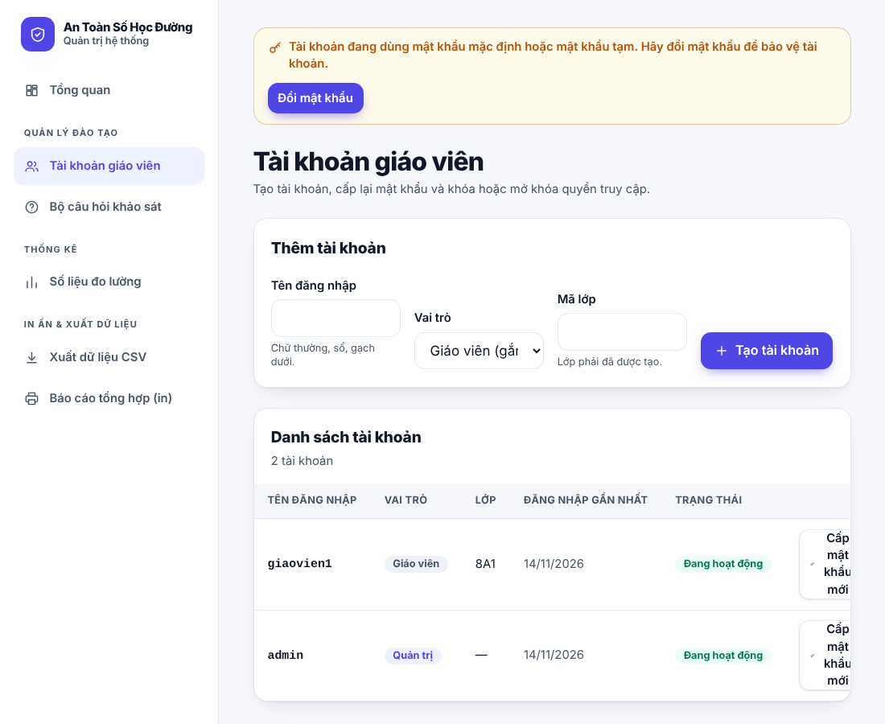{width=80%}

**Thêm tài khoản:** điền **Tên đăng nhập** (chữ thường, số, gạch dưới), chọn **Vai trò** (*Giáo viên (gắn lớp)* hoặc *Quản trị viên (không gắn lớp)*), với giáo viên điền thêm **Mã lớp** (lớp phải đã được tạo ở mục 1.2), rồi bấm **Tạo tài khoản**. Mật khẩu tạm **chỉ hiện một lần**: hãy ghi lại ngay và trao qua kênh trực tiếp, rồi bấm **Đã ghi lại**.

**Cấp mật khẩu mới:** dùng khi giáo viên quên mật khẩu. Bấm **Cấp mật khẩu mới**, xác nhận. Mọi phiên đang mở của tài khoản đó bị đăng xuất; mật khẩu tạm hiện **một lần**.

**Khóa / Mở khóa:** tài khoản bị khóa không đăng nhập được, dữ liệu giữ nguyên. Hệ thống **không cho** khóa chính tài khoản đang đăng nhập hoặc khóa quản trị viên cuối cùng còn hoạt động.

Mọi thao tác đều có hộp thoại xác nhận.

## 1.4. Quản lý bộ câu hỏi khảo sát

Nhóm **Quản lý đào tạo** → **Bộ câu hỏi khảo sát**. Trang hiển thị bộ câu hỏi hiện hành, tách thành **Kiến thức** (có đáp án đúng, đánh dấu ✓) và **Hành vi** (thang bốn mức, có câu **Đảo chiều**).

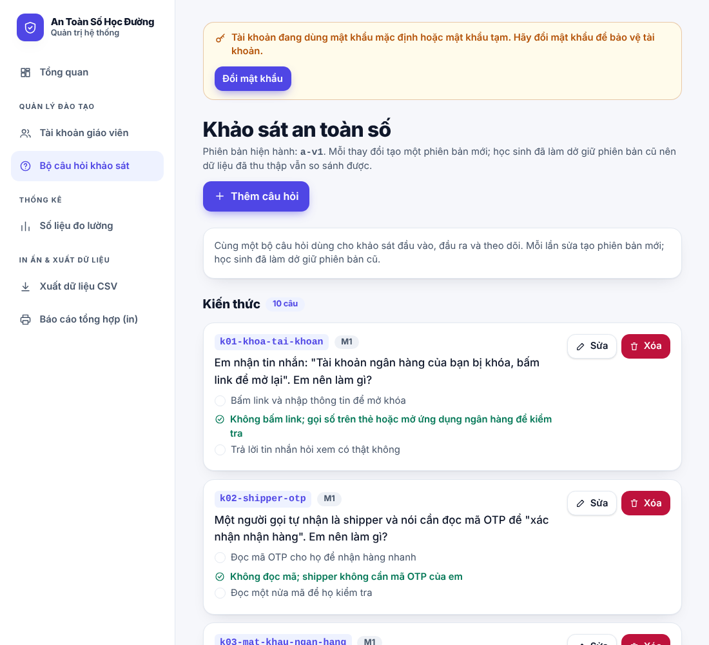{width=80%}

- **Thêm câu hỏi**, **Sửa**, **Xóa** từng câu. Mã câu và loại câu không đổi được sau khi tạo.
- **Mỗi thay đổi tạo một phiên bản mới** của bộ câu hỏi. Học sinh đã làm dở giữ phiên bản cũ, nên dữ liệu đã thu thập vẫn so sánh được. Mục **Lịch sử phiên bản** ghi các phiên bản.
- Đáp án đúng **chỉ quản trị viên thấy**; không bao giờ gửi đến trình duyệt của học sinh.
- **Chỉ sửa bộ câu hỏi trước khi thu thập dữ liệu chính thức.** Đổi câu hỏi giữa chừng làm khó so sánh trước–sau.

## 1.5. Trang Tổng quan

Mục **Tổng quan** là trang đầu sau khi đăng nhập.

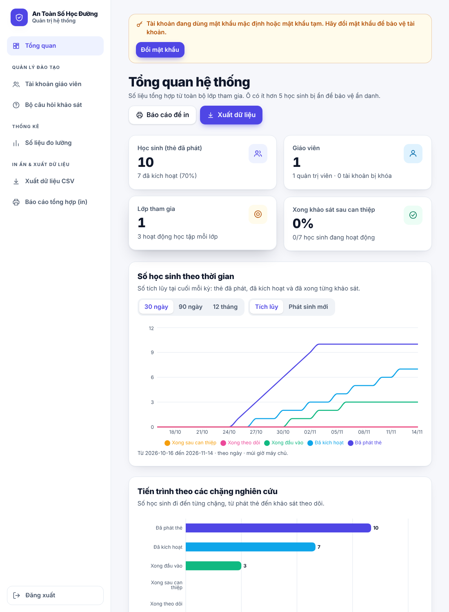{width=85%}

**Bốn thẻ chỉ số:**

| Thẻ | Ý nghĩa |
|---|---|
| Học sinh (thẻ đã phát) | Tổng số thẻ đã tạo và tỉ lệ đã kích hoạt |
| Giáo viên | Số giáo viên đang hoạt động, số quản trị viên, số tài khoản bị khóa |
| Lớp tham gia | Số lớp có thẻ |
| Xong khảo sát sau can thiệp | Tỉ lệ học sinh đang hoạt động đã làm xong khảo sát sau |

**Số học sinh theo thời gian:** chọn **30 ngày**, **90 ngày** (theo ngày) hoặc **12 tháng** (theo tháng); chọn **Tích lũy** (đường: số tại cuối mỗi kỳ) hoặc **Phát sinh mới** (cột: số phát sinh trong từng kỳ). Dữ liệu lấy trực tiếp từ máy chủ theo thời điểm phát thẻ, kích hoạt và hoàn thành khảo sát.

Bên dưới là các biểu đồ chụp nhanh: tiến trình theo chặng nghiên cứu, tỉ lệ kích hoạt thẻ, điểm kiến thức theo giai đoạn, tiến độ theo lớp, tỉ lệ đúng theo chủ đề.

> **Khi mới cài, các số đều bằng 0 và biểu đồ trống.** Đây là bình thường. Số liệu chỉ xuất hiện khi học sinh kích hoạt thẻ và làm khảo sát.

## 1.6. Kiểm tra số liệu đo lường

Nhóm **Thống kê** → **Số liệu đo lường**.

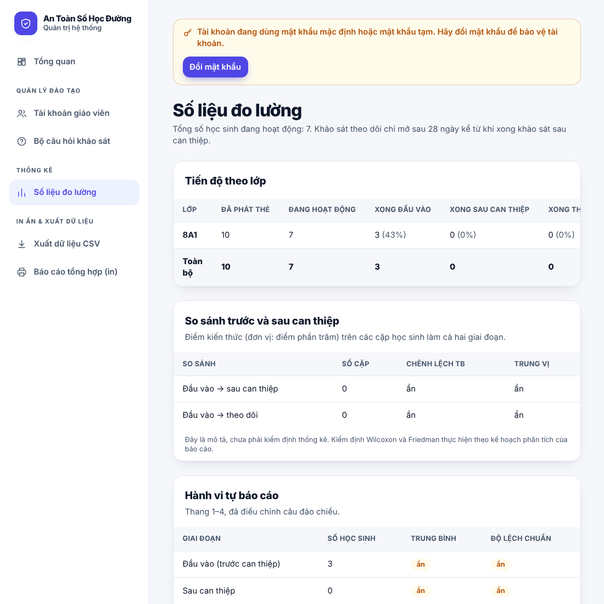{width=85%}

Các bảng: **Tiến độ theo lớp** (kèm dòng tổng), **So sánh trước và sau can thiệp** (số cặp, chênh lệch trung bình, trung vị), **Hành vi tự báo cáo** (thang 1–4, đã điều chỉnh câu đảo chiều) và **Kiến thức theo nhóm chủ đề** (M1 sân chơi tình huống, M2 thám tử tên miền, M3 phòng thí nghiệm tài khoản).

**Quy tắc ẩn ô nhỏ:** ô có **dưới 5 học sinh** hiển thị **ẩn** kèm cỡ mẫu, để không lộ danh tính. Khi thấy "ẩn", không phải lỗi: số học sinh chưa đủ để công bố.

Các số này **chỉ để mô tả**. Kiểm định thống kê (Wilcoxon, Friedman…) làm riêng theo kế hoạch phân tích, trên dữ liệu xuất ra.

## 1.7. Xuất dữ liệu CSV

Nhóm **In ấn & Xuất dữ liệu** → **Xuất dữ liệu CSV**.

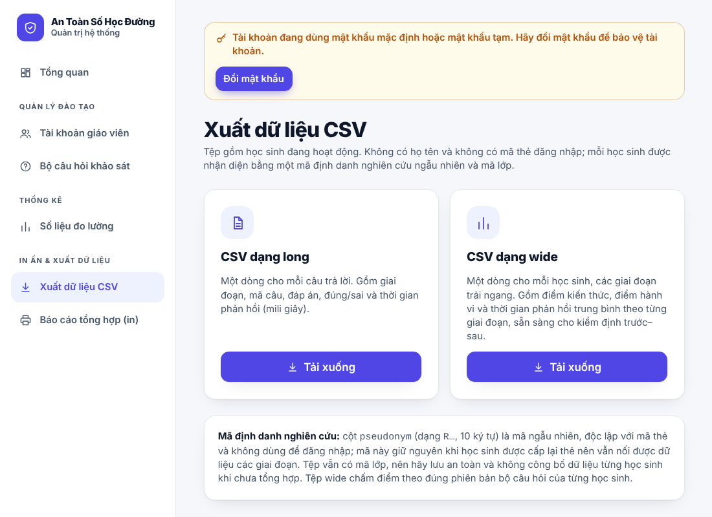{width=80%}

| Tệp | Nội dung | Dùng cho |
|---|---|---|
| **CSV dạng long** | Một dòng cho mỗi câu trả lời (giai đoạn, mã câu, đáp án, đúng/sai, thời gian phản hồi) | Phân tích từng câu |
| **CSV dạng wide** | Một dòng cho mỗi học sinh (điểm kiến thức, hành vi, thời gian phản hồi theo giai đoạn) | Kiểm định trước–sau |

Bấm **Tải xuống**. Tệp chỉ gồm học sinh **đã kích hoạt**, và dùng chính phiên đăng nhập của quản trị viên (không cần nhập token).

**Hai loại mã tách biệt (rất quan trọng về bảo mật):**

| Mã | Dạng | Dùng để | Có trong tệp CSV? |
|---|---|---|---|
| **Mã thẻ** | `XXXX-XXXX` | Kích hoạt và **đăng nhập**; in trên thẻ; giáo viên biết | **Không bao giờ** |
| **Mã định danh nghiên cứu** (cột `pseudonym`) | `R` + 9 ký tự, ví dụ `R7K2MQX9HB` | Nhận diện học sinh trong dữ liệu | Có |

Mã nghiên cứu được sinh ngẫu nhiên khi phát thẻ, **không suy ra được từ mã thẻ**, **không dùng để đăng nhập**, và **giữ nguyên khi cấp lại thẻ**. Nhờ vậy người cầm tệp CSV không thể đăng nhập thay học sinh. Tệp vẫn có **mã lớp** và **thời điểm trả lời**: với lớp nhỏ, cần cẩn trọng khi công bố dữ liệu từng học sinh.

Xuất bằng dòng lệnh (khi cần): `php api/bin/export_assessments.php wide antoanso_wide.csv` và `... long antoanso_long.csv`.

## 1.8. Báo cáo tổng hợp (in hoặc lưu PDF)

Nhóm **In ấn & Xuất dữ liệu** → **Báo cáo tổng hợp (in)** → **Xem trước và in báo cáo**.

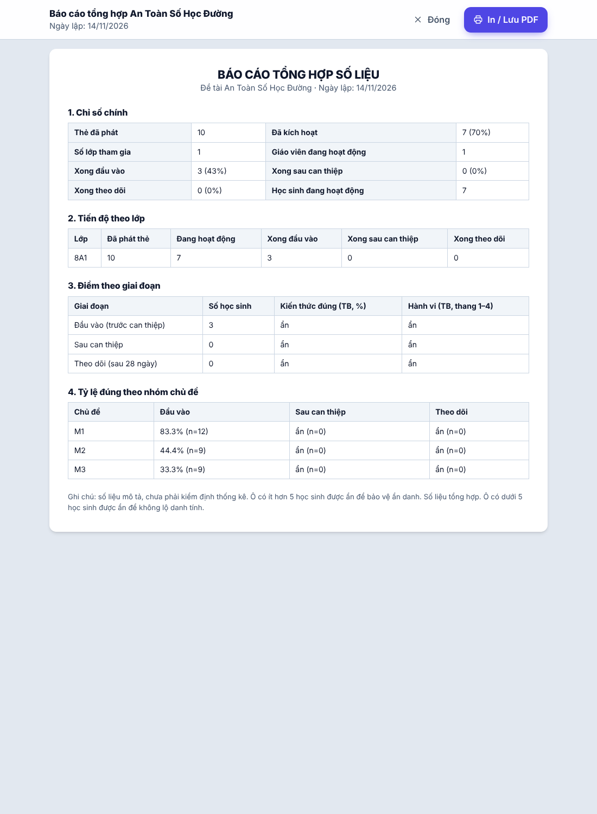{width=80%}

Báo cáo khổ A4 gồm chỉ số chính, tiến độ theo lớp, điểm theo giai đoạn và tỉ lệ đúng theo chủ đề; **chỉ có số tổng hợp**, ô nhỏ hơn 5 vẫn bị ẩn. Bấm **In / Lưu PDF**, trong hộp thoại in của trình duyệt chọn máy in hoặc **Lưu dưới dạng PDF**.

## 1.9. Bảo mật, đạo đức dữ liệu và giới hạn đã biết

**Nên làm:**

- Đổi mật khẩu mặc định (mục 1.1). Không dùng tài khoản mặc định trên hosting.
- Coi **tệp CSV, sổ phát thẻ, `api/.env`, `ADMIN_TOKEN`** là tài liệu mật; lưu an toàn, không gửi qua kênh công khai.
- Không công bố kết quả theo lớp khi lớp có **dưới 5 học sinh**.
- Nhóm kỹ thuật có quyền đọc cơ sở dữ liệu: chỉ truy cập khi cần cho bảo trì hoặc phân tích đã được phê duyệt; không sao chép dữ liệu thô ra ngoài.
- Sao lưu cơ sở dữ liệu định kỳ.
- **Ranh giới ẩn danh:** giáo viên phát thẻ trực tiếp nên biết thẻ nào của học sinh nào. Dữ liệu ẩn danh đối với nhóm nghiên cứu và tệp xuất, **không ẩn danh đối với giáo viên lớp**. Điều này phải nêu trong phiếu đồng ý.

**Giới hạn đã biết:**

- Đăng nhập chưa có giới hạn số lần thử sai.
- Chưa có màn hình xem nhật ký thao tác (`audit_log`); cần truy vấn trực tiếp.
- Chưa có cơ chế tự nhắc làm khảo sát theo dõi.
- Mật khẩu tạm chỉ được nhắc đổi, chưa bị chặn.

---

# PHẦN 2. GIÁO VIÊN

Giáo viên là người **phát thẻ và theo dõi lớp mình được giao**. Giáo viên không cần biết kỹ thuật. Công việc gồm: đăng nhập, tạo thẻ, in thẻ, phát thẻ cho học sinh, ghi sổ phát thẻ, hướng dẫn học sinh kích hoạt, theo dõi tiến độ.

**Quy trình nghiệp vụ tổng quát:**

| Bước | Việc | Mục |
|---|---|---|
| 1 | Đăng nhập, đổi mật khẩu | 2.1 |
| 2 | Tạo đợt thẻ (ví dụ 20 thẻ) và **ghi lại danh sách mã ngay** | 2.3 |
| 3 | In thẻ ra giấy A4 hoặc lưu PDF | 2.4 |
| 4 | Phát thẻ cho học sinh, **ghi vào sổ phát thẻ riêng** | 2.5 |
| 5 | Hướng dẫn học sinh kích hoạt thẻ | 2.6 |
| 6 | Theo dõi tiến độ lớp | 2.7 |
| 7 | Cấp lại thẻ khi học sinh làm mất | 2.8 |

## 2.1. Đăng nhập và đổi mật khẩu

1. Mở ứng dụng, ở khối **Dành cho giáo viên** bấm **Giáo viên đăng nhập**.
2. Nhập tên đăng nhập và mật khẩu do quản trị viên cấp, bấm **Đăng nhập**.
3. Trang lớp hiện ra. Khi xong việc, bấm **Đăng xuất** ở góc trên bên phải.

**Lần đầu đăng nhập bằng mật khẩu tạm hoặc mật khẩu mặc định**, đầu trang có **khối cảnh báo màu vàng**. Bấm **Đổi mật khẩu**, nhập mật khẩu hiện tại, mật khẩu mới (**10 ký tự trở lên, có cả chữ và số, khác mật khẩu cũ**) và nhập lại, rồi bấm **Lưu mật khẩu mới**. Đổi xong, khối cảnh báo sẽ ẩn.

Lưu ý: phiên đăng nhập giữ **8 giờ**; không chia sẻ tài khoản; quên mật khẩu thì liên hệ quản trị viên để được đặt lại.

## 2.2. Trang lớp

Trang lớp (tên lớp ở tiêu đề, ví dụ **Lớp 8A1**) gồm:

- **Bốn chỉ số:** số thẻ đã cấp (kèm tỉ lệ kích hoạt), số học sinh xong khảo sát đầu vào, xong cả ba hoạt động, xong khảo sát sau.
- **Ô tìm theo mã thẻ** và bộ lọc **Tất cả / Đã kích hoạt / Chưa kích hoạt**.
- **Danh sách học sinh** theo **mã thẻ**: trạng thái và tiến độ từng hoạt động. Trên máy tính là bảng; trên điện thoại, mỗi học sinh là một thẻ.
- Hai nút ở góc phải: **In thẻ học sinh** và **Tạo thẻ mới**.

Trang này **chỉ hiển thị tiến độ**, không hiển thị nội dung câu trả lời của học sinh.

## 2.3. Tạo đợt thẻ và ghi lại danh sách mã

> **Chọn đúng thao tác:** tạo thẻ **mới** chỉ dành cho học sinh **chưa có thẻ** (hoặc thẻ chưa ai kích hoạt). Với học sinh **đã kích hoạt** và làm mất thẻ, **không tạo thẻ mới** vì sẽ mất tiến độ cũ; hãy **cấp lại thẻ** (mục 2.8).

**Ví dụ: tạo 20 thẻ cho lớp.**

1. Ở trang lớp, bấm **Tạo thẻ mới**.
2. Trong ô **Số thẻ cần tạo**, nhập `20` (mỗi lần tạo từ 1 đến **20** thẻ).
3. Bấm **Tạo thẻ**.

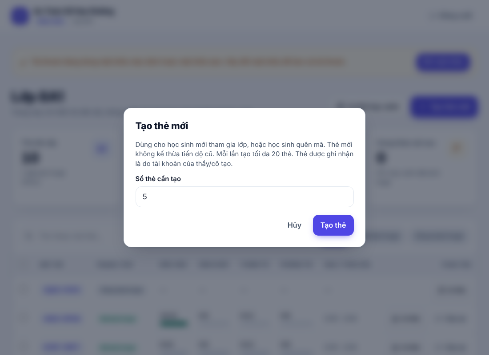{width=70%}

4. Hộp thoại **Đã tạo thẻ mới** hiện **danh sách mã** (mỗi mã dạng `XXXX-XXXX`). **Ghi lại danh sách này ngay** vào sổ phát thẻ hoặc in ra (mục 2.4).

**Về việc lấy lại danh sách mã.** Hệ thống **không có chức năng tải danh sách mã thành tệp** riêng. Sau khi đóng hộp thoại, các mã vẫn còn trong **danh sách lớp** (cột **Mã thẻ**) và có thể in lại bằng **In thẻ học sinh**. Tuy vậy, **hãy ghi lại ngay lúc tạo** vì đó là lúc dễ đối chiếu nhất: bạn cần biết **thẻ nào sẽ phát cho học sinh nào** (mục 2.5).

Giới hạn: mỗi lớp có **tổng số thẻ tối đa** do quản trị viên đặt (mặc định 300, tính cả thẻ đã tạo trước đó). Vượt giới hạn, ứng dụng báo lỗi: liên hệ quản trị viên. Thẻ do giáo viên tạo được ghi nhận là **do tài khoản của giáo viên đó tạo**, để có trách nhiệm đối với việc phát thẻ.

## 2.4. In thẻ học sinh ra giấy A4

**Nút "In thẻ học sinh".** Nút ở góc phải trang lớp:

- **Màu xám, không bấm được** khi lớp **chưa có thẻ nào** (hoặc bộ lọc đang hiện danh sách trống). Hãy bấm **Tạo thẻ mới** trước.
- **Sáng, bấm được** khi lớp đã có thẻ. Nếu bạn **tích chọn** một số học sinh (ô vuông ở đầu mỗi dòng), nút đổi thành **In n thẻ đã chọn** và chỉ in các thẻ đó. Nếu không tích gì, nút in **toàn bộ** danh sách đang hiển thị (có thể lọc *Chưa kích hoạt* để chỉ in thẻ chưa phát).
- Mỗi dòng học sinh có nút **In thẻ** riêng cho từng thẻ.
- Ngay sau khi tạo thẻ, bấm **In các thẻ này** trong hộp thoại **Đã tạo thẻ mới** là in đúng đợt vừa tạo.

**Trang xem trước:**

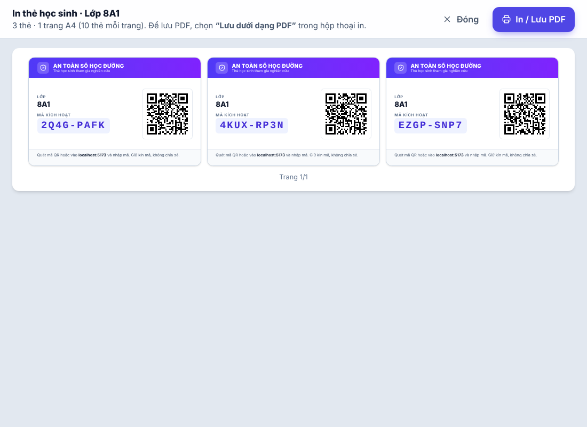{width=80%}

Hệ thống xếp thẻ **đúng kích thước chuẩn thẻ học sinh, khoảng 85,6 × 54 mm**, **10 thẻ mỗi trang A4** (2 cột × 5 hàng). 20 thẻ sẽ ra **2 trang**. Mỗi thẻ có: tên đề tài, **lớp**, **mã kích hoạt** (chữ lớn) và **mã QR**. Thẻ **không có họ tên hay ảnh học sinh**.

**Các bước in:**

1. Bấm **In / Lưu PDF**. Hộp thoại in của trình duyệt mở ra.
2. Chọn **Máy in** thật để in giấy, hoặc chọn **Lưu dưới dạng PDF** để lưu tệp (rồi in sau hoặc gửi đi in).
3. Kiểm tra cài đặt:
   - **Khổ giấy:** A4.
   - **Tỷ lệ / Scale:** **100% (Mặc định)**. **Không chọn** "Vừa trang" / "Fit to page", vì sẽ làm sai kích thước thẻ.
   - **Tiêu đề và chân trang (Headers and footers):** **tắt**.
   - **Đồ họa nền (Background graphics):** **bật**, nếu thấy dải màu tím ở đầu thẻ không hiện.
4. Bấm **In** (hoặc **Lưu**).

**Kiểm tra bản in lần đầu:** in thử **một trang**, dùng thước đo một thẻ. Chiều ngang phải khoảng **85,6 mm**, chiều cao khoảng **54 mm**. Nếu lệch nhiều, kiểm tra lại cài đặt **Tỷ lệ**. Quét thử một mã QR (xem lưu ý ở mục 2.5).

**Sau khi in:** cắt theo viền thẻ; nên in giấy dày hoặc ép plastic để bền. Thẻ in xong là **thông tin nhạy cảm**: giữ cẩn thận.

## 2.5. Phát thẻ, sổ phát thẻ và mã QR

**Sổ phát thẻ (bắt buộc).** Khi phát thẻ, ghi **thẻ nào cho học sinh nào** vào **sổ riêng của giáo viên** (giấy hoặc tệp riêng). **Không ghi vào bất kỳ tệp nào của hệ thống.** Hệ thống chỉ lưu mã, **không lưu họ tên**, nên **không thể tìm lại mã nếu sổ bị mất**. Sổ này là thông tin nhạy cảm, cần bảo quản riêng.

**Về mã QR trên thẻ.**

- Quét mã QR bằng camera điện thoại sẽ mở ứng dụng ở màn **Kích hoạt thẻ mã** với **mã đã điền sẵn**. Học sinh vẫn phải đọc thông tin và tích đồng ý.
- Mã QR trỏ tới **địa chỉ mà bạn đang dùng để mở ứng dụng** (xem dòng "…vào **địa chỉ** và nhập mã" ở chân thẻ). Nếu ứng dụng đang chạy **thử trên máy cá nhân** (địa chỉ `localhost`), **điện thoại quét sẽ không mở được**. Khi đó học sinh nhập mã bằng tay trên máy tính. Chỉ dùng QR cho học sinh khi ứng dụng đã được **cài trên địa chỉ thật** mà điện thoại truy cập được.

## 2.6. Hướng dẫn học sinh kích hoạt thẻ

Cho học sinh xem Phần 3 hoặc hướng dẫn nhanh:

1. Mở ứng dụng, bấm **Em có thẻ mã từ giáo viên**.
2. Nhập mã trên thẻ (hoặc quét QR), tích **Em đã đọc và đồng ý tham gia nghiên cứu**, bấm **Kích hoạt và bắt đầu**.
3. Làm **khảo sát đầu vào** trước, rồi mới mở được các hoạt động.

Mỗi thẻ **chỉ kích hoạt được một lần**. Phát thẻ nào, nhắc học sinh **giữ thẻ cẩn thận**.

## 2.7. Theo dõi tiến độ lớp

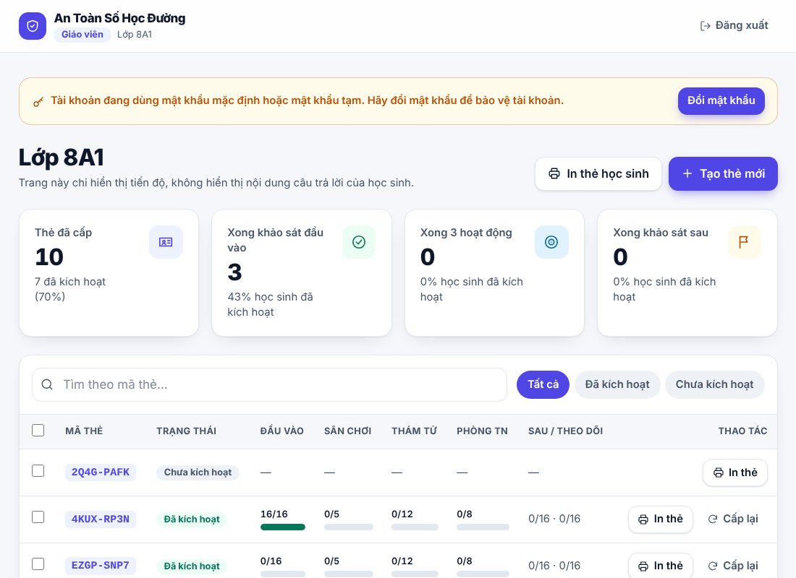{width=85%}

Danh sách hiển thị cho mỗi học sinh:

- **Trạng thái:** *Đã kích hoạt* hay *Chưa kích hoạt* (thẻ chưa kích hoạt chỉ có mã).
- **Đầu vào:** số câu khảo sát đầu vào đã làm trên tổng 16.
- **Sân chơi, Thám tử, Phòng TN:** số mục đã hoàn thành của ba hoạt động.
- **Sau / Theo dõi:** số câu đã làm của khảo sát sau và theo dõi.

Dùng danh sách để **nhắc học sinh còn thiếu**. Khảo sát **theo dõi** chỉ mở sau **28 ngày** kể từ khi xong khảo sát sau; hệ thống **chưa tự nhắc**, giáo viên cần nhắc học sinh.

Giáo viên **không xem được** câu trả lời, đáp án hay nội dung học sinh nhập.

## 2.8. Cấp lại thẻ khi học sinh làm mất

Chỉ dùng cho học sinh **đã kích hoạt** (đã có tiến độ). Thẻ mới **giữ nguyên tiến độ**, mã cũ **mất hiệu lực ngay**.

1. Mở **sổ phát thẻ**, tìm mã đã phát cho học sinh đó. **Bước này bắt buộc**: danh sách lớp chỉ hiển thị mã, không hiển thị tên.
2. Trong danh sách lớp, tìm đúng mã đó, bấm **Cấp lại** ở dòng đó.
3. Trong hộp thoại **Cấp thẻ mới cho học sinh**, **tích ô "Tôi đã đối chiếu mã cũ với sổ phát thẻ"**. Nút **Xác nhận cấp thẻ mới** chỉ bật sau khi tích.

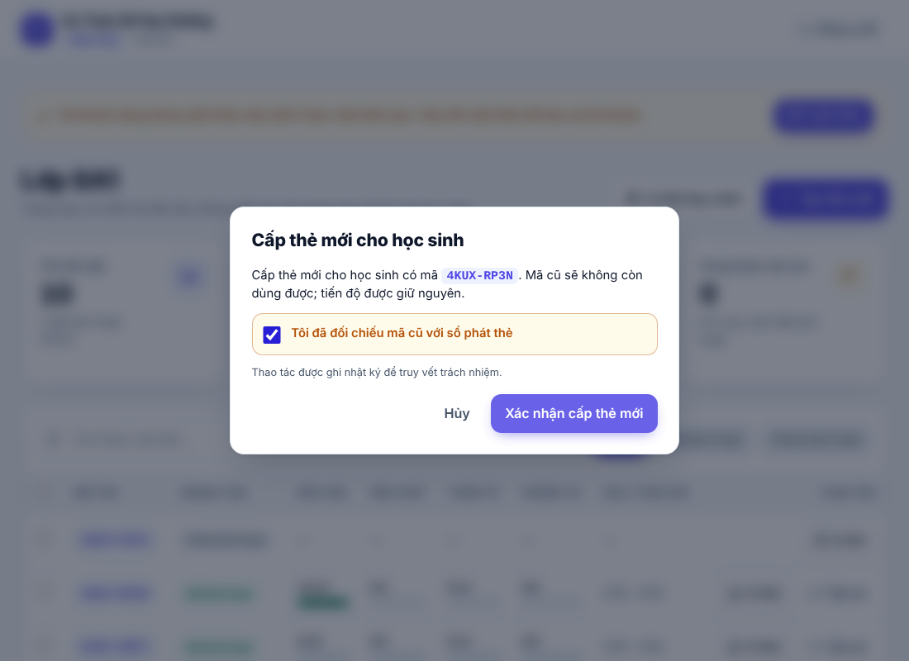{width=70%}

4. Bấm **Xác nhận cấp thẻ mới**. Mã mới hiện ra kèm nút **In thẻ mới**: in và phát cho học sinh.
5. **Ghi vào sổ:** mã cũ, mã mới, học sinh nào, ngày nào.

Mỗi lần cấp lại được hệ thống **ghi nhật ký** (người thực hiện, mã cũ, mã mới, thời điểm) để truy vết trách nhiệm. Chỉ cấp lại được cho học sinh **của lớp mình**.

## 2.9. Bảo mật thông tin mã thẻ và mã QR

Mã thẻ **chính là mật khẩu đăng nhập** của học sinh, và mã QR **chứa chính mã thẻ**. Ai có mã hoặc ảnh chụp mã đều có thể đăng nhập thay học sinh. Vì vậy:

- **Không đăng tải công khai** ảnh chụp màn hình hoặc ảnh thẻ có mã thẻ hoặc mã QR (mạng xã hội, nhóm trò chuyện công khai, tài liệu nộp ra ngoài). Nếu cần minh họa, **che mã** trước khi chia sẻ.
- **Không gửi danh sách mã** qua tin nhắn công khai; chỉ trao thẻ trực tiếp cho học sinh.
- Giữ **sổ phát thẻ** riêng, tách khỏi nơi để thẻ.
- Không chụp màn hình danh sách lớp (có mã thẻ) để chia sẻ.
- Nếu nghi ngờ **lộ mã** của một học sinh, hãy **cấp lại thẻ** cho học sinh đó (mục 2.8).
- Không chia sẻ tài khoản giáo viên; **không tạo thẻ vượt nhu cầu** thực tế của lớp.

## 2.10. Điều giáo viên không làm

- Không yêu cầu học sinh nhập họ tên, email, số điện thoại hay **mật khẩu thật** vào ứng dụng.
- Không tự đổi lớp hoặc mật khẩu của người khác (việc này do quản trị viên).
- Không cố xem câu trả lời của học sinh; giao diện không hiển thị chúng.
- Không tự sửa dữ liệu trong cơ sở dữ liệu.

---

# PHẦN 3. HỌC SINH

Chào em! Ứng dụng này giúp em **nhận biết và tránh lừa đảo trên điện thoại**: cuộc gọi lạ, tin nhắn trúng thưởng, đường link giả, mật khẩu yếu. Em tham gia **hoàn toàn tự nguyện**, và em có thể dừng bất cứ lúc nào.

Ứng dụng **không hỏi họ tên, email, số điện thoại hay mật khẩu thật** của em. Em chỉ dùng **một mã trên thẻ** do thầy/cô phát.

**Em sẽ đi qua 6 chặng:**

| Chặng | Việc em làm | Khi nào mở |
|---|---|---|
| 1 | **Khảo sát đầu vào** (16 câu) | Mở ngay sau khi đăng nhập |
| 2 | **Sân chơi tình huống** | Sau khi làm xong khảo sát đầu vào |
| 3 | **Thám tử không gian mạng** | Sau khi làm xong khảo sát đầu vào |
| 4 | **Phòng thí nghiệm tài khoản** | Sau khi làm xong khảo sát đầu vào |
| 5 | **Khảo sát sau can thiệp** | Khi em xong cả 3 hoạt động |
| 6 | **Khảo sát theo dõi** | Khoảng 4 tuần (28 ngày) sau chặng 5 |

## 3.1. Nhận thẻ và kích hoạt lần đầu

Thầy/cô sẽ phát cho em **một thẻ** có: tên đề tài, **lớp của em**, **mã kích hoạt** dạng `XXXX-XXXX` (4 ký tự, dấu gạch, 4 ký tự) và một **mã QR**. Ví dụ về dạng mã: `AB3D-EF4G` (đây chỉ là ví dụ, không phải mã của em). **Hãy giữ thẻ cẩn thận, không cho ai mượn, không chụp ảnh đăng lên mạng.**

**Cách 1 – Nhập mã bằng tay:**

1. Mở ứng dụng. Ở trang đầu, bấm **Em có thẻ mã từ giáo viên**.

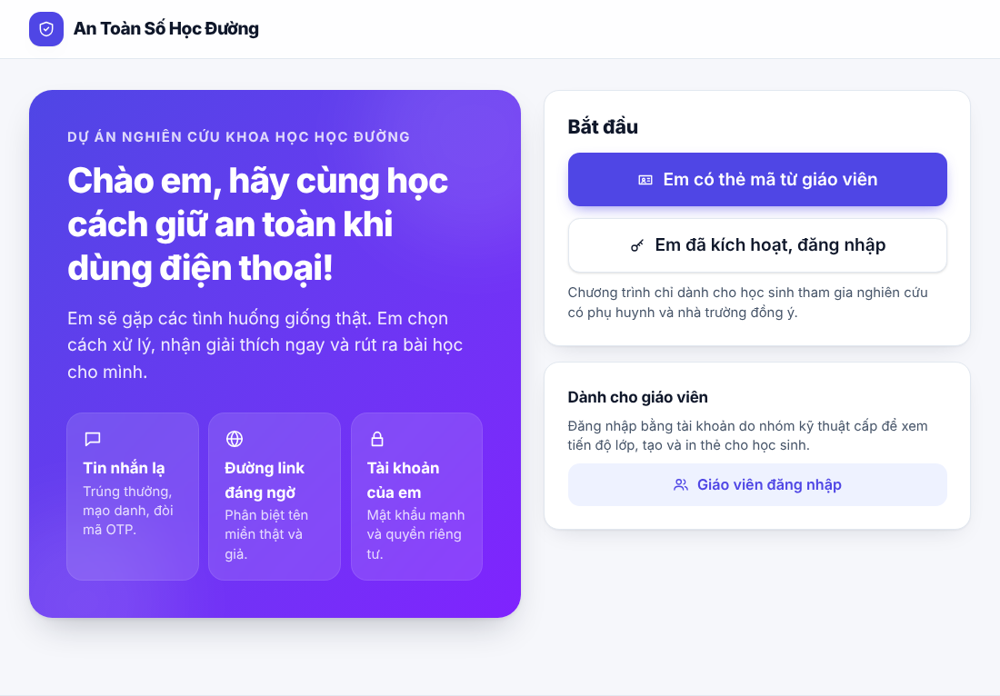{width=80%}

2. Màn **Kích hoạt thẻ mã** hiện ra. Em đọc khối thông tin: ứng dụng **thu thập** mã trên thẻ và kết quả em trả lời; **không thu thập** họ tên, email, số điện thoại, ảnh hay mật khẩu của em.
3. Nhập mã trên thẻ vào ô **Mã trên thẻ**. Em có thể gõ chữ hoa hoặc chữ thường, ứng dụng tự đổi thành chữ hoa.
4. **Tích ô** *Em đã đọc và đồng ý tham gia nghiên cứu.* Nút **Kích hoạt và bắt đầu** chỉ sáng lên khi em đã nhập mã **và** tích ô này.
5. Bấm **Kích hoạt và bắt đầu**.

**Cách 2 – Quét mã QR (nếu thầy/cô cho phép):** dùng camera điện thoại quét mã QR trên thẻ. Ứng dụng mở màn **Kích hoạt thẻ mã** với **mã đã điền sẵn** và dòng *Đã nhận mã từ thẻ của em*. Em vẫn đọc thông tin, tích ô đồng ý, rồi bấm **Kích hoạt và bắt đầu**.

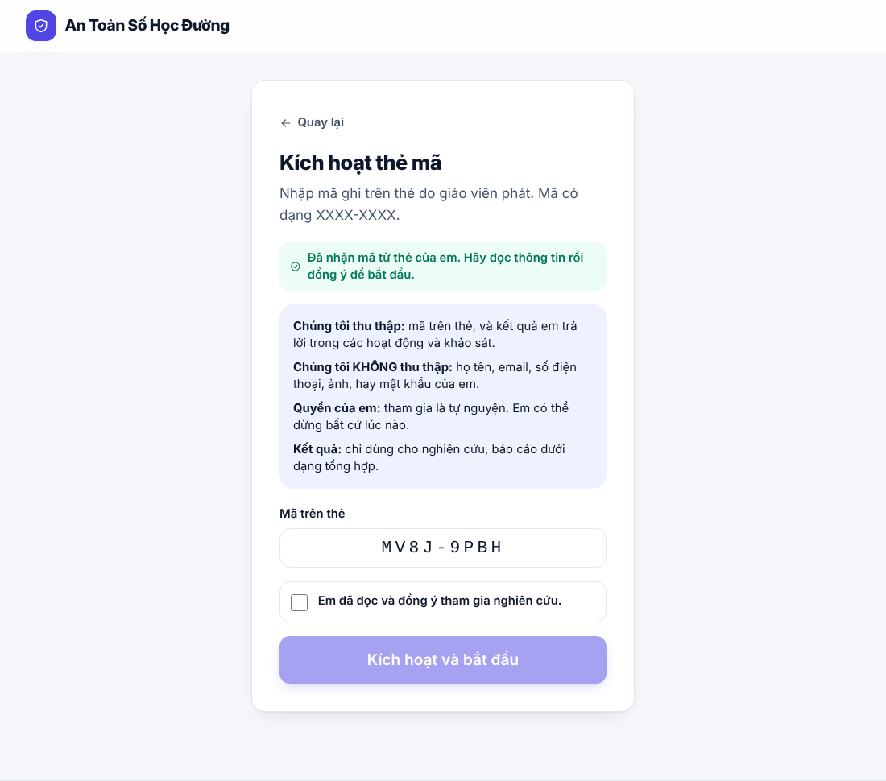{width=70%}

**Nếu không kích hoạt được:** kiểm tra em gõ đúng từng ký tự (mã không có số 0, số 1 và các chữ O, I, L, nên rất ít khi nhầm). Mỗi thẻ **chỉ kích hoạt được một lần**. Nếu thẻ báo đã dùng hoặc không đúng, **báo thầy/cô**.

## 3.2. Đăng nhập những lần sau

1. Ở trang đầu, bấm **Em đã kích hoạt, đăng nhập**.
2. Nhập mã trên thẻ vào ô **Mã học sinh**, bấm **Đăng nhập**.

Phiên làm việc kéo dài **24 giờ**; hết thời gian, em chỉ cần nhập lại mã. **Em vẫn giữ nguyên những gì đã làm.** Cuối buổi, bấm **Đăng xuất** (trên điện thoại là biểu tượng ở góc phải trên).

## 3.3. Bảng học tập

Sau khi kích hoạt, em vào **bảng học tập**. Lúc đầu, em thấy:

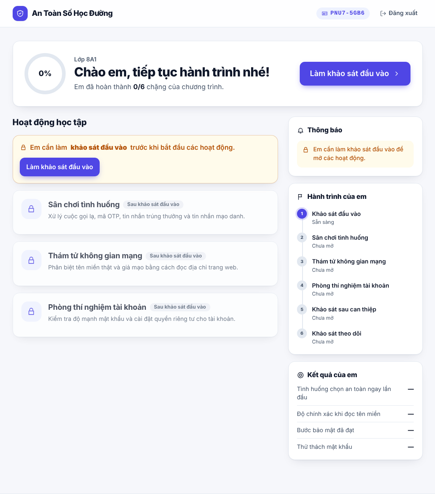{width=85%}

- **Vòng phần trăm** cho biết em đã hoàn thành bao nhiêu trong 6 chặng.
- **Nút lớn** ở đầu trang, lúc này là **Làm khảo sát đầu vào**, chỉ cho em việc cần làm tiếp theo.
- **Ba hoạt động bị khóa** 🔒 với nhãn *Sau khảo sát đầu vào*, và dòng nhắc: *"Em cần làm khảo sát đầu vào trước khi bắt đầu các hoạt động."*
- **Thông báo**, **Hành trình của em** và **Kết quả của em** ở cột bên phải.

**Em chưa làm được các hoạt động vì đang bị khóa. Việc đầu tiên là làm khảo sát đầu vào.**

## 3.4. Làm khảo sát đầu vào (để mở khóa các hoạt động)

1. Bấm **Làm khảo sát đầu vào** (nút lớn ở đầu trang, hoặc ở khối nhắc màu vàng).
2. Màn khảo sát cho biết: *"Khảo sát có 16 câu. Em làm từng câu một."* và *"Không có điểm đúng sai để chấm. Em cứ chọn đúng suy nghĩ của mình."* Bấm **Bắt đầu**.

{width=70%}

3. Em làm từng câu một. Tiêu đề góc phải ghi *Câu x/16* và thanh tiến trình tăng dần. Có hai loại câu:
   - **Câu kiến thức:** có 2 đến 4 đáp án (A, B, C…). Em **bấm vào đáp án** em chọn.
   - **Câu hành vi:** hỏi em thường làm gì, có **4 mức** từ *Không bao giờ* đến *Luôn luôn*. Em **bấm vào mức** đúng với em.
4. **Khi em bấm chọn, câu trả lời được gửi và ứng dụng chuyển sang câu tiếp theo ngay.** Em **không quay lại sửa** được, nên hãy đọc kỹ rồi mới bấm.
5. Sau câu cuối, màn hình hiện *"Em đã hoàn thành khảo sát đầu vào. Cảm ơn em!"* Bấm **Về trang chính**.

**Mẹo:**

- **Không có đúng hay sai** ở khảo sát. Em chọn theo suy nghĩ thật của mình. Đây không phải bài kiểm tra tính điểm.
- Nếu em **làm dở** (mất điện, hết giờ), lần sau đăng nhập và bấm **Tiếp tục**: em làm tiếp từ câu đang dở, các câu đã trả lời được giữ.
- Mỗi câu chỉ trả lời **một lần**. Mất mạng thì đợi có mạng rồi thử lại.

## 3.5. Sau khi khảo sát đầu vào: các hoạt động mở khóa

Khi quay về bảng học tập, ba hoạt động **đã mở**. Vòng phần trăm tăng lên, chặng 1 được đánh dấu **Đã hoàn thành**.

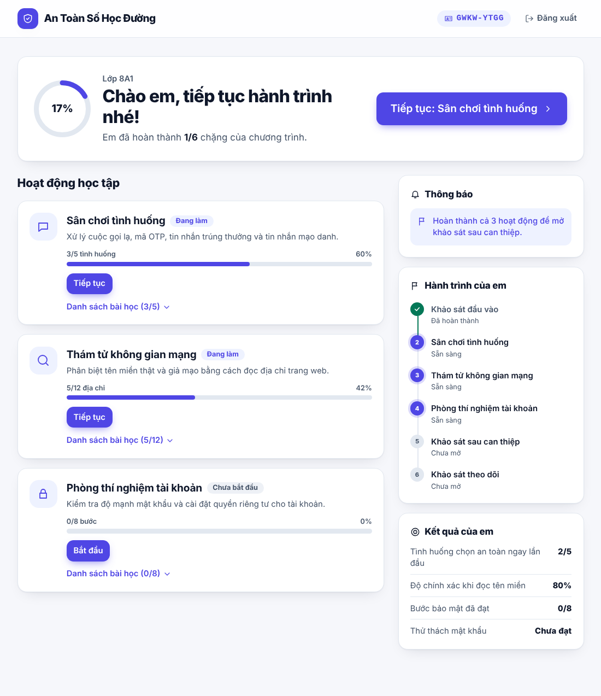{width=85%}

Mỗi hoạt động có **thanh tiến độ** và nút **Bắt đầu**, **Tiếp tục** hoặc **Ôn lại**. Bấm **Danh sách bài học** để xem từng bài nhỏ, bài nào đã làm.

| Hoạt động | Em làm gì |
|---|---|
| **Sân chơi tình huống** | Đọc 5 tình huống giống thật (cuộc gọi tự xưng công an, đòi mã OTP, tin nhắn trúng thưởng, người quen nhờ chuyển tiền gấp, link dịch vụ công giả), chọn cách xử lý, nhận giải thích ngay |
| **Thám tử không gian mạng** | Nhìn 12 địa chỉ web, chọn **Chính thống** hay **Giả mạo**. Khi chưa chắc, bấm **Đọc từ phải sang trái** để học cách đọc tên miền |
| **Phòng thí nghiệm tài khoản** | Thử **mật khẩu mẫu** (không dùng mật khẩu thật) để xem mạnh hay yếu, và làm các bước cài đặt quyền riêng tư cho **Zalo** và **Facebook** |

Em làm **theo thứ tự nào cũng được**. Khi xong **cả 3 hoạt động**, khảo sát **sau can thiệp** sẽ mở: em làm giống khảo sát đầu vào. Khoảng **28 ngày sau**, khảo sát **theo dõi** mở; ứng dụng sẽ báo ngày mở ở phần **Thông báo**.

## 3.6. Điều em cần nhớ

- **Không nhập mật khẩu thật** của em vào ứng dụng. Ở Phòng thí nghiệm chỉ dùng mật khẩu mẫu.
- **Không đọc mã OTP** hay mã xác thực cho bất kỳ ai, kể cả người tự nhận là công an, ngân hàng hay shipper.
- **Giữ thẻ mã** như giữ chìa khóa: không cho bạn mượn, không chụp ảnh thẻ đăng lên mạng.
- **Làm mất thẻ?** Báo thầy/cô ngay. Thầy/cô sẽ cấp thẻ mới và em **vẫn giữ nguyên những gì đã làm**.
- Em có thể **dừng bất cứ lúc nào** và báo thầy/cô nếu muốn rút khỏi nghiên cứu.
- Có thắc mắc về đề tài: hỏi giáo viên hướng dẫn.

---

# PHỤ LỤC. XỬ LÝ SỰ CỐ NHANH

| Ai | Triệu chứng | Cách xử lý |
|---|---|---|
| Admin / Giáo viên | Khối cảnh báo vàng không biến mất | Bấm **Đổi mật khẩu** và đổi xong. Nếu vừa được **Cấp mật khẩu mới**, đó là mật khẩu tạm: phải tự đổi |
| Admin / Giáo viên | Đổi mật khẩu báo lỗi | Mật khẩu mới cần 10 ký tự trở lên, có cả chữ và số, khác mật khẩu cũ, không dùng mật khẩu mặc định đã công bố |
| Giáo viên | Nút **In thẻ học sinh** màu xám | Lớp chưa có thẻ (hoặc bộ lọc đang trống): bấm **Tạo thẻ mới** trước, hoặc chọn lại bộ lọc **Tất cả** |
| Giáo viên | Bản in sai kích thước thẻ | Đặt **Tỷ lệ 100%**, không chọn "Vừa trang"; khổ giấy A4 |
| Giáo viên | Bản in mất dải màu đầu thẻ | Bật **Đồ họa nền** trong hộp thoại in |
| Giáo viên | Quét QR không mở được ứng dụng | Ứng dụng đang chạy ở địa chỉ `localhost`: học sinh nhập mã bằng tay |
| Giáo viên | Báo vượt giới hạn thẻ của lớp | Liên hệ quản trị viên để tăng `CLASS_CARD_LIMIT` hoặc kiểm tra thẻ đã tạo thừa |
| Giáo viên | Mất danh sách mã vừa tạo | Mở danh sách lớp, các mã vẫn còn; in lại bằng **In thẻ học sinh** |
| Admin | Biểu đồ và số liệu trống, "ẩn" | Chưa có học sinh làm khảo sát, hoặc nhóm dưới 5 học sinh; không phải lỗi |
| Admin | Không đăng nhập được, báo lỗi địa chỉ | Mở đúng địa chỉ trong `APP_URL` (ví dụ `http://localhost:5173`), không dùng `127.0.0.1` hay IP |
| Học sinh | Thẻ không kích hoạt được | Kiểm tra gõ đúng mã; thẻ chỉ kích hoạt một lần; báo thầy/cô |
| Học sinh | Ba hoạt động còn khóa 🔒 | Làm khảo sát đầu vào trước, bấm **Về trang chính** khi xong |
| Học sinh | Chọn nhầm đáp án khảo sát | Không sửa được; cứ làm tiếp, khảo sát không chấm đúng sai |
| Học sinh | Làm dở, mất kết nối | Đăng nhập lại, bấm **Tiếp tục** |

# PHỤ LỤC. THUẬT NGỮ

| Thuật ngữ | Nghĩa |
|---|---|
| **Mã thẻ** | Mã `XXXX-XXXX` in trên thẻ, dùng để kích hoạt và đăng nhập. Là thông tin nhạy cảm |
| **Mã định danh nghiên cứu** | Mã ngẫu nhiên khác, chỉ có trong tệp dữ liệu nghiên cứu, không đăng nhập được |
| **Sổ phát thẻ** | Sổ riêng của giáo viên ghi thẻ nào phát cho học sinh nào; không nằm trong hệ thống |
| **Khảo sát đầu vào / sau can thiệp / theo dõi** | Ba lần đo mức hiểu biết: trước khi học, sau khi học, và 28 ngày sau |
| **Ô bị ẩn** | Số liệu của nhóm dưới 5 học sinh, không công bố để bảo vệ danh tính |
