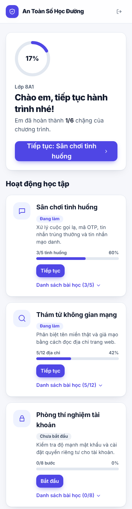
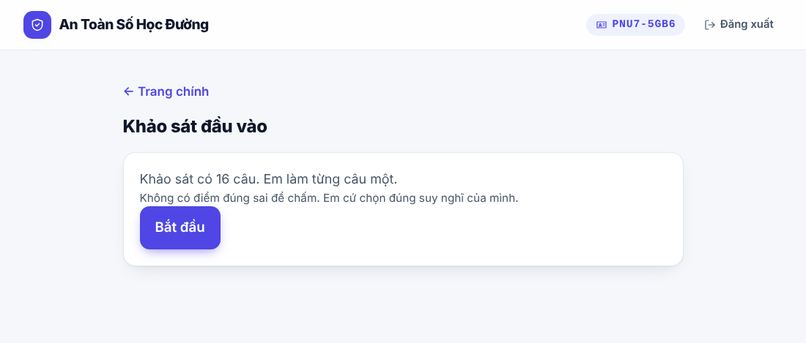
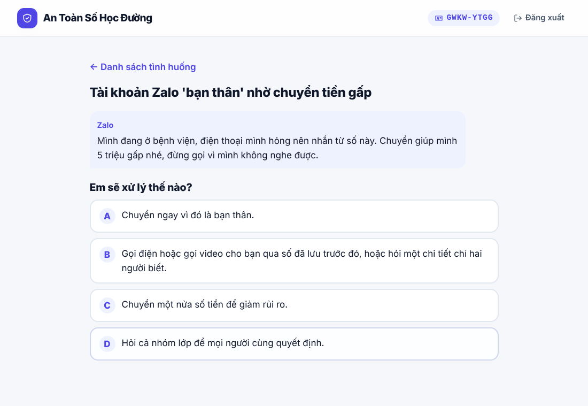
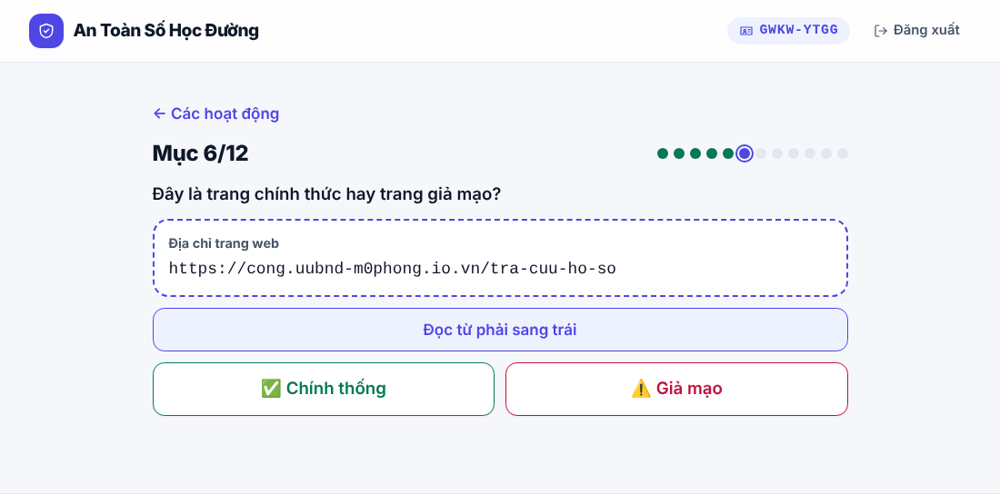
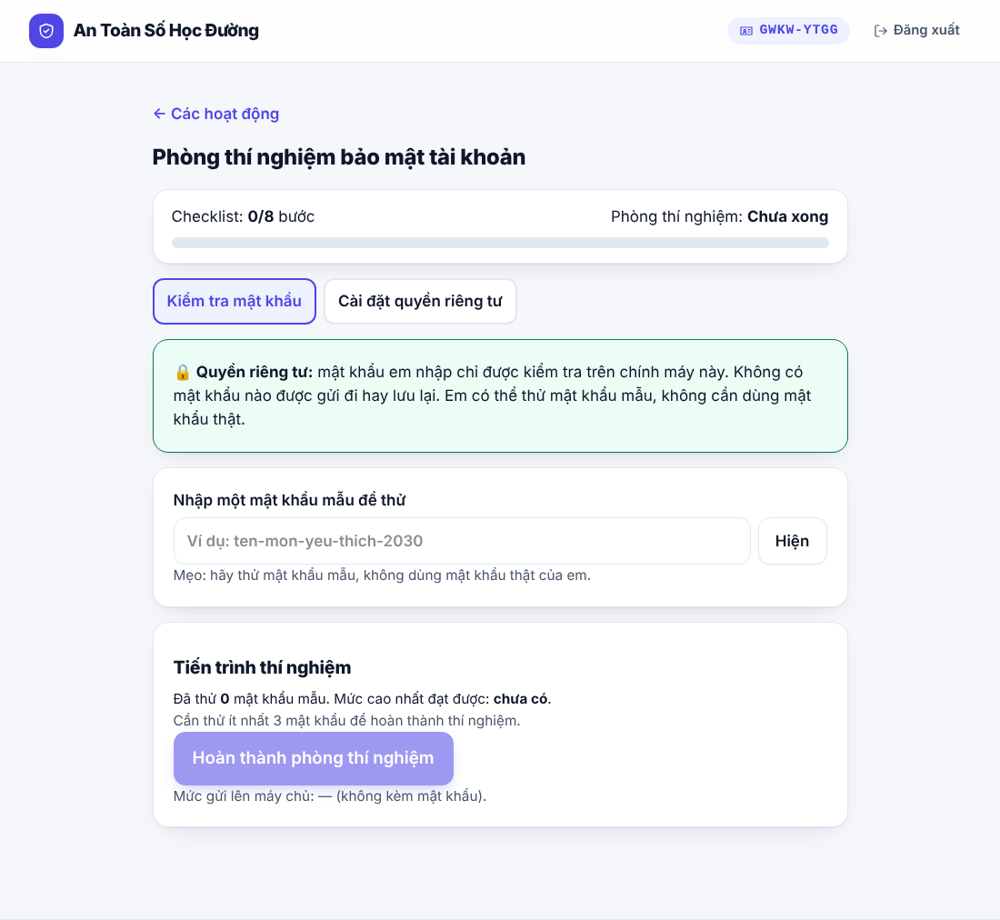
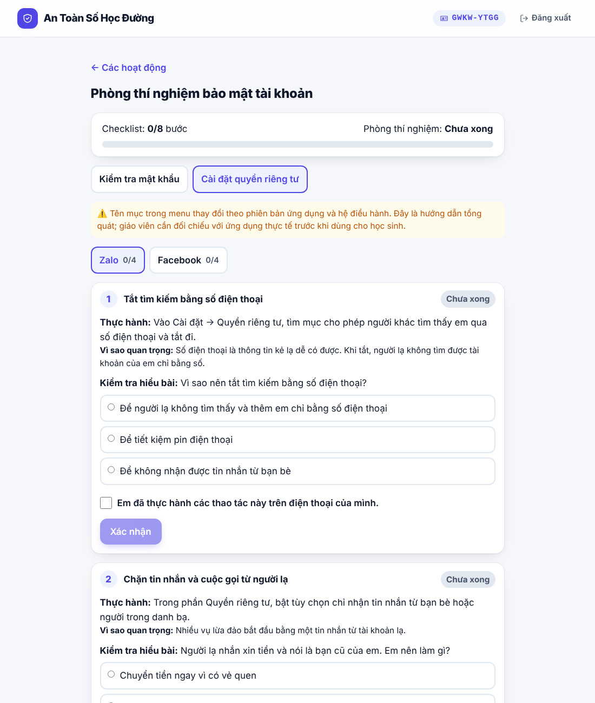
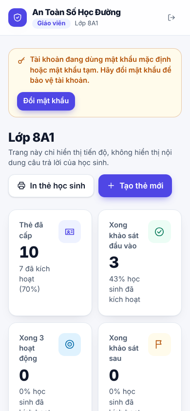
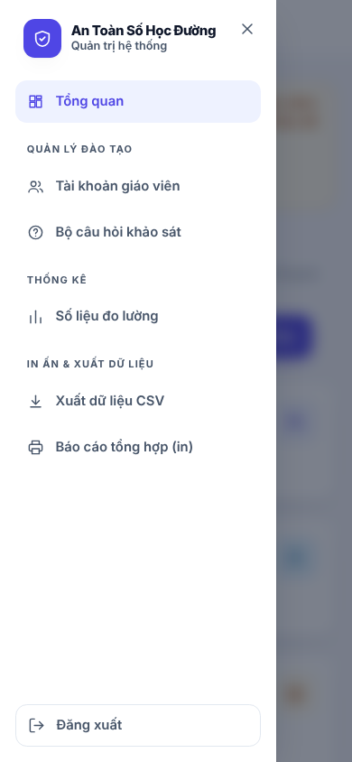

# Hướng dẫn sử dụng theo vai trò

Tài liệu mô tả cách dùng "An Toàn Số Học Đường" theo ba vai trò: **học sinh**, **giáo viên hướng dẫn** và **nhóm kỹ thuật/nghiên cứu**. Với mỗi vai trò có mục riêng về **cách đăng nhập**.

Bảng tóm tắt cách đăng nhập:

| Vai trò | Đăng nhập bằng gì | Đăng nhập ở đâu | Có tài khoản không |
|---|---|---|---|
| Học sinh | Mã học sinh `XXXX-XXXX` in trên thẻ, sau khi kích hoạt thẻ | Trang chủ ứng dụng | Không có tài khoản; có thẻ mã |
| Giáo viên | Tên đăng nhập và mật khẩu do nhóm kỹ thuật cấp | Trang chủ ứng dụng, mục "Giáo viên đăng nhập" | Có tài khoản |
| Nhóm kỹ thuật | Đăng nhập vào máy chủ (Terminal hoặc phpMyAdmin); không đăng nhập vào ứng dụng | Máy chủ hosting | Tài khoản hosting và CSDL |

> **Về các hình minh họa.** Mọi ảnh trong tài liệu được chụp trên bản chạy thử với **dữ liệu mẫu rất nhỏ** (một lớp mẫu, vài thẻ mẫu). Các con số trong ảnh chỉ để minh họa giao diện, không phải kết quả nghiên cứu. Mã thẻ trong ảnh là mã mẫu.

Nguyên tắc chung: học sinh không tự tạo mã. Nhóm kỹ thuật in thẻ mã (mỗi thẻ là một mã ngẫu nhiên, không ghi tên), giáo viên nhận và phát thẻ, học sinh kích hoạt thẻ.

---

## 1. Học sinh

Phần này mô tả trải nghiệm của học sinh theo đúng giao diện của ứng dụng. Mọi nhãn nút và tiêu đề trong phần này là chữ hiển thị trên màn hình.

### 1.1. Kích hoạt thẻ mã (lần đầu)

1. Nhận thẻ mã từ giáo viên. Thẻ có lớp, mã `XXXX-XXXX` và một mã QR.
2. Mở ứng dụng. Trang đầu có khối **Bắt đầu** với hai nút: **Em có thẻ mã từ giáo viên** và **Em đã kích hoạt, đăng nhập**.
3. Bấm **Em có thẻ mã từ giáo viên**. Màn hình **Kích hoạt thẻ mã** hiện ra, kèm khối thông tin về dữ liệu được thu thập và không thu thập.
4. Nhập mã trên thẻ vào ô **Mã trên thẻ**.
5. Tích ô **Em đã đọc và đồng ý tham gia nghiên cứu.** Nút **Kích hoạt và bắt đầu** chỉ bật khi đã nhập mã và tích ô này.
6. Bấm **Kích hoạt và bắt đầu**. Ứng dụng đưa học sinh đến bảng học tập (mục 1.3).

**Cách nhanh bằng mã QR.** Thay cho bước 2 đến 4, học sinh có thể dùng camera điện thoại quét mã QR trên thẻ. Ứng dụng mở thẳng màn **Kích hoạt thẻ mã** với mã đã được điền sẵn và dòng xác nhận *Đã nhận mã từ thẻ của em*. Học sinh vẫn phải đọc thông tin và tích ô đồng ý (bước 5) trước khi kích hoạt.

Mỗi thẻ chỉ kích hoạt được một lần. Nếu thẻ không dùng được, học sinh báo giáo viên.
{width=80%}

{width=80%}


### 1.2. Đăng nhập lại

1. Trên trang đầu, bấm **Em đã kích hoạt, đăng nhập**.
2. Nhập mã trên thẻ vào ô **Mã học sinh**. Ứng dụng không phân biệt chữ hoa, chữ thường, và bỏ qua dấu gạch nối.
3. Bấm **Đăng nhập**.

Phiên đăng nhập có hiệu lực 24 giờ. Khi hết hạn, ứng dụng yêu cầu nhập lại mã. Thanh đầu trang hiển thị mã của học sinh và nút **Đăng xuất** (trên điện thoại chỉ còn biểu tượng đăng xuất).

### 1.3. Bảng học tập

Sau khi đăng nhập, học sinh vào **bảng học tập**. Bảng được chia thành các khối:

- **Khối tiến độ (đầu trang).** Vòng phần trăm cho biết em đã hoàn thành bao nhiêu trên sáu chặng của chương trình (khảo sát đầu vào, ba hoạt động, khảo sát sau can thiệp, khảo sát theo dõi). Nút lớn bên phải dẫn thẳng tới việc nên làm tiếp theo.
- **Hoạt động học tập.** Ba thẻ: *Sân chơi tình huống*, *Thám tử không gian mạng* và *Phòng thí nghiệm tài khoản*. Mỗi thẻ có thanh tiến độ (số tình huống, địa chỉ hoặc bước đã làm), nhãn trạng thái và nút **Bắt đầu**, **Tiếp tục** hoặc **Ôn lại**. Mục **Danh sách bài học** mở ra các bài nhỏ trong hoạt động đó, đã làm hay chưa. Khi chưa làm khảo sát đầu vào, ba thẻ bị khóa và có khối nhắc kèm nút dẫn đến khảo sát.
- **Thông báo.** Các nhắc việc suy ra từ tình trạng khảo sát, ví dụ khảo sát sau can thiệp đã mở, hoặc ngày khảo sát theo dõi sẽ mở.
- **Hành trình của em.** Danh sách sáu chặng theo thứ tự, đánh dấu chặng đã xong, chặng đang sẵn sàng và chặng chưa mở.
- **Kết quả của em.** Số tình huống chọn an toàn ngay lần đầu, độ chính xác khi đọc tên miền, số bước bảo mật đã đạt và thử thách mật khẩu.

Điều kiện mở các khảo sát: đầu vào mở ngay sau khi đăng nhập; sau can thiệp mở khi đã xong khảo sát đầu vào và cả ba hoạt động; theo dõi mở khi đã xong khảo sát sau can thiệp và qua 28 ngày. Trên điện thoại, các khối xếp thành một cột.

{width=80%}

{width=80%}

{width=38%}

### 1.4. Khảo sát (đầu vào, sau can thiệp, theo dõi)

Màn hình khảo sát ghi số câu của phiên bản hiện hành. Bản chuẩn của đề tài có 16 câu. Học sinh làm từng câu một, tiêu đề mỗi câu ghi *Câu x/n*. Bấm **Bắt đầu** để vào câu đầu tiên, hoặc **Tiếp tục** nếu đã làm dở.

Khảo sát không cho biết đúng hay sai. Học sinh chọn đáp án của mình và chuyển sang câu tiếp theo. Câu kiến thức có từ hai đến bốn lựa chọn, tùy câu. Câu hành vi có thang bốn mức.

{width=70%}

### 1.5. Sân chơi tình huống

Hoạt động gồm năm tình huống: cuộc gọi tự xưng công an, nhân viên ngân hàng cần mã OTP, tin nhắn trúng thưởng có đường link, tài khoản Zalo "người thân" nhờ chuyển tiền gấp, và đường link thanh toán dịch vụ công giả. Màn hình đầu hiển thị **Đã trả lời x/5 tình huống** và **Đúng ngay lần đầu**, kèm thanh tiến trình. Mỗi tình huống có trạng thái **Chưa làm**, **Đúng ✓** hoặc **Đã làm**.

Học sinh đọc tình huống trong khung hội thoại, chọn cách xử lý và bấm xác nhận. Ứng dụng cho biết đúng hay chưa đúng, kèm giải thích. Nếu chưa đúng, học sinh bấm **Chọn lại** để thử lại. Bấm **Bắt đầu chơi** lần đầu, hoặc **Tiếp tục chơi** khi đã có tiến trình.

{width=70%}

### 1.6. Thám tử không gian mạng

Hoạt động gồm 12 địa chỉ web. Mỗi lượt, học sinh chọn **✅ Chính thống** hoặc **⚠️ Giả mạo** cho địa chỉ hiện ra. Mỗi địa chỉ chỉ phân loại một lần. Màn hình đầu nêu quy tắc và hai tên gốc chính thức cần nhớ.

Khi chưa chắc, học sinh bấm **Đọc từ phải sang trái** để xem cách tách tên miền: nhìn phần cuối (đuôi miền), đọc ngược sang trái để tìm phần gốc, rồi so với danh sách tên gốc chính thức. Kết quả hiển thị **Chính xác!** hoặc **Chưa đúng, xem cách đọc nhé**.

{width=70%}

### 1.7. Phòng thí nghiệm tài khoản

Hoạt động có thanh **Checklist** ghi số bước đã hoàn thành trên tổng số tám bước, và nhãn **Phòng thí nghiệm** cho biết tình trạng chung. Hoạt động có hai tab.

**Tab Kiểm tra mật khẩu.** Học sinh nhập một **mật khẩu mẫu** vào ô có gợi ý dạng ví dụ, không nhập mật khẩu thật. Nút **Hiện** cho phép xem nội dung đang gõ. Màn hình hiển thị số mật khẩu mẫu đã thử và mức cao nhất đạt được. Cần thử ít nhất ba mật khẩu mẫu trước khi nút **Hoàn thành phòng thí nghiệm** được bật. Khung xanh ghi rõ mật khẩu chỉ được kiểm tra trên máy này, không được gửi lên máy chủ, và dòng cuối ghi **Mức gửi lên máy chủ: — (không kèm mật khẩu)**.

{width=70%}

**Tab Cài đặt quyền riêng tư.** Có hai thẻ theo nền tảng: **Zalo** và **Facebook**, mỗi nền tảng bốn bước. Mỗi bước gồm ba mục:

- **Thực hành:** thao tác cần làm trên điện thoại của học sinh.
- **Vì sao quan trọng:** lý do ngắn gọn.
- **Kiểm tra hiểu bài:** câu hỏi nhiều lựa chọn.

Để hoàn thành bước, học sinh chọn đáp án, tích ô **Em đã thực hành các thao tác này trên điện thoại của mình**, rồi bấm **Xác nhận**. Nếu sai, bấm **Chọn lại**. Thẻ nền tảng hiển thị số bước đã xong, ví dụ *Zalo 0/4*.

{width=70%}

### 1.8. Điều học sinh cần nhớ

- Không nhập mật khẩu thật vào ứng dụng.
- Không đọc mã OTP hay mã xác thực cho bất kỳ ai.
- Giữ thẻ mã. Nếu làm mất thẻ, báo giáo viên để được cấp thẻ mới; tiến độ được giữ nguyên khi giáo viên đối chiếu được sổ phát thẻ.
- Tham gia là tự nguyện. Học sinh có thể dừng bất cứ lúc nào, và báo giáo viên nếu muốn rút khỏi nghiên cứu.

---

## 2. Giáo viên hướng dẫn

### 2.1. Cách đăng nhập

Giáo viên có tài khoản do nhóm kỹ thuật cấp, gồm **tên đăng nhập** và **mật khẩu**. Tài khoản chỉ xem được tiến độ của lớp được gán.

1. Mở ứng dụng trên trình duyệt, ở trang chủ.
2. Ở khối **Dành cho giáo viên**, bấm **Giáo viên đăng nhập**.
3. Nhập tên đăng nhập và mật khẩu, rồi bấm **Đăng nhập**.
4. Trang lớp hiện ra. Khi xong, bấm **Đăng xuất** ở góc trên bên phải.

**Lần đầu đăng nhập bằng mật khẩu tạm:** ở đầu trang hiện khối **"Tài khoản đang dùng mật khẩu mặc định hoặc mật khẩu tạm"**. Bấm **Đổi mật khẩu**, nhập mật khẩu hiện tại và mật khẩu mới (10 ký tự trở lên, có cả chữ và số, khác mật khẩu cũ), rồi bấm **Lưu mật khẩu mới**. Có thể bỏ qua và đổi sau, nhưng nên đổi ngay.

Lưu ý:
- Phiên đăng nhập giữ **8 giờ**. Hết hạn thì đăng nhập lại.
- Nếu quên mật khẩu, liên hệ nhóm kỹ thuật để được đặt lại. Không chia sẻ tài khoản cho người khác.
- Tên đăng nhập và mật khẩu không được gửi qua tin nhắn công khai hay lưu trong ảnh chụp màn hình.

### 2.2. Tạo thẻ mới cho học sinh

Chọn đúng thao tác theo tình huống. Điều quan trọng nhất là **không tạo thẻ mới cho học sinh đã có tiến độ**, vì sẽ làm mất tiến độ cũ.

| Tình huống | Thao tác | Tiến độ |
|---|---|---|
| Học sinh mới của lớp, chưa có thẻ | Tạo thẻ mới (mục dưới) | Bắt đầu từ đầu |
| Thẻ đã phát nhưng chưa ai kích hoạt | Tạo thẻ mới; bỏ thẻ cũ | Bắt đầu từ đầu |
| Học sinh **đã kích hoạt**, làm mất hoặc quên mã | **Cấp thẻ mới** trên danh sách lớp (cần đối chiếu sổ phát thẻ) | **Giữ nguyên** |
| Học sinh đã kích hoạt, quên mã và không có sổ phát thẻ | Không tìm lại được mã cũ. Tạo thẻ mới | Mất tiến độ cũ |

1. Đăng nhập (mục 2.1), bấm **Tạo thẻ mới** ở đầu trang lớp và nhập số thẻ (từ 1 đến 20 mỗi lần).
2. Bấm **Tạo thẻ**. Danh sách mã hiện ra. Bấm **In các thẻ này** để in ngay thẻ học sinh (xem phần *In thẻ học sinh* bên dưới).
3. Phát thẻ cho học sinh và ghi vào sổ phát thẻ riêng (thẻ nào cho ai).

{width=70%}

Lưu ý:
- Thẻ mới **không** kế thừa tiến độ cũ. Với học sinh đã kích hoạt, dùng **Cấp thẻ mới** trên danh sách lớp thay vì tạo thẻ mới.
- Mỗi lớp có tổng số thẻ tối đa, do nhóm kỹ thuật đặt (mặc định 300). Khi vượt giới hạn, ứng dụng báo và giáo viên liên hệ nhóm kỹ thuật.
- Thẻ do giáo viên tạo được ghi nhận là do tài khoản của giáo viên tạo, để có trách nhiệm đối với việc phát thẻ.

**Cấp thẻ mới cho học sinh đã có tiến độ (làm mất thẻ):**

1. Mở sổ phát thẻ, tìm mã đã phát cho học sinh đó. Đây là bước bắt buộc: danh sách lớp chỉ hiển thị mã, không hiển thị tên.
2. Trong danh sách lớp, tìm đúng mã đó (đối chiếu số lượng câu đã làm với học sinh), rồi bấm **Cấp thẻ mới**.
3. Trong khối xác nhận hiện ra dưới tên học sinh, **tích ô "Tôi đã đối chiếu mã cũ với sổ phát thẻ"**, rồi bấm **Xác nhận cấp thẻ mới**. Nút này chỉ bật khi đã tích ô.
4. Mã mới hiện ra; in và phát cho học sinh.
5. Ghi vào sổ: mã cũ, mã mới, học sinh nào, ngày nào.

Mỗi lần cấp lại được hệ thống ghi nhật ký (người thực hiện, mã cũ, mã mới, thời điểm, việc đã xác nhận đối chiếu) để truy vết trách nhiệm. Nhật ký này chỉ dùng nội bộ, không nằm trong tệp xuất nghiên cứu. Yêu cầu không tích ô xác nhận sẽ bị từ chối và mã không đổi.

{width=70%}

Mã cũ mất hiệu lực ngay. Học sinh đăng nhập lại bằng mã mới và tiếp tục từ chỗ đã dừng. Chỉ cấp lại được cho học sinh của lớp mình.

**In thẻ học sinh.** Ở trang lớp có nút **In thẻ học sinh** (hoặc **In n thẻ đã chọn** khi đã tích chọn ở cột đầu của danh sách). Mỗi dòng cũng có nút **In thẻ** riêng. Trang xem trước hiển thị các thẻ đúng kích thước thật (85,6 × 54 mm), 10 thẻ mỗi trang A4. Bấm **In / Lưu PDF** để mở hộp thoại in của trình duyệt; chọn **Lưu dưới dạng PDF** nếu muốn lưu tệp thay vì in giấy.

Mỗi thẻ gồm tên dự án, lớp, mã kích hoạt và một mã QR. Thẻ **không** có họ tên hay ảnh học sinh, vì dự án giữ ẩn danh; danh tính chỉ nằm trong sổ phát thẻ của giáo viên. Quét mã QR bằng điện thoại sẽ mở ứng dụng và điền sẵn mã vào màn **Kích hoạt thẻ mã**; học sinh vẫn phải đọc thông tin và tích đồng ý. Mã QR chứa chính mã thẻ nên cần giữ kín thẻ như giữ mật khẩu.

{width=80%}

### 2.3. Trước khi học sinh tham gia

1. Thống nhất với nhà trường và phụ huynh về việc triển khai nghiên cứu.
2. Đề nghị nhóm kỹ thuật tạo lớp, in lô thẻ đầu tiên và cấp tài khoản giáo viên. Sau đó giáo viên có thể tự tạo thẻ mới cho lớp (mục 2.2).
3. Nhận thẻ và tài khoản. Chuẩn bị phòng máy hoặc điện thoại có kết nối mạng ổn định.

### 2.4. Trong giờ học

1. Phát thẻ cho học sinh. **Ghi lại thẻ nào phát cho học sinh nào trong sổ riêng của giáo viên**, không ghi vào bất kỳ tệp nào của hệ thống. Sổ này là thông tin nhạy cảm và phải được bảo quản riêng.
2. Hướng dẫn học sinh kích hoạt thẻ (mục 1.1) và làm theo trình tự (mục 1.3).
3. Nhắc học sinh giữ thẻ cẩn thận.

### 2.5. Theo dõi tiến độ

Sau khi đăng nhập, đầu trang lớp có bốn chỉ số: số thẻ đã cấp (và tỉ lệ đã kích hoạt), số học sinh xong khảo sát đầu vào, xong cả ba hoạt động và xong khảo sát sau can thiệp. Có ô tìm theo mã thẻ và bộ lọc *Tất cả*, *Đã kích hoạt*, *Chưa kích hoạt*. Trên máy tính, danh sách là một bảng; trên điện thoại, mỗi học sinh là một thẻ. Danh sách hiển thị cho mỗi học sinh:
- **Trạng thái:** đã kích hoạt hay chưa. Thẻ chưa kích hoạt chỉ hiển thị mã.
- **Khảo sát đầu vào, hậu kiểm, theo dõi:** số câu đã làm trên tổng 16.
- **Sân chơi tình huống, thám tử tên miền, checklist:** số mục đã hoàn thành, và đã đạt phòng thí nghiệm hay chưa.

Dùng danh sách này để nhắc những học sinh còn thiếu. Khi khảo sát theo dõi mở, nhắc học sinh làm vì hệ thống chưa tự nhắc.

Danh sách chỉ hiển thị số lượng và trạng thái. Giáo viên không xem được câu trả lời, đáp án hay nội dung học sinh nhập.

{width=80%}

{width=38%}

### 2.6. Điều giáo viên không làm

- Không yêu cầu học sinh nhập họ tên, email, số điện thoại hay mật khẩu thật vào ứng dụng.
- Không chia sẻ thẻ mã, mã học sinh hay tài khoản giáo viên.
- Không tạo thẻ vượt nhu cầu thực tế của lớp; không tự đổi lớp hay mật khẩu (việc này do nhóm kỹ thuật thực hiện).
- Không cố gắng xem câu trả lời của học sinh; giao diện không hiển thị chúng.
- Không tự sửa dữ liệu trong cơ sở dữ liệu.

---

## 3. Nhóm kỹ thuật và nghiên cứu

### 3.1. Cách làm việc và đăng nhập

Nhóm kỹ thuật có hai cách làm việc:

- **Trang quản trị trên ứng dụng.** Quản trị viên đăng nhập bằng cổng **Giáo viên đăng nhập** bằng tài khoản có vai trò quản trị. Sau khi đăng nhập, trang quản trị hiện ra với thanh menu bên trái chia theo nhóm chức năng (mục 3.8). Quản trị viên không gắn lớp và không xem được tiến độ của lớp nào.
- **Dòng lệnh trên máy chủ.** Dùng cho các việc hệ thống: tạo lớp, in lô thẻ, nạp lược đồ, xuất dữ liệu. Cần Terminal của hosting, hoặc chạy trên máy cá nhân khi phát triển cục bộ. Các lệnh chạy từ thư mục gốc của dự án (hoặc `public_html` trên hosting), ví dụ `php api/bin/add_class.php`.
- **Đường HTTP có token quản trị (chỉ để xuất dữ liệu).** Gửi yêu cầu có header `X-Admin-Token` đúng với `ADMIN_TOKEN` trong `api/.env`. Nếu `ADMIN_TOKEN` để trống, chức năng này bị tắt.

Quản lý tài khoản hosting và CSDL do nhóm giữ trong bảng điều khiển iNET và phpMyAdmin. Không chia sẻ các thông tin này qua kênh công khai.

### 3.2. Quyền quản trị của nhóm kỹ thuật

Nhóm kỹ thuật có **toàn quyền** đối với tài khoản giáo viên và thẻ mã:

| Việc | Lệnh (chạy trên máy chủ, từ thư mục gốc) |
|---|---|
| Tạo lớp | `php api/bin/add_class.php <MÃ_LỚP> "<Tên lớp>" "<Tên cơ sở>"` |
| In lô thẻ | `php api/bin/issue_cards.php <MÃ_LỚP> <SỐ_THẺ> <tệp.csv>` |
| Xem danh sách giáo viên | `php api/bin/manage_teacher.php list` |
| Thêm tài khoản giáo viên | `php api/bin/manage_teacher.php create <tên> <MÃ_LỚP>` |
| Khôi phục mật khẩu giáo viên | `php api/bin/manage_teacher.php reset <tên>` |
| Cấp thẻ mới cho học sinh đã có tiến độ (làm mất thẻ) | `php api/bin/reissue_card.php <MÃ_CŨ> --da-doi-chieu-so` (cờ bắt buộc: xác nhận đã đối chiếu sổ phát thẻ) |
| Sửa lớp của giáo viên | `php api/bin/manage_teacher.php move <tên> <MÃ_LỚP>` |
| Khóa tài khoản (không xóa dữ liệu) | `php api/bin/manage_teacher.php disable <tên>` |
| Khôi phục tài khoản đã khóa | `php api/bin/manage_teacher.php enable <tên>` |
| Xóa hẳn tài khoản | `php api/bin/manage_teacher.php delete <tên>` |

Mật khẩu mới (khi tạo hoặc đặt lại) được in ra **một lần**. Ghi lại và trao cho giáo viên qua kênh trực tiếp.

Phân biệt hai thao tác dễ nhầm:
- **Khóa (disable)** là tạm dừng: tài khoản không đăng nhập được, dữ liệu và thẻ giữ nguyên, có thể mở lại bằng `enable`.
- **Xóa (delete)** là xóa hẳn tài khoản. Thẻ đã phát vẫn giữ nguyên; chỉ bỏ liên kết với người tạo.

Mọi thao tác khóa, chuyển lớp, đặt lại mật khẩu hoặc xóa đều thu hồi các phiên đăng nhập đang mở của giáo viên đó.

Sau khi tạo lớp và tài khoản, in lô thẻ đầu tiên:

```bash
php api/bin/issue_cards.php <MÃ_LỚP> <SỐ_THẺ> <tệp.csv>
```

Tệp CSV chứa mã thẻ. In ra, trao cho giáo viên, rồi **xóa tệp khỏi máy chủ**. Ghi vào sổ phát thẻ: thẻ nào đã phát, cho lớp nào, ngày nào.

### 3.3. Cấu hình liên quan đến thẻ và giáo viên

| Biến trong `api/.env` | Ý nghĩa | Khuyến nghị |
|---|---|---|
| `APP_URL` | Địa chỉ ứng dụng (chống CSRF) | Đúng địa chỉ thực tế |
| `ADMIN_TOKEN` | Khóa xuất dữ liệu qua HTTP | Chuỗi ngẫu nhiên dài; để trống nếu không cần |
| `DELAYED_MIN_DAYS` | Số ngày trước khảo sát theo dõi | 28 theo đề cương |
| `CLASS_CARD_LIMIT` | Tổng số thẻ tối đa mỗi lớp (kể cả thẻ giáo viên tự tạo) | 300 hoặc theo sĩ số lớp cộng dự phòng |

### 3.4. Xem tiến độ và hỗ trợ

- Tiến độ chi tiết của từng học sinh là thông tin của giáo viên. Quản trị viên xem **số liệu tổng hợp** (thẻ đã phát, đã kích hoạt, xong từng khảo sát, theo lớp và theo thời gian) ở trang quản trị (mục 3.8), không có mã thẻ hay câu trả lời riêng lẻ. Khi cần kiểm tra sâu hơn, truy vấn CSDL theo mục 3.6.
- Học sinh làm mất thẻ đã kích hoạt: giáo viên đối chiếu sổ phát thẻ rồi tự cấp thẻ mới (mục 2.2). Nếu giáo viên không còn sổ, nhóm kỹ thuật **không tìm được** mã cũ vì hệ thống không lưu tên; khi đó học sinh phải bắt đầu với thẻ mới.
- Nhóm kỹ thuật có thể cấp lại bằng dòng lệnh, nhưng phải có cờ `--da-doi-chieu-so` (mục 3.3). Lệnh này chỉ dùng khi giáo viên không thể thao tác trên ứng dụng và đã đối chiếu sổ.
- **Xem nhật ký cấp lại thẻ** (chỉ nhóm kỹ thuật, qua CSDL): mỗi lần cấp lại có một dòng trong bảng `audit_log`. Truy vấn mẫu:

  ```sql
  SELECT created_at, actor_type, actor_id, old_code, new_code, ledger_confirmed
  FROM audit_log WHERE action = 'reissue_card' ORDER BY created_at DESC LIMIT 50;
  ```

  `actor_type = teacher` kèm `actor_id` là mã tài khoản giáo viên (bảng `teachers`); `actor_type = technical` và `actor_id` trống là nhóm kỹ thuật. Bảng này chỉ dùng để truy vết trách nhiệm, không đưa vào phân tích nghiên cứu.

### 3.5. Xuất dữ liệu nghiên cứu

Hai tệp CSV theo `docs/CODEBOOK_NGHIEN_CUU.md`. Chỉ có học sinh đã kích hoạt được đưa vào tệp.

**Hai loại mã tách biệt.** Mỗi học sinh có:

| Mã | Dạng | Dùng để | Có trong tệp CSV? |
|---|---|---|---|
| **Mã thẻ** (`participants.code`) | `XXXX-XXXX` | Kích hoạt và **đăng nhập**; in trên thẻ; giáo viên biết | **Không bao giờ** |
| **Mã định danh nghiên cứu** (`participants.research_id`) | `R` + 9 ký tự, ví dụ `R7K2MQX9HB` | Nhận diện học sinh trong dữ liệu nghiên cứu | Có, ở cột `pseudonym` |

Mã nghiên cứu được sinh ngẫu nhiên khi phát thẻ, **độc lập với mã thẻ** (không suy ra được mã này từ mã kia) và **không đăng nhập được**. Mã giữ nguyên khi học sinh được cấp lại thẻ nên dữ liệu các giai đoạn vẫn nối được. Vì vậy người cầm tệp CSV không thể đăng nhập thay học sinh. Tệp vẫn có mã lớp và thời điểm trả lời; với lớp nhỏ, cần cẩn trọng khi công bố.

Nối ngược một mã nghiên cứu với mã thẻ chỉ làm được bằng truy vấn trực tiếp vào CSDL (bảng `participants`) và không có trên giao diện. Chỉ làm khi thật cần, có phê duyệt, và ghi nhật ký.

```bash
php api/bin/export_assessments.php wide antoanso_wide.csv
php api/bin/export_assessments.php long antoanso_long.csv
```

Hoặc qua HTTP (cần `ADMIN_TOKEN`):

```bash
curl -H "X-Admin-Token: <token>" -o antoanso_wide.csv https://<tên-miền>/api/admin/export/wide.csv
```

**Nâng cấp CSDL đã có.** Chạy `php api/bin/migrate.php` trên CSDL cũ sẽ tự thêm cột `research_id` và cấp mã cho các học sinh hiện có; không cần tạo lại CSDL, chạy lại nhiều lần vẫn an toàn.

### 3.6. Bảo mật và đạo đức dữ liệu

- Dữ liệu nghiên cứu không chứa họ tên, email, số điện thoại, mật khẩu, **mã thẻ đăng nhập** hay thời điểm đồng ý. Học sinh chỉ được nhận diện bằng mã định danh nghiên cứu (mục 3.5).
- **Ranh giới ẩn danh:** giáo viên phát thẻ trực tiếp nên có thể biết thẻ nào thuộc học sinh nào. Ẩn danh đúng với nhóm nghiên cứu và tệp xuất, không đúng với giáo viên. Điều này phải được nêu trong phiếu đồng ý.
- **Quyền truy cập CSDL:** nhóm kỹ thuật có quyền đọc cơ sở dữ liệu, nên về mặt kỹ thuật có thể xem câu trả lời của học sinh. Chỉ truy cập khi cần cho bảo trì, kiểm tra kỹ thuật hoặc phân tích đã được phê duyệt. Ghi nhật ký mọi truy vấn trực tiếp vào CSDL, và không sao chép dữ liệu thô ra ngoài.
- Không công bố kết quả theo lớp khi lớp có dưới 5 học sinh.
- Bảo quản riêng: sổ phát thẻ, tệp CSV chứa mã thẻ, `api/.env`, `ADMIN_TOKEN`, mật khẩu giáo viên.
- Sao lưu CSDL định kỳ.

### 3.7. Giới hạn đã biết

- Đăng nhập học sinh và giáo viên chưa có giới hạn số lần thử sai.
- Trang quản trị chưa có màn hình xem nhật ký `audit_log`; cần truy vấn trực tiếp. Việc in thẻ và tạo lớp vẫn dùng dòng lệnh.
- Chưa có cơ chế nhắc khảo sát theo dõi.
- Mật khẩu tạm chỉ được nhắc đổi, chưa bị chặn. Đây là chủ ý cho bản chạy cục bộ; trên hosting, cần bổ sung chặn trước khi triển khai rộng.

### 3.8. Trang quản trị

Quản trị viên đăng nhập bằng cổng **Giáo viên đăng nhập** trên trang đầu, với tài khoản có vai trò quản trị. Trang quản trị có thanh menu bên trái (trên điện thoại là nút menu ở góc trái, mở ra ngăn kéo), chia thành các nhóm:

| Nhóm | Mục | Nội dung |
|---|---|---|
| (đầu menu) | **Tổng quan** | Chỉ số chính và biểu đồ |
| Quản lý đào tạo | **Tài khoản giáo viên** | Thêm, cấp mật khẩu mới, khóa hoặc mở khóa tài khoản |
| Quản lý đào tạo | **Bộ câu hỏi khảo sát** | Xem, thêm, sửa, xóa câu hỏi |
| Thống kê | **Số liệu đo lường** | Bảng số liệu chi tiết |
| In ấn & Xuất dữ liệu | **Xuất dữ liệu CSV** | Tải hai tệp CSV |
| In ấn & Xuất dữ liệu | **Báo cáo tổng hợp (in)** | Báo cáo A4 để in hoặc lưu PDF |

Quản trị viên không gắn lớp, nên không xem được tiến độ chi tiết của lớp nào. Nếu tài khoản còn dùng mật khẩu mặc định hoặc mật khẩu tạm, khối nhắc **Đổi mật khẩu** hiển thị ở đầu trang; có thể đổi ngay hoặc đổi sau.

**Tổng quan.** Bốn thẻ chỉ số: số thẻ đã phát (kèm tỉ lệ kích hoạt), số giáo viên đang hoạt động, số lớp tham gia và tỉ lệ xong khảo sát sau can thiệp.

Khối **Số học sinh theo thời gian** vẽ biểu đồ từ dữ liệu thật của máy chủ (điểm cuối `GET /api/admin/analytics/timeline`). Có hai lựa chọn: khoảng thời gian (**30 ngày**, **90 ngày** theo ngày, hoặc **12 tháng** theo tháng) và kiểu hiển thị. Kiểu **Tích lũy** vẽ năm đường: đã phát thẻ, đã kích hoạt, xong đầu vào, xong sau can thiệp, xong theo dõi. Kiểu **Phát sinh mới** vẽ cột số thẻ phát ra, số kích hoạt mới và số khảo sát vừa hoàn thành trong từng kỳ. Mỗi sự kiện được tính vào thời điểm xảy ra (múi giờ máy chủ); một khảo sát được tính là xong khi học sinh trả lời đủ mọi câu, vào thời điểm trả lời câu cuối. Dữ liệu chỉ gồm số đếm, không có mã thẻ hay câu trả lời.

Bên dưới là các biểu đồ chụp nhanh: tiến trình theo chặng nghiên cứu (từ phát thẻ đến xong khảo sát theo dõi), tỉ lệ kích hoạt thẻ, điểm kiến thức trung bình theo giai đoạn, tiến độ theo lớp và tỉ lệ đúng theo nhóm chủ đề. Ô có dưới năm học sinh không được vẽ.
{width=80%}

{width=38%}

**Tài khoản giáo viên.** Gồm biểu mẫu **Thêm tài khoản** (tên đăng nhập, vai trò, mã lớp) và danh sách tài khoản kèm nút **Cấp mật khẩu mới** và **Khóa** (hoặc **Mở khóa**). Mọi thao tác đều có hộp thoại xác nhận. Mật khẩu mới chỉ hiện một lần.
{width=80%}

**Bộ câu hỏi khảo sát.** Hiển thị bộ câu hỏi hiện hành, tách theo kiến thức và hành vi. Mỗi câu có nút **Sửa** và **Xóa**, và có nút **Thêm câu hỏi**. Đáp án đúng chỉ quản trị viên thấy. Mỗi lần thay đổi tạo một phiên bản mới; học sinh đã làm dở giữ phiên bản cũ.
{width=80%}

**Số liệu đo lường.** Các bảng: tiến độ theo lớp (kèm dòng tổng và tỉ lệ), so sánh trước và sau can thiệp (số cặp, chênh lệch trung bình, trung vị), hành vi tự báo cáo (trung bình và độ lệch chuẩn, thang 1 đến 4, đã điều chỉnh câu đảo chiều) và kiến thức theo nhóm chủ đề m1 (sân chơi tình huống), m2 (thám tử tên miền), m3 (phòng thí nghiệm tài khoản). Giai đoạn theo dõi chỉ mở sau 28 ngày kể từ khi xong khảo sát sau can thiệp. Ô có dưới năm học sinh hiển thị **ẩn** (như trong ảnh).
{width=80%}

**Xuất dữ liệu CSV.** Hai tệp: *CSV dạng long* (một dòng mỗi câu trả lời) và *CSV dạng wide* (một dòng mỗi học sinh). Nút tải dùng chính phiên đăng nhập của quản trị viên, không cần nhập token hay gõ lệnh. Tệp **không có họ tên và không có mã thẻ đăng nhập**: học sinh được nhận diện bằng mã định danh nghiên cứu ngẫu nhiên ở cột `pseudonym` (mục 3.5), kèm mã lớp.
{width=75%}

**Báo cáo tổng hợp (in).** Mở bản xem trước báo cáo A4 gồm chỉ số chính, tiến độ theo lớp, điểm theo giai đoạn và tỉ lệ đúng theo chủ đề; bấm **In / Lưu PDF** để in hoặc lưu tệp. Báo cáo chỉ gồm số tổng hợp.
{width=75%}

Quy tắc công bố: ô có dưới năm học sinh được hiển thị là **ẩn** cùng số cỡ mẫu, để không lộ danh tính. Các số trên trang này là mô tả. Kiểm định thống kê được thực hiện riêng theo kế hoạch phân tích của báo cáo.
