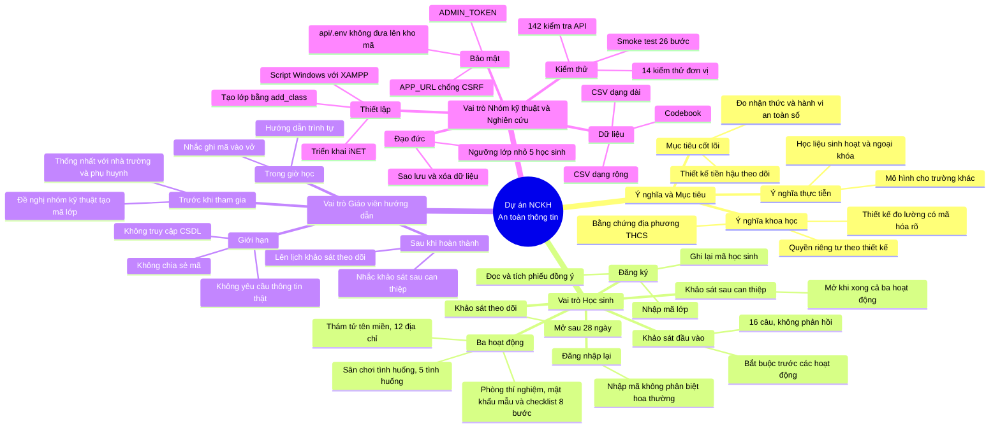

# Phân tích dự án NCKH "An Toàn Số Học Đường"

Tài liệu tổng hợp mục tiêu, ý nghĩa, nghiệp vụ theo vai trò và giới hạn của dự án. Các nhận định được phân loại: **[Thực nghiệm]** là kết quả đã kiểm chứng bằng chạy mã hoặc kiểm thử; **[Đọc mã]** là suy ra từ mã nguồn và tài liệu; **[Suy luận]** là diễn giải cần kiểm chứng thêm.

## 1. Mục tiêu và ý nghĩa

### 1.1. Mục tiêu cốt lõi

Đo lường mức độ thay đổi **nhận thức** và **hành vi** an toàn thông tin của học sinh THCS sau can thiệp bằng ba hoạt động tương tác, theo thiết kế tiền–hậu–theo dõi (pre-test, post-test, delayed test) **[Đọc mã]**.

Ba hoạt động:
- **Sân chơi tình huống:** xử lý cuộc gọi giả mạo, yêu cầu đọc OTP, tin nhắn trúng thưởng, tài khoản mạo danh, trang thanh toán giả.
- **Thám tử không gian mạng:** phân biệt tên miền chính thống và giả mạo bằng quy tắc đọc từ phải sang trái.
- **Phòng thí nghiệm tài khoản:** đánh giá mật khẩu cục bộ trên trình duyệt và checklist quyền riêng tư cho Zalo và Facebook.

### 1.2. Ý nghĩa khoa học

- **Bằng chứng địa phương:** dự án cung cấp dữ liệu về hiệu quả can thiệp ngắn hạn trên một nhóm học sinh cụ thể (40–100 học sinh, 1–2 lớp, theo đề cương đã duyệt) **[Đọc mã: đề cương và codebook]**. Kết quả có giá trị thăm dò, chưa đủ khái quát hóa.
- **Thiết kế đo lường có cấu trúc:** tách biến nhận thức (câu có đáp án đúng/sai) và biến hành vi (tự báo cáo, có đảo chiều), có thời gian phản hồi, và có mã hóa dữ liệu rõ ràng (codebook) **[Đọc mã]**.
- **Bảo vệ quyền riêng tư theo thiết kế:** không thu họ tên, email, số điện thoại; mật khẩu thử nghiệm không rời trình duyệt; máy chủ từ chối trường mật khẩu **[Thực nghiệm: kiểm thử tích hợp và kiểm tra trình duyệt xác nhận mật khẩu không xuất hiện trong yêu cầu gửi đi]**.
- **Tái sử dụng:** kiến trúc nội dung tách khỏi mã (JSON có phiên bản), bộ câu hỏi và kịch bản có thể thay thế cho lớp học khác **[Đọc mã]**.

### 1.3. Ý nghĩa thực tiễn

- Cung cấp học liệu có thể dùng trong giờ sinh hoạt hoặc ngoại khóa, với các tình huống bám sát hình thức lừa đảo phổ biến. Mức độ phổ biến của từng hình thức cần bổ sung nguồn thống kê **[Cần bổ sung nguồn]**.
- Có thể dùng làm mô hình cho các trường khác cùng cấp **[Suy luận]**.

### 1.4. Nguồn gốc kỹ thuật

Dự án kế thừa cấu trúc frontend React + Vite và backend PHP + PDO MySQL từ "Sơn Trà Số". Lớp bảo mật `Security.php` được giữ lại và sửa lỗi so khớp chuỗi. Các thành phần không kế thừa gồm đăng nhập Google, đăng nhập học viên bằng mã không mật khẩu, và dữ liệu tin tức dự phòng, vì báo cáo phân tích đã xác định đây là các điểm yếu thiết kế **[Đọc mã: docs/BAO_CAO_PHAN_TICH_SON_TRA_SO.md của repo gốc]**.

## 2. Nghiệp vụ theo vai trò

### 2.1. Học sinh

**Bước 1: Đăng ký bằng mã lớp**
1. Mở ứng dụng, chọn "Em chưa có mã học sinh".
2. Kích hoạt thẻ mã do giáo viên phát (nhập mã trên thẻ và đồng ý tham gia).
3. Đọc phiếu đồng ý (thu thập gì, không thu gì, quyền rút lui, cách dùng kết quả).
4. Tích đồng ý, bấm "Tạo mã và bắt đầu". Nút chỉ bật khi đã có mã lớp và đã tích đồng ý.
5. Hệ thống hiện mã học sinh dạng `XXXX-XXXX`. Học sinh ghi lại mã; mã không chứa tên.

**Bước 2: Đăng nhập lại**
- Chọn "Em đã có mã, đăng nhập", nhập mã (không phân biệt hoa thường, có hoặc không có dấu gạch).
- Đăng nhập trên thiết bị mới làm vô hiệu phiên cũ.

**Bước 3: Khảo sát đầu vào (pre-test)**
- 16 câu: 10 câu kiến thức có đáp án, 6 câu hành vi thang 4 mức.
- Làm từng câu, không có phản hồi đúng/sai, có thể dừng và tiếp tục.
- Bắt buộc hoàn thành trước khi vào bất kỳ hoạt động nào (API trả 403 nếu chưa làm).

**Bước 4: Ba hoạt động**
- **Sân chơi tình huống:** 5 tình huống. Có phản hồi đúng/sai ngay, có giải thích, được chọn lại khi sai. Ghi nhận mọi lần thử, điểm nghiên cứu lấy lần đầu.
- **Thám tử không gian mạng:** 12 địa chỉ web, mỗi địa chỉ phân loại một lần. Có gợi ý "Đọc từ phải sang trái" (ghi nhận có dùng hay không). Các nút đáp án đổi vị trí theo học sinh và mục để tránh thiên lệch vị trí.
- **Phòng thí nghiệm tài khoản:** hai phần. Phần kiểm tra mật khẩu yêu cầu thử ít nhất 3 mật khẩu mẫu, máy chủ chỉ nhận mức cao nhất (yếu, trung bình, mạnh). Phần checklist có 8 bước cho Zalo và Facebook, mỗi bước có câu kiểm tra và xác nhận đã thực hành trên điện thoại.

**Bước 5: Khảo sát sau can thiệp (post-test)**
- Mở khi đã hoàn thành pre-test và cả ba hoạt động.
- Cùng bộ 16 câu với pre-test.

**Bước 6: Khảo sát theo dõi (delayed test)**
- Mở sau 28 ngày (cấu hình được) kể từ khi hoàn thành post-test.
- Màn hình hiển thị ngày mở dự kiến.

### 2.2. Giáo viên hướng dẫn

**Trước khi học sinh tham gia**
- Thống nhất với nhà trường về việc thực hiện nghiên cứu. Phụ huynh đồng ý theo phiếu.
- Đề nghị nhóm kỹ thuật tạo mã lớp.
- Chuẩn bị thiết bị và kết nối mạng.

**Trong giờ học**
- Hướng dẫn trình tự: khảo sát đầu vào trước, sau đó các hoạt động.
- Nhắc học sinh ghi mã vào vở, không ghi trên giấy có tên.
- Với học sinh quên mã, báo nhóm kỹ thuật; không tự tìm mã trong dữ liệu.

**Sau khi học sinh hoàn thành**
- Nhắc học sinh làm khảo sát sau can thiệp khi đủ điều kiện.
- Lên lịch nhắc khảo sát theo dõi sau 4 tuần. Hệ thống chưa tự nhắc.

**Những việc giáo viên không làm**
- Không yêu cầu học sinh nhập mật khẩu thật, số điện thoại, email vào ứng dụng.
- Không chia sẻ mã học sinh hoặc mã lớp ra ngoài nhóm nghiên cứu.
- Không truy cập hoặc sửa dữ liệu trong cơ sở dữ liệu. Giáo viên có tài khoản riêng để xem tiến độ lớp mình, không xem câu trả lời và không có quyền quản trị.

### 2.3. Nhóm kỹ thuật và nghiên cứu

**Thiết lập và chạy**
- Cài đặt cục bộ: `docs/CHAY_CUC_BO.md`, có script tự động cho Windows với XAMPP (`scripts/setup-windows.bat`).
- Triển khai hosting: `docs/TRIEN_KHAI_INET.md`.
- Tạo lớp học: `php api/bin/add_class.php`.

**Cấu hình bảo mật và vận hành**
- `api/.env` chứa thông tin CSDL và `ADMIN_TOKEN`; tệp này được loại khỏi kho mã.
- `ADMIN_TOKEN` để trống thì tắt chức năng xuất qua HTTP.
- `APP_URL` phải khớp địa chỉ thực tế để chống CSRF.

**Xuất dữ liệu nghiên cứu**
- Dạng rộng (một dòng mỗi học sinh) cho phân tích lặp đo, dạng dài (một dòng mỗi lần trả lời) cho phân tích từng câu.
- Xuất bằng dòng lệnh (`php api/bin/export_assessments.php`) hoặc HTTP (`/api/admin/export/*.csv`, header `X-Admin-Token`).
- Dữ liệu chỉ có mã định danh nghiên cứu (ngẫu nhiên, tách biệt với mã thẻ đăng nhập) và mã lớp. Mã hóa cột và cách tính biến nằm trong `docs/CODEBOOK_NGHIEN_CUU.md`.

**Bảo mật và đạo đức dữ liệu**
- Không công bố kết quả theo lớp khi dưới 5 học sinh. Điều này được khuyến nghị trong codebook nhưng **chưa được thực thi trong mã** [Thực nghiệm: không có kiểm tra ngưỡng trong AssessmentExportService].
- Sao lưu định kỳ, lưu bản sao ngoài máy chủ.
- Xóa dữ liệu khi kết thúc theo phiếu đồng ý.

**Kiểm thử**
- Tích hợp API: 142 kiểm tra đạt (lần xác nhận gần nhất).
- Đơn vị bộ đánh giá mật khẩu: 14/14 đạt.
- Smoke test luồng học sinh: 26/26 đạt, gồm xuất CSV có token.

## 3. Giới hạn và rủi ro

| Mục | Mô tả | Mức độ |
|---|---|---|
| Hiệu ứng luyện tập | Pre, post, delayed dùng cùng một bộ câu hỏi | Cao |
| Tính hợp lệ của câu hỏi | Chưa có thẩm định chuyên gia hay thử nghiệm thí điểm | Cao |
| Câu hành vi | Tự báo cáo, có thể sai lệch do mong muốn xã hội | Trung bình |
| Không có giao diện giáo viên | Quản lý lớp và xuất dữ liệu cần nhóm kỹ thuật | Trung bình |
| Không tự nhắc khảo sát theo dõi | Phụ thuộc giáo viên | Trung bình |
| Chưa kiểm tra ngưỡng lớp nhỏ | Nguy cơ suy luận lại danh tính khi công bố | Trung bình |
| Nội dung Zalo và Facebook | Tên mục menu có thể khác phiên bản, chưa kiểm chứng trên ứng dụng thật | Trung bình |
| MariaDB 10.4 | Đã chạy được trên máy người dùng nhưng bộ kiểm thử gốc chạy trên 10.11 | Thấp |
| Chưa kiểm thử trên hosting thật | Chưa chạy smoke test trên iNET | Cao trước khi triển khai |
| Câu tham khảo | Các tài liệu học thuật cần bổ sung và xác minh theo APA 7 | Trung bình |

## 4. Sơ đồ tư duy

